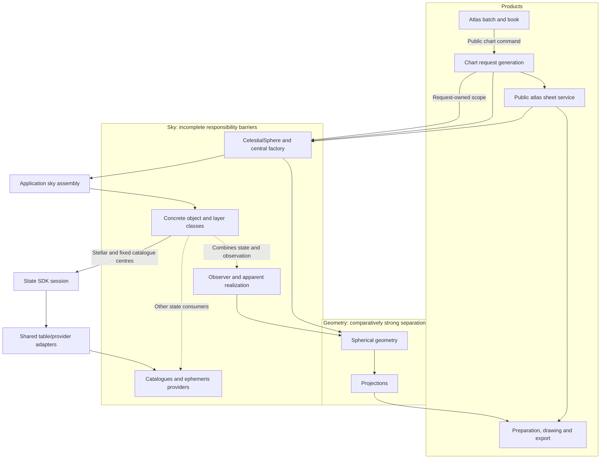
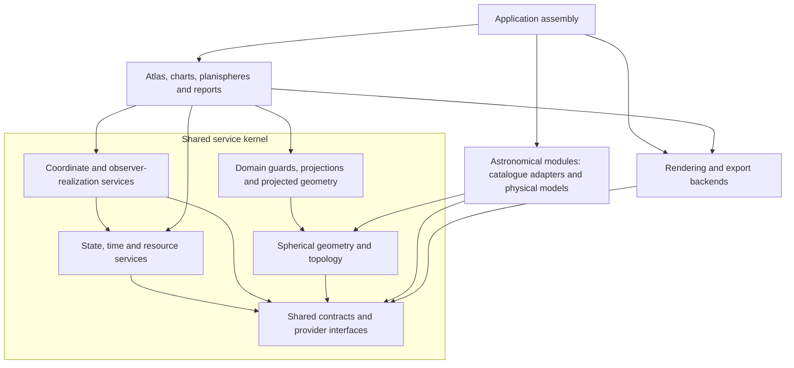

# Roadmap to v0.9.5: a frozen kernel and loadable astronomical packages

**Plan revision:** 92, 2026-10-23. **Status:** PR #332 is merged; Fernando confirmed clean synchronized Mac main `5971acb9`, merged-branch cleanup and 36 documentation tests in 3.55 s. The previously selected next slice is bounded offline Hipparcos-2 standard five-parameter covariance qualification. Plan below precedes implementation. No propagation/provider uncertainty admission or source mutation is selected.
**Frozen functional baseline:** main `6708f54a0d8984c0be348b2c8cb02b311646a02b`.
Its Git tree is identical to `ea8dc505`, which passed 3,606 plugin-disabled Mac
tests in 1,136.74 s and 16 configuration-overlay tests in 4.03 s.

`v0.9.5` is a provisional release label requested for this work. The archived
[earlier coordinate target with that name](archive/pre_kernel_20261017/docs/developer/target_architecture_v0.9.5.md)
describes already accepted 49B/49C work; it does not implement this kernel.
Confirm the new release name against existing tags before creating a release.
No tag or package-version change is made here. The baseline is pinned by its
immutable commit and the [cleanup ledger](documentation_cleanup_v1.json).

## Product review correction PR.03: finite constellation segments

Fernando requested the regional-chart correction on 2026-10-21 after reviewing
the six-product acceptance outputs, then explicitly said "Please fix the code."
The bounded correction clips explicitly declared finite constellation segments
to the shared spherical projection cap before their planar chords can wrap
across a regional viewport. Preserve wholly interior endpoints, source HIP
topology, metadata, observer/native routing and style independence. Keep sampled
curves, grids, polygons and other projections compatible; no cluster sizing,
coordinate-label placement, source bytes, acquisition, Gaia or new science.
Acceptance: synthetic far-side/crossing/interior/rotated-frame regression cases,
existing constellation/projection/geometry and kernel gates, plus Mac replot
of the reported Sco/Lib/Sgr/Oph field. All six product specimens were subsequently accepted by Fernando; colours,
formats, symbol sizes and coordinate-label placement remain deferred. This is a
bounded functional/visual checkpoint, not final K9 publication acceptance.

## Release objective

Refactor existing Wenu functionality into kernel plus astronomical modules while
preserving its accepted behaviour and appearance. Gaia DR3 and the shared
proper-motion/parallax work are agreed scientific additions; they are identified
separately below rather than used to enlarge baseline migration implicitly.
No object expansion or morphology evolution is included.

This is the single authoritative roadmap. The detailed ledger below expands the
already documented scope in the [functionality audit](kernel_migration_audit_v1.md#current-functionality-ledger)
and [source/test inventory](kernel_migration_inventory_v1.json); it does not add
new scientific features. As-built APIs remain in the
[implementation reference](implementation_reference.md), scientific limits in
[scientific contracts](scientific_contracts.md), and verification in
[testing policy](testing_policy.md). Their roles do not replace user agreement.

## Current position and next-item selection

**Accepted baseline:** main `d447565d12c3405eab462fac268c441f5a4b2bd4`.
K4a.01 is accepted through PR #315 after 35 focused cases/nine subtests,
36 documentation and eight tooling Mac cases. Clean synchronized main and
branch cleanup are confirmed. Fernando selected K4a.02 with “Proceed”.
K3.40 was accepted through PR #313 after 25 consumer-reconciliation, 36
documentation and eight tooling Mac cases. PR #314 corrected finite constellation
segments; 205 kernel, 180 focused and 36 documentation Mac cases passed, and
Fernando confirmed the regional replot fixed the problem. Branch cleanup and
clean synchronized main are confirmed.

| Track | Position |
|---|---|
| Baseline migration | K0 complete; K1 initial contracts/K2 foundation and bounded K3.01–K3.40 routes accepted; final reconciliation remains K5 |
| Gaia | Published primary/supplemental identities, input capture, local source and coverage accepted; external redistribution review remains deferred |
| Shared positional extension | AX.01–AX.12 accepted; AX.14 full-input stellar subset accepted through K4b.01; reduced/other pending scopes remain separate |
| Freeze/extraction/release | K5–K9 pending |
| Current bounded result | K4b.05 no-light-time comparison passed full Mac gates at 5da8220f in PR #330: 334 focused/nine subtests, 125 audit, 36 documentation, eight tooling/81 subtests, and 133 actual cached directions across 16 HIPs; accepted solution digests unchanged |
| Next bounded submilestone | K4b.05 conditional Gaia report accepted at 652087cb with complete Mac gates, cache report and percentile/star review. Merge/cleanup, then bounded Hip2 covariance qualification selected; exact plan before implementation. Production uncertainty admission and K4b.06 remain separate |

Reduced-input models (AX.13) are agreed capability scope, but their placement as
the immediate next task was an agent sequencing decision, not a separate user
agreement. This revision removes that automatic next-step designation. Continuing
remaining K3 migration and continuing the positional extension are distinct
choices. K3.07 baseline migration was subsequently proposed explicitly and selected by Fernando. AX.13 now has an accepted measured-PM slice, while its remaining scopes stay pending.

The architecture documentation is accepted through PR #280, main
`abb68d9127068f9cc9ace6db8be0a8132a9f22ba`; 36 Mac documentation tests
passed at `a5f6c00f`. Fernando confirmed clean synchronized main and branch
cleanup. This documentation merge adds no runtime acceptance.

## K4b.05: Hipparcos-2 standard covariance qualification

Fernando selected this next qualification with “Proceed” after the Gaia
report review, followed by confirmed clean synchronized Mac main `5971acb9`
and PR #332 branch cleanup. As-is: complete 276-byte Hip2 records and UW/error
fields are already preserved in the immutable source. The accepted offline
audit owns source diagnostics; its test file and report staging owner remain
the correct boundaries. The Gaia covariance/report implementations stay intact.

Primary CDS layout and Michalik et al. (2014), Appendix B, clarify that CDS UW
values require diagonal scaling using quoted formal errors and the unit-weight
error recovered from Ntr/F2. Verify the published-error covariance convention
separately from the paper's catalogue-combination weighting policy; do not
blindly invert raw UW or apply Gaia error/correlation construction to Hip2.

Add an explicit maintenance-only qualification mode reading the existing
manifest-bound source, with a small declarative corrected-CDS layout/reference
resource (not an acquisition-profile change). Qualify only Sn modulo 10 = 5;
retain double/photocentre/secondary flags without identity veto. Decode Ntr/F2
from preserved original bytes, validate units/edition, packing/scaling,
invert via triangular solve, and report numerical residuals, conditioning and
diagonal agreement with quoted errors. Decimal quantization is disclosed;
diagonal ratios remain diagnostics, not a new empirical acceptance threshold
or silently forced agreement. All retained HIPs and source gaps remain explicit.
Report fallback applicability separately from all-standard-row qualification.

No additional catalogue/annex acquisition, source/snapshot/provider/SDK mutation,
Hip2 positional-error propagation, full RV covariance, physical lookback/domain
certificate, epoch-scale resolution, renderer/default change or package.
Issue #326, nonstandard solution marginalization and K4b.05 parent remain open.

Acceptance: existing gaia-crossmatch-audit owner plus documentation/tooling;
synthetic non-unit scaling, column-wise packed order, off-diagonal preservation,
formal-versus-combination convention, invalid/singular/unknown-edition/unit and
nonstandard-solution refusals, independent covariance reconstruction and
shared report/CLI source-identity/no-clobber seams. Closest existing tests:
`test_uncertainty_covariance_marginal_singular_and_small_negative`,
`test_uncertainty_snapshot_cli_offline_lineage_and_no_clobber` and
`test_enrichment_round_trip_immutable_values_and_fallback`.
Deliberate packing/scaling faults must fail nearest tests before restoration.
The existing corrected raw Hip2 bytes may be checked read-only locally with
exact provenance; actual combined-source/fallback counts remain a separate
Mac report. Commit this plan before adding the decoder.

## K4b.05: offline Gaia uncertainty and missing-RV sensitivity report

Selected by Fernando's “Proceed” after PR #331 merge and confirmed clean
synchronized Mac main `9395ad21`, branch cleanup and 36 documentation tests.
The existing assessment and actual field inventory are prerequisites now met.

Extend the existing `tools/gaia_crossmatch_audit.py` maintenance owner with an
explicit report mode reading the validated immutable enrichment snapshot only.
Bind the source manifest, Gaia reference/units, report policy and elapsed TCB
Julian-year offsets. Preserve every HIP and explicit missing/invalid status.
Reconstruct and check the full five-parameter Gaia covariance (31 and 95);
the latter uses its marginal astrometric covariance, not fixed pseudocolour.
Check finite nonnegative errors, correlation ranges and positive semidefiniteness
with a stated floating-point tolerance; disclose singular/ill-conditioned input
without clipping, jitter or invented covariance.

First report the four-parameter marginal propagated through the existing
normalized angular model, using the normal-triad differential convention and
a target tangent plane. Give one-standard-deviation principal axes and matrix,
conditional on this reduced model; no total-error or confidence bound.
Report perspective sensitivity per km/s separately using positive source parallax
and an explicitly labelled hypothetical zero-RV anchor. This is a derivative,
not an assumed missing measurement, RV prior, finite interval bound or an adopted
motion model. Unknown distance remains unknown. Full six-dimensional
RV-independent covariance and Hip2 UW reconstruction are deferred; neither is
needed to qualify this first angular measurement report.

Keep all numerical report code outside production providers/SDK; no native
solution/source mutation, acquisition, dependencies, renderer/default changes,
ESA reproduction or physical accuracy/domain certificate. Output is a separate
versioned no-clobber report with hashes and completion manifest, never another
source snapshot. Reuse existing source verification and publication patterns.

Acceptance: existing gaia-crossmatch-audit gate plus documentation/tooling;
add tests in its current owner for diagonal/correlated/singular/indefinite/
missing inputs, source/units/refusal, epoch zero and both signs, pole/wrap,
analytic versus independently perturbed tangent-triad finite differences and
seeded small-error Monte Carlo, RV derivative versus finite scenarios,
publication/no-clobber/failure cleanup and unchanged source bytes. Existing
source-admission tests remain intact. The closest existing tests are
`test_enrichment_round_trip_immutable_values_and_fallback`,
`test_main_real_ecsv_to_report_offline` and
`test_publish_no_clobber_and_failure_cleanup`; the new checks protect
covariance/RA-convention/Jacobian errors and false missing-RV certainty.
The [candidate implementation](implementation_reference.md#offline-gaia-conditional-uncertainty-report)
passed Mac acceptance at `652087cb`: 158 audit cases (4.57 s), 36 documentation
(3.31 s), eight tooling/81 subtests (10.38 s). The actual cache report retains all
118,218 HIPs and evaluates 115,105 positive-definite Gaia matrices at seven
offsets. At +/-10,000 years the median formal major-axis sigma is 0.2573 arcsec,
90th percentile 0.9872 arcsec and maximum 16.92 arcsec; these remain conditional
measurement statistics. The audit records source/code hashes, selected-star
results and gaps. Local fixtures remain explicitly synthetic. K4b.05 parent, Hip2 native
epoch issue #326 and later consumer adoption remain open.

## K4b.05: ancient-position uncertainty and missing-RV assessment

Fernando selected this bounded assessment with “Proceed” on 2026-10-23 after
PR #330 merge and confirmed clean synchronized Mac main/branch cleanup at
`fde11d83`. First inspect the existing immutable-source fields, error/correlation/
Hip2 UW encoding and actual model/uncertainty contracts, together with primary
Gaia/Hip2/propagation references. Record which conditional measurement covariance
is reconstructible, assumptions required for RV and reduced-input models,
systematics/binary/acceleration limitations, and a concrete bounded next gate
in the existing migration audit. Quantify analytic missing-RV sensitivity using
explicitly synthetic examples or a separately verified local-cache inventory;
do not claim absent real-cache results.

Scope is assessment/documentation, not implementation of covariance propagation,
new source acquisition, invented RV/distance priors, confidence/accuracy-domain
admission, model/SDK/source mutation, default switches or K4b.06 adoption.
Unknown physical and total errors remain unknown. A numerical threshold or
formal confidence ellipse cannot silently become a physical upper bound.
Use the documentation gate; any actual cached-field inventory remains a
separate Mac receipt. The plan was committed at `b4a24bb8` before assessment outputs. The
[assessment](kernel_migration_audit_v1.md#k4b05-ancient-position-uncertainty-and-missing-rv-assessment-2026-10-23)
now records existing-schema limits, conditional covariance/unknown-RV distinctions,
synthetic analytic sensitivity examples and an offline-report proposal. Fernando's
actual Mac receipt at `82405290` passed 36 documentation cases in 3.61 s;
115,105 Gaia angular inputs pass error/correlation field checks and 2,682 of
2,850 Hip2 fallback inputs have standard suffix-5 solutions and the required
fields. The audit records the full inventory and limits: no PSD/inversion or
propagated uncertainty has been verified. Assessment accepted for merge/cleanup;
no new covariance/sensitivity runtime selected. K4b.05 parent, ESA comparisons
and issue #326 remain separate.

## K4b.05: no-light-time numerical comparison

Selected by Fernando's “Proceed” on 2026-10-23 after PR #329 Mac acceptance,
merge and confirmed clean synchronized main/branch cleanup at `439b8a67`.
The existing audit supplies the reference and as-is assessment.

Bounded scope: extend the existing `tests/test_stellar_state.py` owner with a
test-only spherical-form implementation of Butkevich & Lindegren (2014),
Sect. 5.5, Eqs. (83)–(84), using angular departure/bearing rather than the
production SI affine-vector construction. Check actual SDK returned directions
from full Gaia, measured-PM Gaia angular and Hip2 fallback admissions at native
source epoch and elapsed +/-100, +/-1,000 and +/-10,000 Julian years, including
oblique/pole/wrap, high motion, both RV signs, radial-only and zero-PM cases.
Matched native TCB inputs only; no relabelling of physical events.

Protect adapter unit/PM convention and perspective-term errors with an external
mathematical oracle, plus demonstrated fault injection. Reuse existing exact
arithmetic/conformance/domain/refusal/cold tests; do not duplicate the core or
add a production oracle/service. Verify uncertainty/source/model identities
remain unchanged. A bounded Mac cached-source comparison should report actual
sample input availability, residuals and unchanged solution digests; source gaps
remain gaps. Select principal Orion and seven Big Dipper HIP identities from
existing source/topology evidence, with high-motion stress cases, without new
acquisition or invented missing RV/distance. This is mathematical validation,
not a reproduction of ESA's unavailable numerical inputs or physical ancient
accuracy. No enlarged production domain or new science is implied.

Acceptance: existing stellar-motion-provider gate (unchanged selections), source
audit, documentation/tooling and bounded actual Mac cached-source evidence.
Production code, dependency/SDK/source bytes/model identities, covariance and
light-time policy, observer/precession/renderer/default consumers remain unchanged.
Update existing roadmap/audit/testing-policy owners only as needed. The plan was committed at `932bab69` before test implementation. The
[test/reference result](kernel_migration_audit_v1.md#k4b05-no-light-time-reference-implementation-2026-10-23)
records 23 new cases (147 synthetic directions and two demonstrated faults)
and 456 combined local passes/nine subtests. Complete Mac acceptance at
`5da8220ff821680f7c133acaa191f6aaffa9e82a` passed 334 focused cases/nine subtests,
125 source-audit, 36 documentation and eight tooling cases/81 subtests without
exclusions. The 16-HIP cache sample passed 133 directions at seven native relative
epochs; maximum chord difference `8.959779580913775e-16`, with unchanged accepted
solution digests. This closes the bounded mathematical-comparison slice only:
physical/covariance/dynamical qualification, numerical ESA reproduction,
K4b.05 parent/K4b.06/issue #326 remain open. PR #330 remains unmerged.

## K4b.05: reference assessment and ESA constellation comparison plan

Fernando requested “Please add the ESA work comparison to the roadmap” on
2026-10-23, after discussion of existing constellation reconstructions.
This adds comparison criteria to pending K4b.05. Fernando subsequently selected
its bounded reference/method assessment with “Proceed”: review the published ESA
products and Butkevich & Lindegren (2014) against actual Wenu source/test owners,
record recoverable inputs and missing evidence, and propose the smallest numerical
and qualitative comparison gate. Use the existing migration audit for findings.
Acceptance is documentation integrity and source-backed assessment; no runtime
implementation, catalogue acquisition, physical-model change or K4b.06 chart
adoption is selected. The plan was committed at `80d4d423` before findings. The [reference assessment](kernel_migration_audit_v1.md#k4b05-reference-and-method-assessment-2026-10-23) now records the no-light-time mathematical-reference recommendation, ESA evidence/gaps and a proposed bounded comparison gate. No numerical comparison or implementation is claimed.

Start with these published ESA products (reference discovery checked 2026-10-23):

- [The future of the Orion constellation](https://www.esa.int/Science_Exploration/Space_Science/Gaia/The_future_of_the_Orion_constellation)
  (2017): a 40 by 20 degree field evolved over 450,000 years, using Gaia
  DR1/TGAS, Hipparcos for bright stars and additional ground-based information.
  ESA explicitly excludes stellar birth and death from the animation.
- [Hipparcos stereo images: Ursa Major](https://www.cosmos.esa.int/web/hipparcos/stereo-images):
  three-dimensional views and a future extrapolation based on Hipparcos proper
  motions. The indexed ESA description was available, but direct page retrieval
  was blocked during discovery; search retrieval subsequently recovered a +60,000-year Ursa Major description,
  preliminary 30-month source provenance and enhanced stereo geometry. Exact
  reference epoch, per-star values and algorithms remain unverified. See the
  assessment; this is not a recovered numerical dataset.

Before implementation, establish for each product the identifiable stars/HIP
keys, catalogue editions and input values, epochs and time conventions,
propagation assumptions (including distance, radial velocity and light time),
frame/origin, projection/viewpoint and availability/licensing of numerical data
or source code. Record unavailable details explicitly. Published future cases
test the same propagation machinery, but are not ancient observational evidence;
past-epoch comparisons require a documented past reconstruction or an explicitly
labelled new calculation.

Comparison acceptance, once a bounded implementation is separately selected:

1. Reproduce documented ESA epochs and the same star identities and conventions
   wherever recoverable. Separate reproduction with the original published inputs
   from a calculation using Wenu's newer Gaia/Hip2 inputs; explain catalogue,
   missing-input and model differences.
2. Compare numerical directions when reference coordinates or a documented
   reproducible algorithm are available. Use images/video only for qualitative
   constellation-shape checks when their precision or projection is insufficient
   for a numerical angular test. Do not invent reference coordinates, tolerances
   or an executed comparison.
3. Compare pairwise angular separations as well as directions when possible:
   constellation deformation must be distinguished from common frame rotation
   and projection changes. Keep native stellar motion separate from the accepted
   long-term mean-frame orientation.
4. Report implementation discrepancies, measurement uncertainty and physical-model
   limitations separately. Agreement with an ESA extrapolation is external
   comparison evidence, not an independent measurement of ancient positions or
   a physical-accuracy certificate. Shared catalogue inputs/models limit
   independence; binaries, missing RV/distance and unmodelled acceleration remain
   explicit.
5. Keep the mathematical propagation-reference review and uncertainty assessment
   in K4b.05 alongside these constellation cases. The proposed Butkevich &
   Lindegren (2014) reference still requires a convention/model review; this
   roadmap addition does not adopt its full model or add light-time physics.

This is documentation-only scope: no source capture, new numerical model,
dependency, SDK, provider, renderer or default consumer changes. The acceptance
gate for this plan change is documentation integrity; actual ESA reconstruction
comparisons remain pending.

## K4b.04: long-term frame orientation

Fernando selected this step with “Proceed” on 2026-10-23 after the proposal
covering existing precession implementations, model/domain/accuracy limits,
independent ancient/future checks, and separation from stellar motion and
historical horizon reconstruction. Base: clean synchronized Mac main
`e2a231b5220c3df3670d383fa0e3ee66addbeeb4`; prior branch cleanup confirmed.

As-is: CoordinateService delegates existing FK4/FK5/ecliptic/observer routes to
Astropy and does not admit a separately named long-term frame model. Existing
astrometric_coordinates owns explicit time/spatial convention receipts, while
SDK state records preserve native ICRS directions. Extend that existing domain
convention owner and test_astrometric_state, with a narrow composed stellar
test in the existing stellar owner. Do not change CoordinateService defaults,
SDK records/pins or propagation/source owners.

Use the corrected Vondrak, Capitaine & Wallace 2011/2012 model via installed
ERFA ltpb/ltecm, not a copied coefficient implementation. Admit a separately
explicit mean equator/equinox or mean ecliptic/equinox orientation, including
ICRS frame bias, with a caller-selected finite TT domain inside J2000 +/-
200000 Julian years. The frame equinox must be an explicitly declared TT
TimePoint; it is independent of each native state’s TCB evaluation epoch.
No TCB-to-TT relabel/conversion or implicit observer epoch is permitted.
Record exact input two-part equinox, rounded backend Julian epoch, backend/
model identity, immutable matrix/pole, domain and convention limits.

SOFA section 7 and ERFA function contracts describe historical accuracy of
a few arcseconds, degrading to tenths of a degree at the remote endpoints.
These qualitative descriptions are not a certified per-epoch upper bound.
Keep physical/date/model and total direction uncertainty unqualified; a request
for a numerical physical-accuracy guarantee must refuse. Retain first-order
frame-bias approximation explicitly. No nutation, polar motion, Earth rotation,
historical EOP/Delta-T, observer translation, aberration or light time.

Expose immutable orientation receipts and an explicit derived direction-batch
view that preserves the original SDK batch/source epoch/evaluation time and
source uncertainty. This does not re-admit or overwrite a native model or
create a Cartesian/velocity transform. Existing chart/geometry consumers remain
on their accepted routes until K4b.06. No acquisition, source change, dependency,
SDK change, new module or automatic model switch is selected.

Acceptance: published ERFA regression matrices (reference-library conformity,
not independent physical integration), independent pole/equinox triad geometry,
near-modern IAU 2006 comparison, long-domain endpoints/negative years, matrix
handedness/norm/round-trip and Decimal matrix-vector checks; identity/bias/
equinox/domain/refusal and malformed backend checks after success; actual SDK
batch composition preserving source/time/model identities and uncertainty;
native cold paths remain scientific-import-free and orientation evaluation
requires no EOP/network. Use existing stellar/shared-core/cluster and source-
audit gates plus documentation/tooling; complete Mac acceptance separate.
Model physical accuracy remains a qualified limitation, not a newly measured
claim. K4b.05/K4b.06 and issue #326 remain open. This plan was committed at
79ea2b9d before implementation. The explicit frame receipt and derived batch
view are now present in the existing owner. Local checks pass 54 new cases;
combined stellar/shared-core/cluster/source-audit owners pass 433 cases and
nine subtests, with three existing full-application cases retained for the
complete Mac gate. Independent geometry/Decimal/library checks do not certify
physical dynamics. Measured ERFA pmat06/ecm06 comparisons over 1900-2100 reach
about 0.647/0.280 mas; no uniform 100-microarcsecond agreement is promised.
**Mac acceptance, 2026-10-23:** Fernando supplied the complete receipt for
`97921fe83ca97fa6c8be932247a9eb93bf438975`, PR #328. All 311 focused cases and
nine subtests (10.02 s), 125 source-audit (2.23 s), 36 documentation (2.51 s)
and eight tooling cases/81 subtests (8.59 s) passed without exclusions.
The actual immutable snapshot retains 115,105 Gaia and 2,850 Hip2 angular
models; accepted Gaia full/angular and Hip2 angular digests are unchanged.
Forty-eight derived directions over eight frame admissions (two mean axes at
TT Julian epochs -10000, -1000, 2000 and 12000) passed an independent 80-digit
Decimal matrix-application check; maximum vector chord difference is
`1.576213700060856e-16`. Measured modern inter-model differences are about
0.646561 mas equatorial and 0.279190 mas ecliptic. Exact Mac model IDs/poles and
backend versions are retained in the inventory; matrix-bound IDs need not be
bit-identical across platforms with last-bit numerical differences. This is
arithmetic/reference-library evidence, not a physical/total accuracy certificate.
PR #328 is merged at `90e2d1e6d6c5114fa50b607ebcfa3099a8998636`; Fernando confirmed
clean synchronized Mac main, deletion of the merged local/remote branch and
36 documentation cases passing in 3.39 s. No next runtime item selected.
K4b.05/K4b.06 and issue #326 remain separate.

## K4b.03: historical date and time semantics

Fernando selected this bounded step with “Proceed” on 2026-10-23 after the
proposal covering BCE/year zero, Julian versus Gregorian input, conversion to
the model TCB axis, date uncertainty, and ancient native stellar queries without
modern Earth-orientation resources. Base: clean synchronized Mac main
`dc2035daa256a55a566dbdf6949d0dc750bec030`; prior merged branch removed.

As-is assessment: SDK TimePoint already preserves two-part continuous dates,
and TimeService requires explicit directed conversion admissions. Existing
`astrometric_coordinates.py` owns resource-free TDB/TCB convention conversion;
native stellar queries use finite TCB coverage without an observer. There is
no explicit historical calendar/year-numbering/date-uncertainty input record.
Extend this existing time/convention owner and its existing
`test_astrometric_state.py` owner. Do not add a parallel time service or alter
SDK records, numerical propagation, source snapshot, model identities or pins.

Scope: immutable calendar-date input requiring proleptic Gregorian or Julian,
astronomical versus BCE/CE year numbering, declared continuous scale and
explicit known nonnegative source-date uncertainty or unknown. Astronomical
year 0 equals 1 BCE; BCE/CE labels require positive year numbers. Reject invalid
dates, ambiguous labels, leap seconds and implicit local/civil time. Preserve
original labels alongside a normalized two-part TimePoint, bounded calendar
rounding and the exact admitted TimeService conversion receipt to TCB. No
calendar choice guesses a physical time scale. Use existing TDB/TCB conversion
or TCB identity; unsupported TT/TAI-to-TCB requires an independently admitted
adapter and otherwise refuses. Do not invent a historical clock or Delta-T.
Retain input-date uncertainty on its source time scale separately from numerical
rounding/conversion; do not claim a total converted-time or angular uncertainty.

Acceptance: independent published JD/calendar vectors, ERFA Gregorian oracle,
BCE/year-zero and negative-year cycle checks, reform/leap boundaries, subsecond
two-part precision, uncertainty preservation, typed invalid/admission/coverage
refusals after success, and an actual native stellar SDK query at an ancient
calendar epoch with observer/EOP/network/scientific-import access blocked.
Existing focused stellar/shared-core/cluster plus source-audit and documentation/
tooling gates protect unchanged Gaia/Hip2 bindings. No new acquisition,
dependency, SDK/schema, CLI/product/calendar auto-switch, precession, observer,
physical-accuracy claim, or issue #326 resolution. K4b.04–K4b.06 stay separate.
The plan was committed at e0ce8c6f before runtime changes. Implementation
extends the existing convention owner with HistoricalDate, HistoricalEpoch and
resolve_historical_date; the SDK/propagation/source owners remain unchanged.
All 54 new chronology cases pass locally; combined local owners pass 379 cases
and nine subtests, with three unavailable full-application cases retained in
the complete Mac gate.

**Mac acceptance, 2026-10-23:** Fernando supplied the complete receipt for
`ceeb894bc83302d40478540208e1abbc909ed805`, PR #327. All 257 stellar/shared-core/
cluster cases and nine subtests (12.58 s), 125 source-audit (2.58 s), 36
documentation (2.73 s), and eight tooling cases/81 subtests (9.05 s) passed,
without exclusions. The immutable actual snapshot returned 24 sampled states
across 1000 BCE Julian, astronomical year zero Gregorian, year -10000 Gregorian
and 2000 CE Gregorian inputs. Source-date bounds/unknown values were preserved.
All accepted Gaia full/angular and Hip2 angular coefficient digests are unchanged;
115,105 Gaia and 2,850 Hip2 angular models remain available. Maximum independent
80-digit Decimal affine-oracle vector chord difference: `2.486410087150353e-16`.
This checks arithmetic/native event semantics, not physical/historical dating,
observer or precession accuracy. PR #327 is merged at e2a231b5; Mac synchronization and branch cleanup are confirmed. K4b.04 is selected below; K4b.05–K4b.06 and issue #326 remain separate.

## K4b.02: Hipparcos-2 fallback qualification

**Policy agreement before implementation:** Fernando instructed, "So we should
use TCB. If the difference from Hipparcos is small we should not worry too much
and resolved the issue later, and open a ticket about it." He clarified that
1991.5 was a typo: the intended epoch is J1991.25. This explicitly supersedes
the time-scale evidence blocker below. Follow-up
[issue #326](https://github.com/fselman/wenu/issues/326) remains open: verify the
2007 epoch and Julian-year rate convention and quantify any needed conversion.

Use the source-declared J1991.25 value on a nominal TCB model axis, not an
assertion that the original source declared TCB or an actual TT-to-TCB
conversion. Retain its original null time scale, all original row bytes and
unknown convention/source/physical errors. Bind the explicit nominal policy
and follow-up issue into model metadata/resource/provenance. Do not silently
reuse this policy for other sources.

Implementation: extend the existing stellar owner with a separately explicit
Hipparcos-2 angular-fallback admission over finite caller-selected TCB coverage.
Use only matched HIP records with measured position and both PM components
when the accepted Gaia angular input route is unavailable. The source's
position/epoch and pmRA=mu-alpha-star/pmDE supply the already accepted shared
AngularMotionRow and affine engine. This is nominal tangent extrapolation;
distance/RV/parallax, binary/acceleration/photocentre/systemic corrections and
physical PV remain outside this model. Preserve flags/weights and published
associations without inventing measurements or replacing Gaia choices.
All original HIP entries remain, including the 263 original lookup entries.
Preserve existing Gaia full/angular coefficients, metadata and model identities;
their APIs and default/chart routes remain unchanged. Use distinct fallback
model/resource/reference identities, and reject Cartesian/velocity output.

The existing stellar/shared-core/source-audit owners protect source-unit/pole/
epoch conversion, fallback precedence and all-HIP preservation, wrong-policy/
domain/scale/capability refusal, immutable original metadata, distinct cache
identity, actual SDK conformance/reuse and cold source-free offline evaluation.
No numerical-core rewrite or new module, dependency, acquisition, source-schema,
CLI, renderer or product adoption is selected. Mac acceptance must separately
count actual fallback admissions and sample independent directions while
rechecking both accepted Gaia digests.

Fernando approved this bounded step with "Proceed" on 2026-10-22 after the
clean synchronized Mac main/merged-branch cleanup receipt at
`8167bb39f4377f7f486a027662d203ff149bab36` (36 documentation cases passed).
Selected scope: verify Hipparcos-2 position/epoch/time-scale/proper-motion
conventions against primary documentation, then admit qualified records from
the 2,850 fallback candidates through the existing shared motion engine.
Preserve the 263 original lookup entries and all original HIP/V/designations,
published identities, source bytes, error/solution/component flags and accepted
Gaia full/angular model digests. Missing measurements remain missing. No-PM,
new associations, acquisition, source rewriting, binary/orbit corrections,
physical-accuracy promises, SDK/dependency and chart/default/product adoption
are excluded. This slice does not close K4b.02/AX.13.

The source convention record distinguishes verified facts from the explicit
nominal-TCB policy. J1991.25 does not silently acquire a verified source time
scale; the authorized approximation is separately bound in the model. Unknown
convention error remains unknown and later source qualification stays issue #326.

**Qualification review, 2026-10-22:** The captured corrected I/311 table
and ReadMe hashes were independently rechecked against the existing acquisition
profile: 117,955 rows, 276 bytes per row. CDS and NASA HEASARC document ICRS
positions, J1991.25 and angular PM units. The 2007 author paper uses
mu-alpha-star notation; the author's 2009 paper explicitly defines it as
mu-alpha times cos(delta), available in the primary publisher's indexed text.
No motion convention has been inferred merely from the column name.

The captured CDS ReadMe, HEASARC new-catalogue documentation and ESA's external
I/311 datamodel do not explicitly identify the epoch time scale. ESA's
1997 documentation specifies TT for that catalogue; direct continuity to the
2007 product has not been established from the consulted primary material.
The relevant 2007 book's astrometry chapter could not be read through the
available access route. The book landing page/front matter and the accessible
validation paper do not resolve this specific statement. This is an evidence
gap, not evidence that the 2007 catalogue used a different scale.

The initial qualification block is resolved for this nominal model by
Fernando's explicit TCB policy, not by claiming new source evidence. Full
primary time-convention qualification remains deferred. The current
[migration inventory](kernel_migration_inventory_v1.json) binds this distinction
and the source/owner checks.

Acceptance owner: the existing stellar-state/shared-core gate, source-audit
regressions and documentation/tooling checks, with independent source-unit and
propagation references, identity/immutability/fallback/refusal coverage and
unchanged Gaia binding checks. Actual Mac fallback counts and sampled directions
remain distinct from constructed tests. Implementation result: the separate
nominal-TCB Hip2 angular fallback is present in the existing owner, with the
shared engine unchanged. Local partial-checkout checks passed 324 cases and
nine subtests; four complete-tree cases remain in the unfiltered Mac gate.
**Mac acceptance, 2026-10-22:** Fernando supplied the complete receipt for
`d71ee8daf9870c0e77d8ef1c39e3111bd9110072`, PR #325. All 203 stellar/shared-core/
cluster cases (nine subtests), 125 source-audit, 36 documentation and eight
tooling cases (81 subtests) passed. The actual immutable snapshot admits 2,850
Hip2 fallback models alongside 115,105 Gaia angular models; 117,955 total, with
263 original lookup entries and all 118,218 records preserved. Both accepted
Gaia digests are unchanged. Twenty-four sampled states (eight HIPs at the
nominal source epoch and +/-50,000 Julian years) agree with the independent
80-digit Decimal affine oracle within `1.594436429147036e-16` vector chord
difference. This checks implementation arithmetic, not physical or time-scale
accuracy over that domain. Original null source scale is retained; issue #326
remains open. PR #325 is merged at dc2035da; Mac synchronization/branch cleanup and 36 documentation passes are confirmed. This is not parent milestone closure.

## K4b.02 / AX.13: measured-proper-motion angular model

**Mac acceptance:** Fernando supplied the complete result on 2026-10-22 for
`41c47e1680e65a506862acfd19f96e4f03433c1d`, PR #323. All 173 stellar/shared-core/
cluster cases and nine subtests passed (9.91 s), all 125 source-audit cases
(5.37 s), 36 documentation cases (2.66 s), and eight tooling cases plus 81
subtests (8.94 s). The actual immutable source manifest `8747349e…4d365`
retains 118,218 HIP entries and admits 115,105 angular models: 17,395 additional
to the full-input subset. The 2,106 Gaia position-only and 1,007 unassociated
entries remain unavailable to this explicit angular adapter. Existing fallback
source records remain preserved; no product policy is activated.

The full-input SI digest remains
`032f76e398eadf136fd9aa59a3c2b3a66d4dc25d9da74bc995b4bdb6088cfe8f`.
Angular coefficient digest:
`6d3e46ff0aa8bd707ea4b8f169b55fdd41c3bc85d65250d7a801c541ebb38602`.
Five HIP entries (1, 59096, 118322, 3, 58925), evaluated at the source epoch
and both +/-50,000-Julian-year nominal-domain endpoints, produced 15 states;
maximum independent Decimal-oracle vector chord difference was
`1.5700939560399132e-16`. This is numerical evidence for the declared model,
not a long-epoch physical-accuracy guarantee. Source/physical errors stay unknown.
This measured-PM slice is accepted; all K4b.02/AX.13 parent scopes are not closed.
Merge/cleanup remains separate; no further runtime scope is selected.

Fernando selected incomplete-input propagation with "Proceed" after the Mac
cleanup receipt on 2026-10-22: clean synchronized main
`08a58b226d4267ce97292c2dc19c2ed939377a51`, all six merged remote/five local task
branches removed, only main retained, and 36 final documentation cases passed.
This selects the first measured-PM deliverable already discussed, not all
remaining K4b or AX.13 proposals. K4b.01 remains accepted at PR #321; its explicit
complete-input models and identities must remain unchanged.

Scope: add an explicitly angular row representation to the existing shared
astrometric engine. Measured position/reference epoch and both PM components
supply a unit direction u0 and transverse derivative w (per SI second), with
nominal direction normalize(u0 + dt*w). This normalized tangent approximation
omits radial perspective, observer parallax and additional light time. It is not
constant angular speed or a measured zero-RV/full-space-motion solution. No
physical distance or velocity is fabricated. The same affine numerical and
cone/reuse owner evaluates this row; generic engine code never branches on object
family. Angular rows cannot advertise Cartesian distance/PV/observer capabilities.

Extend the existing stellar adapter with a separate explicit angular admission,
retaining the complete immutable source and every original HIP entry. Linked
Gaia five-/six-parameter position/epoch/both-PM rows are eligible independently
of parallax or RV. Keep supplied parallax/RV/errors/flags as unchanged source
facts, not measured zeros or hidden quality/identity vetoes. Source metadata owns
units, mu-alpha-star, reference and TCB scale. A finite caller-declared TCB domain
is mandatory, with no universal short PM cutoff. Numerical direction tolerance
is relative only to admitted binary64 angular inputs; source/input-conversion,
physical model, ignored perspective and date errors remain unknown. Unknown
physical accuracy cannot become a zero or total accuracy promise.

Acceptance: extend existing shared-core and stellar-state test owners with
independent analytic/Decimal and spherical-differential input references,
short/long forward/backward epochs, poles/RA wrap/zero measured PM, incomplete
input and immutable identity/source preservation, actual SDK direction/reuse/
closure, explicit no-Cartesian/no-velocity/scale/domain refusal, warm failures,
standalone isolation and unchanged full-input SI/model bindings. Run focused
stellar/core, affected cluster adapter and documentation/tooling gates; source
admission remains unchanged. Actual external-snapshot Mac coverage and sampled
angular evaluation are separate from constructed tests. No acquisition, source
snapshot/schema rewrite, dependency, SDK, default/provider/chart/observer/saved
consumer adoption, covariance claim, binary/companion substitution, historical
calendar/precession or physical-validity guarantee. Missing-PM source-position
approximation and qualification/adoption of unresolved Hip2 fallbacks remain
pending; this deliverable does not close all K4b.02 or AX.13.

## K4b.01: explicit full-input stellar model admission

Fernando selected the stellar adapter/full-input propagation step with "Proceed"
on 2026-10-22 after the successful local source publication, then confirmed clean
synchronized Mac base `3fed5483bcb162a1437cd9cae48804e8b61b9a0b`.
K4a.04 and K4a.05 local technical acceptance is evidenced by the source-free
validated reload, all original membership/order/loaded-field/V and association
ledger checks, 125 focused, 36 documentation and eight tooling cases/80 subtests.
The actual Mac snapshot manifest SHA-256 is
`8747349e08f70a428b547f6d0131c47b6f935df73e6b7df9ef6b9d36aba4d365`.
Coverage remains 118,218 HIP entries, 117,211 published associations, 115,105
Gaia motion-input rows, 2,850 Hip2 fallback rows and 263 original lookup rows.
Motion-input availability is not a count of complete adopted physical models.
External redistribution review remains deferred.

Mac acceptance completed at `ec6a35e2a8363d9f511121bb4f661680ea35c187` (PR #321):
86 stellar/core cases and nine subtests, 125 source-audit cases, 36 documentation
cases and eight tooling cases/81 subtests passed. The actual source admits
97,710 complete-input models while retaining all 118,218 original objects.
Unavailable reasons: 17,380 missing Gaia RV, 2,106 position-only, 1,007 without
published association and 15 nonpositive-parallax rows. Five HIPs at two epochs
passed direction/Cartesian comparison; maximum unit-vector chord difference
`1.5700924820799756e-16`. Source manifest remains `8747349e`; SI solution digest
is `032f76e398eadf136fd9aa59a3c2b3a66d4dc25d9da74bc995b4bdb6088cfe8f`.
Caller-declared J2000–J2100 TCB coverage is nominal computation, not physical
validity. These are user-run Mac receipts, not assistant-run full-source science.
Fernando then explicitly requested merging what is ready, updating the Mac and
cleaning merged branches before further work. K4b.02/AX.13 is a proposal, not
new execution authority; no runtime scope/order is expanded by this closure.

Scope: extend the existing stellar state adapter to admit explicit immutable
source snapshots into the already accepted object-independent SI rectilinear
engine and SDK. Retain all original HIP objects/order, published identities,
source metadata and unknown error channels. The initial explicit nominal model
uses linked DR3 five-/six-parameter rows with finite position, both proper
motions, positive parallax and measured radial velocity. A caller-selected
positive-parallax reciprocal is a nominal distance estimator, not a posterior
or zero-point correction; spectroscopic RV is an explicit kinematic proxy.
Convert declared source units/TCB epoch once and preserve source facts. No
extra stellar light-time correction is added to the existing nominal core.
A finite caller-declared TCB domain is mandatory and is not physical validity.
Incomplete, nonpositive-parallax, unassociated and unqualified Hip2/original
rows remain visible with unavailable reasons, never silently filled or omitted.
Quality/component flags remain evidence, not identity vetoes.

Acceptance: existing stellar-state test owner covers source-to-SI conversion,
large edition-qualified IDs, original preservation, complete/incomplete rows,
direction and Cartesian queries through the actual SDK, independent analytic
and Astropy composition references, mutation/binding/domain/scale/refusal after
success and isolated import/closure. Reuse the existing core's numerical and
certificate proofs; verify the stellar adapter seam without duplicating them.
Focused stellar/core and documentation/tooling gates precede a real offline Mac
snapshot admission/evaluation check. No new acquisition, binary/companion
substitution, covariance accuracy claim, reduced-input algorithm (AX.13/K4b.02),
historical calendar/precession, observer/product/default/CLI/saved-sky adoption,
SDK or dependency change. K4b.02 onward is not activated.

## K4a.04: local immutable enrichment source admission

Fernando selected source admission before propagation with "Proceed" on
2026-10-22 and confirmed a clean synchronized Mac base at
`dba60b2e2bd0725066bdcfa84963cc777306d515`. K4a.03S2 is accepted through the
real v4_run2 Mac report: 118,218 retained entries; 117,211 published links;
115,105 Gaia motion-input rows, 2,850 Hip2 fallback rows and 263 original lookup
rows. All 36 additional Gaia batches completed; 88 focused, 36 documentation
and eight retained tooling cases/80 subtests passed.

Scope: publish a versioned, digest-bound local source snapshot only from the
already verified original/Kervella/astrometry caches. Preserve full original
loaded columns and designation records, exact HIP membership/order and visual
photometry; all linked/candidate Gaia source fields, units/errors/correlations;
Hip2 original records/weights and unknown conventions; association and alternate
evidence; per-HIP availability and explicit null adoption. Retain edition-qualified
identities and references. Use a data-only immutable snapshot codec, separate
from native-direction ingestion and propagation. Unknown Hip2 time-scale/RA-motion
facts remain unknown: source admission does not qualify a physical model.

Acceptance: strict manifest/schema/byte/ID/unit/epoch/reference and membership/V
validation, immutable detached reads, no-clobber atomic publication/failure cleanup,
source-free offline reload and actual public command round trip. Extend the
existing offline stellar-audit test owner and documentation gate. Existing default
stellar/kernel/chart behavior and saved-sky schema stay unchanged. The local
snapshot does not bundle data into Git or a wheel and does not close deferred
redistribution review. K4a.04 technical local publication is distinguished from
external redistribution admission; K4a.05 acceptance and K4b propagation remain
separate, with no automatic activation or new acquisition.

## K4a.03S2: astrometric inputs and fallback coverage

Fernando explicitly agreed on 2026-10-22 to fetch parameters for supplemental
published Gaia identities, reusing already cached source rows; acquire Hipparcos-2
astrometry for fallback; and produce an offline coverage report before changing
production propagation. The Mac base was confirmed clean and synchronized at
`39a9c7d3d711d1a48c0d871a06072d80a636cda4`.

K4a.03S1 passed 54 focused and 36 documentation Mac tests. The combined report
retains 117,211 associations: 99,525 primary plus 17,686 supplemental, leaving
1,007 unassociated HIP entries. No conflicts or shared sources were reported.
These are user-run real-data receipts, not assistant-run combined results.

Scope: explicit bounded, sequential source acquisition outside rendering/tests;
verify the v3 report and original cache, request only deduplicated missing DR3
IDs, preserve exact raw responses and metadata/units/nulls/errors/correlations;
capture the published CDS I/311 astrometric table with edition-bound provenance.
Produce a separate offline per-HIP coverage report retaining all original rows,
published associations and original visual/descriptive fields. Distinguish Gaia
five-/six-parameter and position-only records, incomplete/unknown solutions,
Hipparcos-2 fallback availability and absent Hipparcos-2 entries. Missing inputs
remain unknown, never zero-filled; no association is vetoed by quality flags.
Hipparcos-2 acquisition serves fallback, not a repeated positional crossmatch.

Acceptance: synthetic transport, resumable verified batch cache, truncated/overflow
refusal, exact integer ID/unit/reference admission, fallback/missing-input and
membership preservation tests in the existing offline audit owner; documentation
and tooling integrity; then actual capture and coverage report on the Mac.
No provider/model, propagation, binary orbit, companion-parallax substitution,
renderer, SDK, saved-sky, dependency or redistribution change is selected.
K4a.04 immutable source publication and K4b model admission remain separate.

## Selected offline Gaia candidate audit

Fernando approved this bounded K4a.03 task with “Proceed” after the 2026-10-21
Mac integrity report at clean main `e931c1243fd6bb67a071bdd571c1820e4ac51b83`.
The external versioned downloader completed 118,218 retained HIP rows, 100,010
Gaia sources, 99,525 HIP rows with candidates and 18,693 without candidates.
Fernando's local check verified six products and all completed raw-query hashes;
`adopted_matches=0`. These are user-run receipts, not an independently executed
real-data audit here. The prior policy-only status did not reflect that external
run. Terms/licensing review was deferred in the external downloader workflow;
this receipt neither closes K4a.02 nor authorizes distribution.

Fernando subsequently instructed: “Just trust the 2007 paper work and keep those
associations.” This explicitly supersedes the original all-unresolved audit
policy: retain the published Gaia DR3 hipparcos2_best_neighbour association for
each exact HIP key, without independently repeating that crossmatch or acquiring
the 2007 positions/proper motions. Preserve all neighbourhood alternatives and
original flags as evidence. A missing best-neighbour row remains unassociated;
never select a neighbourhood alternative by proximity. Multiple contradictory
best-neighbour rows are a data-integrity error, never resolved by guessing.

Retain published associations even when 1997-motion diagnostic separations are
large or unavailable, Gaia PM/RV/parallax is missing, the original entry is a
multiple, or a source is shared. These are annotations, not identity vetoes.
Accepting a published association does not adopt an astrometric propagation
model, measurement quality, component-specific RV or a new V magnitude.
Original HIP membership and descriptive/photometric fields remain intact.

The Mac v1 audit completed at 60fff03c with 29 focused, 36 documentation and
eight tooling cases (80 subtests). It retained 99,042 one-candidate HIP entries,
483 multiple-candidate entries and 18,693 unmatched entries; 100,010 pairs and
no shared Gaia sources. Gaia-back diagnostics existed for 98,011 pairs and
1997-forward diagnostics for all 100,010. These diagnostic counts/percentiles
are historical v1 evidence, not a new acceptance requirement for published links.

Scope: update the same offline maintenance audit and report to record exactly
the published best-neighbour links and alternatives with source/digest/policy
provenance. Produce a new v2 report without overwriting v1. The existing raw cache
stays read-only. No new acquisition, 2007 catalogue reprocessing, positional
recovery search, provider/propagation, chart/photometry/selection change, source
distribution or package extraction.

Acceptance: existing corruption/integer/membership and report-publication checks,
plus exact best-neighbour retention despite adverse/missing diagnostics or flags,
no adoption of neighbourhood-only alternatives, contradictory-best-row refusal,
and an exact per-HIP association ledger. Run focused documentation/tooling checks
and the real v2 Mac report. This is association acceptance; K4a.04 immutable-source
publication and K4b model/quality admission remain separate.

## K4a.03S1: Kervella published supplemental associations

Fernando explicitly selected this work with “Please proceed with Kervella's work”
after the magnitude histogram exposed incomplete published best-neighbour coverage.
He will review the results tomorrow; this authorizes preparing the bounded work
now, not scheduling an unattended future run or merging a PR.
Base: accepted Mac branch feat/gaia-dr3-offline-match-audit at
3111bb1ae8fd2805c15b6e945c167ffe3996bb83 (PR #317, not yet merged). Use a dedicated
stacked branch/PR; preserve the existing branch and all 99,525 published links.

Acquire/read only the published CDS J/A+A/657/A7 main table A.1 and its ReadMe
using the advertised HTTPS static-file route, one sequential transfer at a time.
No own cone/positional matching or Hipparcos-2 position/PM acquisition. Pin the
captured raw/expanded bytes and exact column layout, positive integer HIP and
nullable integer GaiaEDR3/GaiaDR2 identities. Scope excludes the much larger
companion tables A.2/A.3 and any Gaia source-parameter acquisition.

The current CDS ReadMe reports 116,017 A.1 rows; the paper describes 116,343 in its
PM-anomaly catalogue. Do not silently equate these counts or promise that many
new EDR3 links. Use captured rows and record the discrepancy. Check the 2024
corrigendum for relevant changes. The EDR3 identifiers retain their edition;
record ESA's explicit shared EDR3/DR3 source-list statement as the bridge, never
apply an assumed same-number bridge to DR2 or future releases.

Supplement only HIP entries without an already accepted published association.
Keep the existing association unchanged on agreement or conflict and record
Kervella's alternative evidence/conflict. Never invent an EDR3 ID from a DR2-only
row, a coordinate neighbour, component name or a companion-table entry. Missing
Kervella row/ID remains explicitly unassociated; membership, original V/name/
component fields and all original candidate evidence stay intact. Identity
association does not adopt Kervella's corrected parallaxes, long-term proper
motions, PM anomalies, RVs or production propagation.

Real source assessment: the completed compressed source is 23,902,236 bytes,
expanding to 75,527,067 bytes and 116,017 exact 650-byte records. Full gzip CRC,
pinned hashes, HIP uniqueness and column-layout admission passed. There are
115,928 rows with unique EDR3 IDs and 89 DR2-only rows; no EDR3 ID is shared
between HIP rows in this captured source. These are source-only counts, not the
number of new links in the combined Mac result. Record both initial and exact
missing-tail HTTP receipts; no partial archive was used as accepted evidence.

Deliver: source profile/receipts and reproducible explicit acquisition/offline
supplement/report tooling; coverage, agreements/conflicts, newly linked and
remaining-unlinked counts, magnitude-bin data where the retained original
population is available, and precise source/edition/provenance. All old reports/
caches stay read-only; outputs use a new version and refuse overwrite.
Retain actual available source assessment now; full comparison with Fernando's
Mac-only cache/report remains a local acceptance gate, never claim it ran here.

Acceptance: real source row/layout/identity counts and hashes; synthetic exact
HIP linkage, existing-link preservation/conflict, nullable/large integer IDs,
DR2-vs-EDR3 separation, missing/shared-source cases, corruption and bounded
acquisition/publication failure gates in the existing offline stellar-audit test
owner. Closest existing gates: gaia-crossmatch-audit plus documentation/tooling
integrity where changed. New provider/production numerical or visual suites are
not needed; no renderer, SDK, package extraction or runtime source adoption.
Source acquisition is explicit and bounded (100 MiB transport and 100 MiB
expanded per static table; at most one request per declared resource, no retry,
mirror/account fallback, per-star query loop or import/test-time network).
The assessment's first advertised static-file response declared 23,902,236 bytes
but the connection ended at 23,898,311 bytes (3,925 bytes missing); gzip integrity
refused it. The same server explicitly advertises Accept-Ranges: bytes and an
ETag. An explicit assessment-only range request may retrieve exactly the missing
tail using If-Range and that ETag, accepting only HTTP 206 with exact matching
Content-Range/total/ETag/length before concatenation and full gzip CRC/hash
validation. Record both HTTP receipts and never interpret the partial payload.
This is a validated byte-resume of the same resource, not a new source/mirror,
whole-file blind retry or automatic retry policy. The shipped acquisition tool
continues to stop on a truncated response with no automatic retry.

Review dated primary provider usage/attribution and article/corrigendum terms;
respect existing deferred Gaia licensing review and claim no broader clearance
or redistribution. Raw provider data stay external to the repository.

## Agreed product acceptance before Gaia

Fernando requested six real products before Gaia, and explicitly agreed the
order **K3.40 → six-product review → Gaia** on 2026-10-21. The review comprises
the B4 landscape atlas, pouched polar planisphere (disk/pouch/print sheets), a
regional chart, the earlier Venus chart, a comet chart and asteroid 79989.
Recover existing design/request settings and resolve any missing target/date,
identity or offline resource coverage before producing each output. Preserve
current product/scientific policies; a new resource/model/acquisition need must
be assessed explicitly rather than silently enabled. This review is separate
from K3 routing closure and does not freeze the SDK, activate K4 science or
permit astronomical package extraction. No product execution is part of K3.40. All six specimens are now reviewed and
accepted with the recorded presentation caveats; Fernando selected K4a.01 after
reviewing its place and scope in the full roadmap.

## Roadmap agreement and change control

Follow the [mandatory agent procedure](assistant_instructions.md#roadmap-control-mandatory-before-implementation).
Before implementing any extra item or changing agreed scope/order, discuss the
reason, alternatives, consequences, dependencies and acceptance gate with Fernando;
obtain explicit agreement; then document that agreement and the revised milestone
**before implementation**. An agent cannot authorize its own addition by editing
this document. A proposal may be recorded as proposed while awaiting a decision.

Stable IDs below identify reviewable deliverables. Numbering groups responsibility;
it does not claim that independent pending rows have an agreed serial priority.
Dependencies constrain execution. The selected next ID must be stated explicitly.
Existing scope may be decomposed in this documentation review without granting
blanket execution authority. Routine choices/fixes inside an agreed bounded item
remain part of that item; new deliverables or reordered work require change control.

| Plan change | Authority and scope | Effect on runtime authority |
|---|---|---|
| Revision 88: select uncertainty/missing-RV assessment | Fernando's 2026-10-23 “Proceed” after PR #330 merge, Mac synchronization and branch cleanup | Inspect existing measurement/correlation/UW evidence and primary conventions, derive explicitly conditioned sensitivity and propose the next bounded gate. Documentation only; no covariance runtime, source acquisition, assumed missing RV/distance, accuracy certificate or consumer adoption. |
| Revision 87: record bounded K4b.05 Mac acceptance | Fernando's complete Mac gate and cached-source receipts on 2026-10-23 at 5da8220f, PR #330 | Record 334 focused/nine subtests, 125 audit, 36 documentation, eight tooling/81 subtests and 133 actual native directions; all accepted solution digests unchanged. No physical/ESA numerical/parent closure, new runtime selection or merge authority. |
| Revision 86: select no-light-time numerical comparison | Fernando’s 2026-10-23 “Proceed” after PR #329 Mac acceptance, merge and clean synchronized main/cleanup | Test-only independent spherical no-light-time oracle, fault injection and bounded cached-source checks in existing owners; preserve production models, sources, identities and unknown physical errors. No light-time/covariance/dynamics implementation or consumer adoption. |
| Revision 85: select bounded K4b.05 assessment | Fernando’s 2026-10-23 “Proceed” after the ESA/Butkevich–Lindegren reference-assessment proposal | Source-backed documentation assessment and concrete comparison proposal only, in existing roadmap/audit owners. No runtime, catalogue acquisition, additional light-time physics, covariance implementation or K4b.06 adoption. |
| Revision 84: add ESA constellation comparisons to K4b.05 | Fernando’s 2026-10-23 “Please add the ESA work comparison to the roadmap”; PR #328 merged and clean synchronized Mac/cleanup confirmed | Record Orion and Ursa Major reference discovery, input/method availability review, like-for-like numerical versus qualitative comparison criteria and uncertainty/independence limits. Documentation only; no runtime, acquisition or K4b.06 adoption selected. |
| Revision 70: select K4a.03S1 | Fernando’s “Please proceed with Kervella's work” after the missing-association magnitude histogram | Source-bound published A.1 association supplement and report, preserving accepted links. Explicit bounded source acquisition only; no independent rematching, derived astrometry/model adoption, Gaia source enrichment or merging. |
| Revision 69: retain published associations | Fernando’s “Just trust the 2007 paper work and keep those associations” | Trust the published DR3 Hipparcos-2 best-neighbour links via exact HIP key. No 2007 astrometry download or independent re-crossmatch; diagnostic/quality annotations never veto published associations. Alternatives remain evidence; propagated-solution admission stays separate. |
| Revision 68: select K4a.03 offline audit | Fernando’s “Proceed” after the successful downloader and offline integrity receipt | Offline report only, with cardinality/component/edition warnings and common-epoch diagnostics; zero automatic adoptions. K4a.02 terms review remains deferred, without permission claims; no acquisition/publication/production propagation. |
| Revision 67: select K4a.02 | Fernando’s “Proceed” after PR #315 Mac acceptance, merge and confirmed clean main/branch cleanup | Review current primary API/terms and propose bounded offline acquisition, match/component, quality and missing-data policies. Record dated URLs, evidence limits and unresolved permission/service constraints honestly. Documentation/policy only: no live TAP catalogue query, downloaded subset, new dependency, matching implementation, propagation or runtime change. Policy acceptance and later acquisition remain separate. |
| Revision 66: select K4a.01 | Fernando’s “Proceed” after the full roadmap and six-product acceptance; clean synchronized main at 2988f754 confirmed | Define the retained Hipparcos membership, component/photometry invariants and edition-qualified enrichment record/schema. Bind an offline census to source bytes and verify existing selection contracts in current stellar test owners. Documentation/data contract and regression evidence only; no acquisition route, match decisions, production astrometry/photometry/selection change, new dependency, SDK or package extraction. K4a.02 onward remains separate. |
| Revision 64: select K3.40 complete consumer reconciliation | Fernando’s “Proceed” after PR #312 acceptance/cleanup and explicit order K3.40, six products, Gaia | Reconcile every current production/kernel, public export/command, example/notebook and operational consumer to appropriate route and accepted bounded evidence; refresh stale current statuses while preserving historical receipts and explicit scientific/compatibility limits. Pin exact current source hashes and dependency/call evidence; extend existing inventory/architecture test owners to reject orphan paths/exports, stale source identities, missing receipt links and erased limits. Reuse unchanged service/product numerical/installation receipts; use a focused consumer-reconciliation gate plus documentation/tooling. Correct only demonstrated baseline bypasses within existing contracts; extra science/architecture returns to scope control. No new SDK/dependency/module/package, source bytes/schema, provider/acquisition/network, renderer/numerical algorithm, product export or external benchmark execution. K3.40 acceptance is routing/compatibility closure only; six-product review precedes Gaia and K5 remains separate. |
| Revision 63: select K3.39 geometry and rendering boundary verification | Fernando’s “Proceed” after PR #311 complete Mac acceptance and confirmed cleanup | Audit existing kernel topology/domain/clipping and all three projections, Wenu preparation, canonical chart consumers, renderer/furniture and PNG/PDF/SVG export. Retain accepted KG numerical/alias/isolation and K3 product receipts for unchanged implementations. Verify guarded returned geometry reaches preparation/drawing, refusal remains live after prior success, rendering/export operates on supplied geometry without provider/state/coordinate calls, metadata/topology/NaN segmentation and physical presentation remain compatible. Use existing test owners and a focused geometry-rendering-routing gate plus documentation/tooling; actual small synthetic scenes cover all three projections and output formats. Correct only demonstrated in-scope gaps; no graphics/science rewrite, SDK/dependency/module/package, source bytes, schema, acquisition/network, production benchmark, new geometry-query protocol or extraction. K3.40/K4/K5 and paused/consumed external execution remain separate. |
| Revision 62: select K3.38 maintenance and resource consumers | Fernando’s “Proceed” after PR #310 complete Mac acceptance and confirmed cleanup | Inventory every operational Python tool plus resource/acquisition/build owners; classify pure source normalization/crossmatch/copy/layout, explicit acquisition, independent numerical oracles and application scientific consumers separately. Preserve current source policies and independent raw comparison paths. Route the demonstrated zodiac application-coordinate transforms through existing CoordinateService with unchanged mean-ecliptic J2000/FK5/AltAz meaning and formatting; correct partial observer acquisition/cleanup in the existing reusable-sphere benchmark. Verify returned service values/refusal and Astropy parity, bounded synthetic benchmark lifecycle (no production timing run), strict offline curation/promotion/copy and build-resource admission/delegation without importing runtime providers. Use maintenance-resource-routing plus documentation/tooling; retain accepted unchanged installation/numerical receipts. No new catalogue selection/science, provider route/retry/cache/redistribution policy, SDK/dependency/module/package, source bytes, schema, renderer algorithm, acquisition/network, external benchmark or paused/consumed execution. K3.39 and K3/K5 remain separate. |
| Revision 61: select K3.37 public consumer surfaces | Fernando’s “Proceed” after PR #309 complete Mac acceptance and confirmed cleanup | Audit public Python exports, all eight installed commands, six canonical examples, five packaged notebooks and both installers, configuration overlays/presets and translations. Retain already compliant delegation and lower-level numerical/product receipts. Repair demonstrated notebook retired imports/render calls through current public composition; preserve intended teaching requests and filenames, with no alternate renderer/science. Verify every notebook cell executes in order with controlled service seams, returned values/refusal and observer cleanup; actual package resource bytes, command help, installer skip/force behavior and public imports without checkout access. Protect real configuration precedence/translation and example routes with existing owners. Use public-surface-routing plus documentation/tooling; fix demonstrated packaging gaps only. No new science, SDK/dependency/module/package, source catalogue bytes, acquisition/network, numerical/renderer algorithm, snapshot/manifest schema, or K3.38 maintenance/acquisition work. Historical Moonlight/consumed authority remains separate. |
| Revision 60: select K3.36 radiometry and M8 resource metadata | Fernando’s “Proceed” after PR #308 complete Mac acceptance and confirmed cleanup | Audit existing bolometric/spectral consumers; retain accepted illumination geometry and no state re-evaluation. Move exact TSIS edition/source/digest/count/header/grid/unit/resolution/audit-integral/redistribution facts unchanged into packaged JSON, validate into an immutable record in the existing radiometry owner and mirror defaults through existing public identity/constants. Preserve exact external-CSV admission and old API; parser, native trapezoidal integration, inverse-square/fraction scaling, IAU 1361 nominal bolometric model and uncertainty policies remain unchanged. Verify metadata malformed/missing/duplicate/non-finite/type/unit/grid refusal, authoritative returned metadata and no fallback, compatibility aliases, actual geometry-to-radiometry consumption, and exact metadata bytes/import/numerical consumer in wheel/sdist without checkout access. Use satellite-radiometry-routing plus documentation/tooling. Existing external TSIS byte/integral and K3.35 Sun/EOP/independent numerical receipts remain applicable to unchanged sources/math. No CSV vendoring/acquisition, current permission claim, new source edition/physics, SDK/dependency/module/package, build rules, schema for existing science records, renderer or paused/consumed external execution. K3.37 onward remains separate. |
| Revision 59: select K3.35 illumination and shadows | Fernando’s “Proceed” after PR #307 complete Mac acceptance and confirmed cleanup | Audit existing illumination, Sun/EOP orientation and observer-independent transition consumers. Satellite inputs already use accepted SGP4 Cartesian transport; route known Skyfield Sun sources through the existing KernelEphemerisStateSource in the current illumination owner and preserve custom injected protocols. Preserve typed propagation refusal at the new kernel boundary. Keep numerical occultation/quadrature, observer twilight, continuous limb/contact/root search, WGS-84 and finite-Sun policies unchanged. Verify returned Sun/satellite state consumption, exact times/source/resource/EOP identities, warm refusal, custom-source compatibility, and retained independent analytic/orientation/transition/domain oracles. Use satellite-illumination-routing plus documentation/tooling and a real offline DE440s parity case on Mac; no acquisition or external benchmark execution. No new physics, numerical policy, SDK/dependency/module/package, source bytes, schema, renderer or radiometry-resource change; K3.36 onward and paused/consumed external authorities remain separate. |
| Revision 58: select K3.34 satellite report consumers | Fernando’s “Proceed” after PR #306 complete Mac acceptance and confirmed cleanup | Audit immutable exact reports, lossless JSON/ECSV/VOTable projection, two-call/direct CLI assembly and offline planning advisories. Existing owners consume admitted exact results or compose the accepted coordinator; preserve implementations and refactor demonstrated gaps only. Verify returned scientific values and refusal through the real CLI/coordinator boundary, report-to-interchange-to-advisory composition, ordered positive/zero fields, complete source/observer/time/EOP identities, nullable Unicode, strict corruption refusal, current validation after prior success and atomic no-clobber publication/failure cleanup. Protect faults in actual values, null indicators, advisory overlap and publication, using existing test owners. Gate satellite-report-routing plus documentation/tooling; retain unchanged lower-level K3.31/K3.33 numerical, worker and SDK/install receipts. No new science, numerical policy, provider acquisition/network, facility writes, source bytes, SDK/dependency/module/package, schema or renderer change. Do not rerun historical production benchmarks or revive consumed execution authority. K3.35 onward remains separate. |
| Revision 57: select K3.33 exact satellite consumers | Fernando’s “Proceed” after PR #305 complete Mac acceptance and confirmed cleanup | Audit exhaustive/adaptive solving, conservative tri-state selection, atomic multi-field airmass/solver coordination, strict matrix evidence/worker and solved-track realization/display. Existing owners already use accepted SGP4 Cartesian/observer services and shared coordinate/kernel geometry; preserve numerical bodies and refactor demonstrated gaps only. Verify returned kernel PV and refusal at exhaustive/selector/default-track boundaries, indeterminate-to-exact behavior, no false-negative/fallback/domain regressions through existing independent/adversarial owners, current-service batch admission after prior success, actual solved-track/event/singleton drawing and a small fresh-process synthetic snapshot equivalence case. Retain event anchors, samples, time/resource/snapshot identities, exact request admission, bounded certificates, original tolerances/limits, atomic failure and candidate-versus-exact distinction. Gate exact-satellite-routing plus documentation/tooling. No new physics, acquisition/network/policy, source bytes, SDK/dependency/module/package, schema or renderer change. Preserve historical accepted production matrix receipts; do not rerun the medium production benchmark or revive consumed execution authority. K3.34 onward remains separate. |
| Revision 56: select K3.32 sampled satellite candidates | Fernando’s “proceed” after PR #304 complete Mac acceptance and confirmed cleanup | Test/evidence closure of existing SatChecker receipt/parser/cache, typed sampled candidate, presentation and canonical chart routes. As-is consumers already use CoordinateService and public kernel geometry/domain/projection services. Refactor demonstrated gaps only; no production rewrite planned. Instrument returned coordinate values/refusal after prior use across track/sample/singleton geometry and actual drawing; verify cached exact synthetic receipt replay reaches reports/layers with response identity, UTC/UT1 samples, provider warnings and candidate-only semantics. Preserve one explicit submission/poll, no automatic retry, local exact receipt cache, coverage/licensing restrictions, source-inferred coordinate convention and per-sample time. Do not create propagated object states, interpolate, claim exact boundary events or new provider accuracy/permission. Gate sampled-satellite-candidate-routing plus documentation/tooling; preserve numerical/SDK/installation receipts for unchanged owners. No new network request, acquisition route/policy, resource bytes, SDK/dependency/module/package, schema, renderer algorithm or later satellite migration. K3.33 onward remains separate. |
| Revision 55: select K3.31 satellite state services | Fernando’s “Proceed” after PR #303 complete Mac acceptance and confirmed cleanup | Retain validated immutable snapshots/elements, exact source/snapshot identity and offline admission. Add thin transport to the existing Cartesian SDK in the current SGP4 owner, keeping Earth-centred geometric TEME separate from the ICRF-only ephemeris adapter. Preserve scalar/accelerated-array SGP4 WGS-72, split-UTC JD, input order/duplicates, source epoch/age, provenance and original nonzero-status error API. Use explicit installed-leap UTC-to-TAI labels only at the SDK boundary; admit only the exact requested finite batch, with unknown physical/numerical uncertainty and no reuse certificate or invented orbital validity range. Keep existing TEME-to-ITRS/topocentric Astropy/EOP services and formulas; verify they consume returned SI states and propagate refusal, with independent Vallado and Skyfield/Astropy oracles. Gate satellite-state-routing plus documentation/tooling covers snapshot corruption/admission, scalar/array transport, identity, returned PV/refusal and observer/EOP domains. No new numerical model, acquisition/policy, SDK/module/package, dependency, resource bytes, schema, renderer algorithm or later satellite product migration. K3.32–K3.36 remain separate. |
| Revision 54: select K3.30 antisolar constructed references | Fernando’s “Proceed” after PR #302 complete Mac acceptance and confirmed cleanup | Reuse the existing Cartesian adapter for known Skyfield apparent-Sun fallback inputs, preserving raw observer/apparent roles and custom protocol compatibility. Factor the duplicated Sun realization into the existing shared point owner. Preserve provider PsAng precedence, missing-angle fallback, conjunction/opposition exclusion, tangent offset, per-sample observer time, fixed axes, symbol preparation and rendering. Explicit CelestialPoints antisolar antipodes retain their existing Astropy get_sun/CoordinateService calculations and construction-time anchoring, with source observation/frame/provenance retained instead of an unqualified physical-state claim. Add constructed-reference provenance at point/symbol boundaries; never query an antisolar pseudo-body. Verify returned Sun/refusal, provider no-unnecessary-query behavior, native/observed construction metadata, actual canonical output and existing offline angle/science oracles through antisolar-reference-routing plus documentation/tooling. No new astronomical model, SDK/package, acquisition, resource bytes, dependency, snapshot schema or renderer algorithm; K3.31 remains separate. |
| Revision 53: select K3.29 comet consumers | Fernando’s “proceed” after PR #301 complete Mac acceptance and confirmed cleanup | Reuse the existing minor-body Cartesian adapter at offline comet session assembly, preserve solution/model/segment and both SPK references, and forward the existing optional provider tail-angle hook. Extend the existing separate-session warm-track admission to comets. Preserve one light-time owner, sample/tick chronology, shared sample symbols and appearance. Audit existing discovery/identity/photometry/report consumers: retain validated provider records and magnitude-model semantics outside positional state queries, acquisition outside rendering, and existing workload/cache/failure behavior. Gate comet-routing plus documentation/tooling covers state values/refusal, provider hook, session closure, real canonical output, report/CLI data consumption and existing offline Encke/161P parity. No new numerical model, acquisition policy, SDK, module/package, dependency, resource bytes, schema, renderer algorithm or K3.30 antisolar migration. |
| Revision 52: select K3.28 asteroid consumers | Fernando’s “proceed” after PR #300 acceptance and confirmed Mac cleanup | Extend the existing Cartesian adapter to explicit resource chains and preserve the returned minor-body solution/segment record. Adapt known asteroid sources at offline session assembly; retain raw observer/apparent roles and custom protocol compatibility. Move the complete Ceres solution facts unchanged into a versioned packaged manifest with validation and legacy import compatibility. Preserve SPK digest/target/frame/coverage checks, aliases, one light-time owner, exact samples and canonical output. Use asteroid-routing plus documentation/tooling and installed-manifest evidence. No new propagation, acquisition, comet adoption, SDK, dependency, snapshot/manifest schema or renderer algorithm. K3.29 remains separate. |
| Revision 51: select K3.27 natural-body track consumers | Fernando’s 2026-10-20 “Proceed” after PR #299 complete Mac acceptance/cleanup and the explicit natural-body track/temporal-component proposal | Reuse the existing Cartesian adapter for known Skyfield planet/Moon target bindings, including default and mixed-request resolver bindings; keep raw observer/apparent roles and custom protocol injection compatible. Preserve exact sample/tick chronology, the existing single light-time/apparent calculations, one transform into fixed chart axes, and independent path/tick/symbol/date selections. Apply the accepted live observer-key and same-context component-sharing rule at the shared track owner, with existing minor-body/comet compatibility tests; this is not their state adoption. Verify returned states/refusal, mixed binding roles, fresh-request/resource refusal, shared sample-derived symbols, public request/CLI/cadence behavior, actual canonical output and offline real-ephemeris parity through natural-body-track-routing plus documentation/tooling. No SDK, new module, source bytes, dependency, schema, renderer/annotation/sampling algorithm, acquisition or minor-body/comet state migration. K3.28/K3.29 remain separate. |
| Revision 50: select K3.26 disk and appearance consumers | Fernando’s 2026-10-20 “proceed” after PR #298 complete Mac acceptance/cleanup and the explicit resolved-disk/physical-appearance/observed-frozen-Earth proposal | Reuse K3.25’s existing Cartesian adapter at default single-disk, observed-sequence and frozen-Earth sequence assembly. Keep raw reception/apparent backend separate; route target/Sun geometric queries, including the reception-Sun appearance query and frozen initial Earth vector. Preserve the existing light-time, phase, diameter, bright-limb, geometry, sample chronology, physical/display scale and magnification algorithms; no new physics. Preserve component sharing within one request context, check existing live observer-resource keys before reuse (SPK only for frozen geometric output), and prevent equal-valued separate request contexts from hiding fresh admission/refusal. Custom injected protocol owners retain compatibility. Verify returned state/refusal, source/time/centre identity, shared-component lifecycle, physical-versus-display invariants, existing scientific/display owners and real offline DE440s parity through resolved-disk-routing plus documentation/tooling. No new SDK, module/package, dependency, source bytes, snapshot/manifest schema, renderer algorithm or track/minor-body adoption. K3.27 remains separate. |
| Revision 49: select K3.25 major-planet/Moon state routing | Fernando’s 2026-10-20 “Proceed” after PR #297 Mac acceptance/cleanup and the explicit major-planet/Moon proposal | Reuse existing EphemerisStateSource, one-way light-time solver and Skyfield apparent correction service. Add a thin Wenu adapter to the existing kernel Cartesian-state contract for default major-planet/Moon point consumers; preserve numeric provider targets versus physical body IDs, reception/emission times, geometric target-minus-centre evaluation and borrowed-resource ownership. No new SDK capability or numerical model. Repair M10 filename inference: hash exact bytes, retain coverage and explicit caller model declarations, mark otherwise unqualified; do not invent DE-model qualification. Verify returned states/refusal, identities, SI/AU conversion, lifecycle, existing numerical and point-layer consumers through major-planet-moon-routing plus documentation/tooling. Preserve default science, source bytes, dependencies, snapshot/manifest formats, renderer and package placement. Resolved disks/appearance K3.26 and minor-body adoption remain separate. |
| Revision 48: select K3.24 fixed-sky consumers | Fernando’s 2026-10-20 “proceed” after PR #296 Mac acceptance/cleanup and the explicit fixed-sky/frozen-baseline/rotating-horizon proposal | Retain existing CoordinateService orientation and canonical static/observer-time generators. Keep celestial anchor, local frame time and catalogue epoch distinct; preserve actual astronomical orientation and independent complete-render baseline. Correct the demonstrated observer ownership gap when local construction or cleanup fails, without changing calculations. Verify returned service results/refusal, time/context/configuration forwarding, cold versus loaded-sphere geometry and PNG/SVG/rendered-PDF outputs through existing owners, plus scientific reference and graphical-comparison tests. Gate: fixed-sky-routing plus documentation/tooling. No new science, true frozen evaluated-state cache, temporal certificate, SDK/dependency/source bytes, snapshot/manifest schema, renderer algorithm or extraction. K3.25 moving-body models remain separate. |
| Revision 47: select K3.23 ordinary temporal sequences | Fernando’s 2026-10-20 “Proceed” after PR #295 Mac acceptance/cleanup and the explicit ordinary-sequence/state-realization/playback/resume proposal | Inspect existing timeline/sequence/manifest/CLI/configuration owners and reuse the canonical static generator. Refactor demonstrated bypasses only. Verify per-frame simulation/context times and returned kernel directions, refusal with partial progress and resource cleanup, selective output-hash resume, and declared chart/configuration/timeline/display/playback identity. Preserve schema-v1 manifest portability, UTC sampling versus civil display, existing source/observation mathematics and appearance. Gate: observer-time-sequence-routing plus documentation/tooling, including the retained real two-frame output/resume case. A demonstrated per-frame composition failure permits reusing the existing immutable FullSkyChart viewport rather than recomputing its numerical fit; preserve the exact formulas and strict composition guard, and verify the affected full-sky/composition/export owners. No new science, SDK/dependency, source bytes, snapshot/manifest schema, renderer algorithm or extraction. Fixed-sky K3.24, moving-body source/model routing K3.25 onward and universal resource/code identity certificates remain separate; saved output reuse verifies the declared plan and bytes, not current physical-model accuracy. |
| Revision 46: select K3.22 physical polar products | Fernando’s 2026-10-20 “Proceed” after PR #294 Mac acceptance/cleanup and explicit agreement that shared mathematics belong in the kernel while polar pairs/calendars/pages/pouches/sheets remain Wenu products | Inspect existing product owners; reuse current coordinate, kernel geometry/domain/projection, canonical chart and export services. Refactor demonstrated bypasses only; no rewrite where routes already comply. Verify returned-value/refusal consumption at paired registration/calendar projection, observer horizon overlay, reference anchors and page export, plus retained classroom/physical layout and both projection owners. Gate: polar-product-routing plus documentation/tooling. Retain accepted KG/K3.16 real four-polar cold/restored PNG/PDF/SVG and K3.21 installation/atlas receipts for unchanged services. Preserve common-year sidereal calibration, both projections, scene/print appearance, physical assembly and APIs. No new science, SDK/dependency, source bytes, snapshot v6, renderer algorithm, product extraction or later milestone activation. |
| Revision 45: select K3.21 atlas contract and consumer closure | Fernando’s 2026-10-20 “proceed” after PR #293 acceptance and cleanup, following the explicit public sheet contract/design/index/publication/report proposal | Place existing sheet types, rendering and report helpers in a lower-level atlas_sheet service owner shared by batch publication and generic request execution; retain legacy publication/request imports as aliases and generic request scope/staging ownership. Use a public sheet render result contract instead of cross-owner private helpers. Route catalogue-count position availability through full-source public stellar native positions, preserving deduplication/photometry/count semantics. Verify dependency direction, returned results/refusal, index/report/CLI/worker and real cold/saved/spawned outputs with atlas-sheet-routing plus documentation. No new science, SDK, source bytes, dependency, snapshot format, layout/appearance or package extraction; K3.22 remains separate. |
| Revision 44: select K3.20 ordinary chart consumers | Fernando’s 2026-10-20 “Proceed” after PR #292 acceptance and cleanup, following the explicit five-family/centre/mask/content/style/detail/furniture proposal | Inspect existing consumers and reuse admitted layer/coordinate/geometry services; refactor demonstrated bypasses only. Preserve mathematics, membership, independent presentation policy and output. Verify changed returned values, refusal, request isolation and existing public family/mask/presentation owners with ordinary-chart-routing plus documentation. No SDK, resource, dependency, schema, renderer, new science or package extraction. K3.21 chart/atlas boundary and later moving-body provider obligations remain separate. |
| Revision 43: select K3.19 application assembly | Fernando’s 2026-10-20 “Proceed” after PR #291 acceptance/cleanup, following the explicit explanation of separating component creation from central sky orchestration | Move existing construction and source-free reconstruction bodies to one application-assembly owner; keep public sky convenience/factory/snapshot calls as delegates, layer order, aliases, source-free workers, validation and v6 format. Verify supplied assembly is consumed/refusal propagated plus existing cold/saved/spawned atlas output. No scientific, SDK/dependency, resource bytes, renderer or schema change; no plugin-discovery framework or package extraction. Gate: sky-application-assembly plus documentation. |
| Revision 42: select K3.18 observer/resource lifecycle | Fernando’s 2026-10-20 “Proceed” after PR #290 acceptance and clean main 56f5e8ff, following the explicit observer/resource/cache proposal | Reuse existing state/coordinate/finite-observer services and request ownership. Correct demonstrated missing backend/EOP/leap/ephemeris cache identity and closed-resource admission in existing owners. Verify resource changes, warm refusal, legacy families and owned/borrowed cleanup with observer-resource-lifecycle plus documentation. Preserve mathematics, source bytes, appearance, SDK/dependency pins and snapshot v6. No new package, physics or solar-system model admission; M10 model qualification remains K3.25. |
| Revision 41: select K3.17 constructed references | Fernando’s 2026-10-20 “proceed” after PR #289 acceptance and clean main 6e6fcd96, following the explicit grids/planes/poles/boundaries/horizon/visibility/masks proposal | Inspect and reuse existing CoordinateService and kernel geometry/domain/projection routes; change only demonstrated routing gaps. Preserve definitions, sampling, frame/equinox meaning, observer-local horizon, masks, styles and pixels. Add owner/consumer returned-value/refusal and saved-sky evidence where absent; retain valid prior receipts. No new mathematics, scientific policy, SDK capability, dependency, source bytes or snapshot schema. Gate: constructed-reference-routing plus documentation; K3.18 resource/cache-lifetime work remains separate |
| Revision 40: select K3.16 metadata and v6 transport | Fernando’s 2026-10-20 “Agreed. Proceed.” after explicit explanation of saved-sky versions and the bounded v6 proposal; clean main 2b607d71 after PR #288 | Preserve byte-bound original diffuse source properties, distinguish declarations from compatibility interpretation, validate geometry before native output/warm reuse, and write v6 metadata transport. Read v1–v5 without source reload or invented metadata; older readers reject v6. Reuse established geometry services and unchanged science/topology/appearance. Gate: diffuse-geometry-routing plus documentation, covering admission/refusal, legacy/source-free transport and real atlas/polar output. No new SDK API/release, source bytes, physics or renderer change |
| Revision 39: select KG.07 correction | Fernando’s 2026-10-20 proceed after accepted PR #287 and clean main 9e71ab49 | Implement only G06.C1 at shared point projection; preserve source rows/IDs/metadata, strict numerical domains and finite formulas. Verify point batches, both real equidistant outputs without xfail, compatibility and isolated installed access; immutable corrected-kernel pin follows changed package bytes. No other G06.U item, new science or K3.16 activated |
| Revision 38: select KG.06 audit | Fernando’s 2026-10-20 proceed after accepted PR #286 and clean main 52c8315c | Audit every completed K deliverable and relevant accepted AX composition against actual service/caller boundaries. Record retained evidence, corrections and unresolved scope. Documentation/read-only probes only; KG.07 runtime correction remains separate |
| Revision 37: select KG.05 acceptance | Fernando’s 2026-10-20 proceed after accepted PR #285 and clean main 608bc91d | Compose existing services and verify isolated installed access plus real cold/restored atlas and polar PNG/PDF/SVG outputs. Reuse accepted numerical/packaging evidence; no production mathematics, dependency, source, schema or policy change. KG.06 remains separate |
| Revision 36: select KG.04 implementation | Fernando’s 2026-10-19 proceed after accepted PR #284 and clean main 59a4f2f9, following explicit clipping/three-projection/domain-topology proposal | Move existing mathematics behind agreed kernel leaves and legacy aliases. Preserve all formulas, domain/cap/hole/seam semantics and numerical dependencies; keep marker sizing/culling margin, label and chart/render policy in Wenu. Verify isolated installed services and affected consumers; no new algorithm, source bytes, observation model or snapshot schema |
| Revision 35: select KG.03 implementation and KG.02 placement | Fernando’s 2026-10-19 “proceed” after merging/reviewing PR #283 and clean main e0d56204, following the explicit KG.03 proposal to use the documented contracts and placement | Implement pure coordinate vocabulary, spherical/projected/frame/viewport records and current ring helper in existing wenu-kernel numerical leaves; optional geometry NumPy extra and immutable root pin follow the published KG.02 plan. Preserve stdlib base imports and same-object legacy aliases. Projections/clipping remain KG.04; no new scientific algorithm, source bytes or snapshot schema |
| Revision 34: select KG.02 design | Fernando’s 2026-10-19 “proceed” after accepting KG.01 and clean main at PR #282 | Define public geometry semantics, compatibility/dependency rules and concrete placement proposal. Extend existing kernel distribution with explicit numerical leaves and optional NumPy geometry extra as a proposal requiring explicit agreement before packaging edits. No implementation, dependency pin or new distribution is authorized by the design publication |
| Revision 33: select KG.01 assessment | Fernando’s 2026-10-19 “proceed” after clean main/cleanup receipt at PR #281 and the explicit KG.01 inventory proposal | Document existing services, source-verified dependencies/callers, import coupling, mutation semantics and located test oracles. Assessment only; KG.02 contracts/placement and KG.06 completed-K audit remain separate later work |
| Revision 32: geometry services before diffuse migration, followed by completed-K audit | Fernando’s 2026-10-19 agreement: “Indeed, and then audit what has already been migrated to the kernel to see whether it will need modification”, followed by “Proceed” to documenting the sequence | Insert KG.01–KG.07 before K3.16: assess services, establish interfaces, migrate spherical/topology and projection/domain services, audit completed K work, then apply and verify demonstrated corrections. Retain valid prior evidence without assuming every implementation is compliant. This task documents the sequence only; no new science, automatic package extraction or runtime backlog activation |
| Revision 31: agreed service-kernel boundary | Fernando’s 2026-10-19 clarification that spherical geometry/projections belong in the service kernel, followed by “Add these architectural decisions to wenu” | The state SDK is one kernel component. Shared geometry/topology/domain guards/projections and coordinate/realization services form the broader service kernel; catalogue science, product policy and rendering implementations retain separate owners. Withdraw the default geometry-query extension proposal. Preserve accepted bounded K receipts; K3.16 reuses existing geometry contracts first. Documentation only; no relocation, new package/API, snapshot version or automatic backlog activation |
| Revision 30: select and assess K3.16 | Fernando’s 2026-10-19 “proceed” after the diffuse-geometry proposal; clean main receipt at PR #279 | Record [source/contract assessment and alternatives](kernel_migration_audit_v1.md#k316-diffuse-geometry-assessment-and-architectural-resolution). Existing state-only SDK lacks geometry dispatch; new geometry capability and snapshot transport are proposed, not agreed. The decision is resolved by revision 31 below; the original new-capability proposal was not approved or implemented. No SDK/schema/source/renderer change was authorized by this assessment |
| Revision 29: select K3.15 | Fernando’s 2026-10-19 “Proceed” after the SNR-routing proposal; clean main receipt at PR #278 | Use SNR-owned source/provider identity with accepted shared lookup/cache mechanics. Preserve signed Green designations, radio diameters/flux, unknown PA circle policy, selected geometry and appearance. Gate: supernova-remnant-routing with changed-state/refusal and cold/restored atlas pixels. No source replacement, compact-object substitution, motion/expansion, SDK/schema/renderer or diffuse migration |
| Revision 28: select K3.14 | Fernando’s 2026-10-19 “Proceed” after the PN-routing proposal; clean main receipt at PR #277 | Use PN-owned source/provider identity with accepted shared lookup mechanics. Close PN native raw-coordinate and observed-symbol cache inputs while preserving curated criteria, selection order, filters, metadata and fixed symbols. Gate: planetary-nebula-routing, including changed-state/refusal and cold/restored atlas pixels. No source replacement, motion/expansion, SDK/schema/renderer or SNR migration |
| Revision 27: select K3.13 | Fernando’s 2026-10-19 “Proceed” after the globular-routing proposal; clean main receipt at PR #276 | Opt the dedicated globular owner into the accepted lookup and cache mechanics with its own source/provider identity. Preserve Harris data, half-light diameter, labels, selection and observer science. Gate: globular-routing, including changed-state/refusal, cold/restored geometry and actual atlas pixels. No source replacement, motion, SDK/schema/renderer or PN/SNR migration |
| Revision 26: select K3.12 | Fernando’s 2026-10-19 “proceed” after the bounded generic nonstellar/Messier/Caldwell proposal; clean main receipt at PR #275 | Reuse catalogue lookup for generic points, outlines, labels and named target centres; preserve independent membership, identity, selection, observation science and appearance. Verify returned-state/refusal and cold/restored routes with nonstellar-routing. No new motion, source replacement, SDK/schema/renderer or dedicated other-family routing |
| Revision 25: select K3.10 | Fernando’s 2026-10-19 “proceed” after the galaxy-closure proposal; clean main receipt at PR #274 | Apply accepted K3.09 lookup admission; preserve unqualified source dates as provenance without blocking static lookup; pre-query returned centres and bind warm observed caches to them. Verify all centre/outline/label/public/saved seams, refusal after cache fill and identical native pixels with galaxy-routing-closure. Existing constructed/unitless legacy compatibility stays disclosed. No source replacement, new physics, SDK, schema, renderer or other-family routing change |
| Revision 24: approved admission and PM-only policy | Fernando’s 2026-10-19 “Incorporate this to the policy and proceed” following his tens-of-thousands-of-years PM-only clarification | Record before implementation: catalogue lookup may retain explicit source gaps; known position/epoch and both PM components allow angular propagation without distance/RV and without a universal short cutoff. Accuracy/uncertainty/model limits control suitability. Selected runtime slice: K3.09 lookup-admission API/disclosure/refusal in existing owner; catalogue-coordinate-defaults gate. No family routing or AX.13 numerical implementation activated |
| Revision 23: K3.09 M5 assessment | Fernando’s 2026-10-19 “proceed” after the remaining source-assessment proposal; clean main receipt at PR #273 | Documentation/evidence only. [Assessment and concrete proposal](kernel_migration_audit_v1.md#m5-source-assessment-and-proposed-admission-distinction-2026-10-19). Lookup versus physical-motion admission and baseline closure with explicit compatibility limits are proposed, not approved. No source, runtime, SDK or sequence change is authorized by this revision |
| Revision 22: select K3.09 | Fernando’s 2026-10-19 “proceed” after the bounded K3.09 proposal; clean main receipt at PR #272 | Remove M4 shared implicit J2000 stamps without changing coordinates; audit and retain actual M5 missing source declarations and strict refusal; preserve known epochs and snapshot lineage. Gate: catalogue-coordinate-defaults with coordinate/point/grid/boundary callers and inherited nonstellar/snapshot admission tests. No source replacement, invented qualification, motion, SDK or renderer changes. K3.09 remains partial if M5 evidence is absent |
| Revision 21: select K3.08 | Fernando’s 2026-10-19 “proceed” after the bounded observed-consumer proposal; clean main receipt at PR #271 | K3.05–K3.07 prerequisites accepted. Route existing star/figure/label observation inputs through returned kernel state, retaining observer/time, selection, Skyfield/Astropy methods and appearance. Gate: observed-stellar-routing, including changed-state/refusal after cache fill, owner regressions and real observed-output comparison. No Gaia, propagation, new physics, SDK or rendering changes |
| Revision 20: select K3.07 | Fernando’s 2026-10-19 “Proceed” after the bounded native-label proposal | Implement K3.07 only, after accepted K3.05/K3.06. Preserve full-source membership, Serpens splitting, mean anchors, placement and appearance. Verify public-interface isolation, changed kernel results/refusal, native chart and saved-sky compatibility with the focused native-label gate; no observed migration, propagation, Gaia, projection or renderer changes |
| Revision 19: detailed intermediate ledger and strict governance | Fernando's 2026-10-19 request to write the full roadmap, expose intermediate milestones and require discussion/agreement/documentation for extra work | Documentation/instructions only; no new runtime item activated |

Future accepted changes record a change ID/date, the specific user agreement
(or accepted PR documenting it), affected milestone IDs, scope/dependency/order
changes and acceptance criteria. Do not record invented agreement or retroactively
mark work agreed merely because it was implemented.

Status vocabulary: **Accepted** means the bounded deliverable has an acceptance
receipt; **Partial** means named pieces work but the whole row/parent is open;
**Pending** means existing agreed scope without implementation acceptance;
**Optional/proposed** means not an activated obligation; **Excluded** means outside
this plan. Existing functionality in a pending migration row still works through
its current implementation; pending does not mean that feature is absent.

## Ordered starting point

The baseline, archival documentation and original coarse roadmap are complete
(K0). Use the detailed IDs and dependencies below for remaining work. Preserve
the canonical catalogue/provider → spherical → domain guard → projection →
projected → preparation → renderer → furniture/export flow. Every existing
scientific state consumer must migrate before closure; pure layout, copying and
PDF assembly remain pure services rather than artificial state providers.

K3 may use temporary adapters, but permanent state bypasses are not closure.
K4 can proceed alongside K3 after explicit task selection. **Both K3 and K4 must
close before K5; extraction follows K5 → K6 → K7 → K8, then K9 release closure.**
Test ownership/isolation work accompanies each migration/extraction rather than becoming an unrelated
science or appearance project. A compatible provider change eventually runs its
own science and conformance gate; integration/release checks have separate owners.

## Current architecture

Arrows show calls/dependencies; dashed edges identify coupling to remove.
The existing projection and graphics pipeline is retained. The kernel edge
shows the implemented state SDK component, not the whole intended service kernel;
shared geometry/projections now use kernel services through compatible Wenu aliases. Other source paths remain
to migrate. The accepted explicit cluster observer subset does not close the
legacy observation paths.

| Intended barrier | As-is defect | Required replacement |
|---|---|---|
| Source catalogue / epoch state | Stellar native position ignores instant; moving bodies use different contracts | Typed state queries with explicit capabilities |
| Physical state / observer realization | Legacy layer fallback discards context | Common realization service over state interfaces |
| Kernel / domain packages | Application assembly now owns concrete construction; independent extraction remains pending | Preserve public contracts and extract only after K5 acceptance |
| Immutable state / request | Mutable arrays, dictionaries, layers and resolver bindings | Immutable snapshots and request-owned sessions |
| Chart / atlas | Public sheet leaf now shared by execution and batch publication; Mac acceptance pending | Retain legacy aliases, request scope and unchanged output |
| Package / independent test gate | Shared installation and historical documentation assertions | Isolated environments, provider conformance and owner suites |

The source evidence is in `sky/celestial_sphere.py`, `sky/maximal_sphere.py`,
`sky/sky_layer.py`, `objects/stars.py`, `charts/request_generation.py`,
`charts/atlas_publication.py` and `minor_body_resources.py`.
See [current architecture](current_architecture_v0.9.md) for precise limits.

## Proposed architecture

**Agreed target boundary, 2026-10-19 (revision 31).** “Kernel” means a modular
collection of shared services for upper-level astronomical/product modules.
The existing separately installed state/provider SDK is one implemented component,
not the complete kernel. The target ownership below does not claim that services
have already moved packages or passed final K5 interface/dependency acceptance.

Arrows below are **source-code dependencies**, not a forced data-processing
sequence. State services may invoke registered providers through kernel-owned
interfaces without importing their concrete modules. Application assembly supplies
providers/backends; it is the boundary allowed to know concrete implementations.

The renderer depends on shared geometry/output contracts, not astronomical
catalogues or concrete state providers. Output-backend implementations remain
outside the kernel. Product-specific preparation (symbol sizes, labels, legends,
layout) stays outside generic geometry/clipping/projection services even where
those responsibilities currently share a file. A data-flow diagram alone is not
proof of a clean dependency boundary.

| Responsibility | Agreed owner | Boundary |
|---|---|---|
| Identity, typed state/time/reference/resource contracts, registration and lifetime | Shared kernel services; current state SDK is the implemented subset | No mandatory catalogue, concrete provider, acquisition or renderer import |
| Generic spherical geometry, topology, mathematical clipping/domain guards, projections and projected geometry | Shared kernel services | Know coordinates/geometry/contracts, not Harris/Gaia fields, atlas pages or Matplotlib artists |
| Generic coordinate/observer realization contracts and reusable orchestration | Shared service-kernel boundary | Explicit selected backends/resources; catalogue-specific/ephemeris algorithms remain provider/backend responsibilities; preserve existing scientific authorities |
| Catalogue decoding, source qualification, physical models and isophote ingestion | Astronomical modules/adapters | Produce admitted states or geometry and metadata; do not duplicate generic geometry/projection services |
| Chart/atlas composition, selection, labels, styles, layout and publication policy | Product modules | Compose public services; no kernel dependency on particular products |
| Matplotlib/SVG/PDF/PNG implementations and export | Rendering/output backends | Consume shared output contracts; do not own physical models or generic projection mathematics |

## Kernel scope and public contract

The [K1 specification](kernel_contract_k1.md) describes state/provider contracts
within this broader kernel, not every shared service's full API. K5 must review
all applicable public service contracts and dependency boundaries. Preserve
existing accepted state APIs and geometry/projection interfaces as the starting
point; do not build parallel equivalents to satisfy a diagram.

The kernel is internally modular. Consumers call the particular service they
need; there is no mandatory universal manager, state query, registry dispatch or
serialization round trip for a geometry operation. The state-contract component
can retain its stdlib-only isolation; this does not impose that dependency policy
on every numerical geometry component. Optional scientific backends remain
explicit. A conceptual kernel is not a demand for one class, one file, one wheel,
or eagerly importing all services. Package/dependency extraction remains governed
by the existing K3/K5–K9 milestones; this decision performs none of it.

Catalogue-specific decoding, Gaia cross-identification, planetary ephemerides,
SGP4 and object-specific models belong to providers or admitted backends. Generic
coordinate/observer realization uses their public contracts and preserves current
origin, reception-time and correction ownership. Moving responsibility must not
create a second scientific implementation.

Diffuse contours, constructed grids and reference planes use geometry services
without becoming artificial physical objects. Constellation figure endpoints
still consume stellar states where those states are required; IAU boundaries
retain their official defining frame. Kernel closure means each consumer uses
its **appropriate shared service and domain interface**, not that every feature
must issue a state query. Direct use of a public geometry service is valid routing.
A separate geometry-query protocol is considered only if a demonstrated discovery,
resource-lifetime or dispatch need cannot be met by existing interfaces, then uses
ordinary discussion/agreement/documentation before implementation.

### Effect on accepted K work

| Existing work | Disposition under the agreed boundary |
|---|---|
| K0 documentation/baseline and K1 initial state contracts | Keep receipts; correct scope/diagrams and include broader service contracts in final review |
| K2 state/time/resource/registration/reuse/conformance foundation | Retain as a kernel component; no reimplementation or wholesale test rerun from a documentation change |
| Accepted stellar, galaxy, cluster, generic nonstellar, globular, PN and SNR centre routes | Retain returned-state/source-admission/cache/refusal and compatibility evidence; physical/catalogue centres legitimately use state lookup |
| Existing spherical geometry, topology, clipping and projections | Retain implementations and scientific/visual tests; establish ownership/public imports and dependency isolation under KG.01–KG.05 before K3.16, then audit/correct completed K deliveries under KG.06–KG.07. Remaining K3.18/K3.19/K3.39/K3.40 and K5 obligations stay open |
| K3.16 assessment | Keep M9 source/snapshot evidence. Withdraw the new geometry-query contract as default. Reassess through existing geometry interfaces; metadata transport still needs concrete design, without predetermining a new snapshot version |
| Remaining K3 and K5–K9 | Remain open. Accepted bounded routes do not certify complete service-kernel integration, extraction or final freeze |

There is **no blanket redo**. A specific adapter, interface or placement changes
only if its dependency/semantic assessment identifies a concrete violation, with
its own bounded evidence. Conceptual ownership does not automatically require
moving files. The current task records the architecture; it changes no runtime,
SDK capability, source bytes, dependency, snapshot schema or numerical behavior.

The interface must uniformly express:

- Stable internal object identity plus edition-specific external identifiers.
- Query object set, evaluation instant and time scale; source reference epoch
  is retained separately, as is equinox where relevant to the frame.
- Direction-only versus Cartesian position/velocity capabilities. Do not
  manufacture distances or radial velocities for incomplete stellar solutions.
- Frame, origin, units, state/status, validity interval, model and uncertainty.
- Immutable data and metadata, precise resource hashes and failure semantics.
- Vectorized/batch evaluation and coverage requests suitable for tracks and
  epochs, not a scalar-only interface that forces thousands of hidden calls.
- Deterministic registration, optional-dependency isolation, resource/session
  lifetime, unload behavior and typed unsupported-capability failures.

The state/provider vocabulary comes from K1; final public service APIs freeze
only after K5 acceptance. This roadmap does not freeze new signatures.
Avoid requiring every object family to implement meaningless operations. A
common query/result envelope with explicit capabilities is uniformity;
pretending every source has a known six-dimensional state is not.

## Selective updates and invalidation

| Change | Recompute | Retain when scientifically valid |
|---|---|---|
| Stellar target epoch | Selected stellar states and star-connected geometry | Galaxy fixed-direction states and unrelated orbit states |
| Observer/site | Observer realization and its descendants | Observer-independent physical states |
| Projection | Projected geometry/preparation | Physical states and reusable realized geometry |
| Colour or label policy | Affected appearance/furniture | Astrometry, orbits and geometry |
| Provider/resource version | Its states and dependent realizations | States of unaffected providers |

Cache keys include provider/version, source/resource digest, model, requested
object set and relevant time/policy inputs. Static direction providers may
declare epoch invariance; the kernel must not falsely label them as newly
propagated measurements. Providers declare validity/dependencies, and tests
count evaluations to prove isolation. No in-place update of a shared snapshot.

## Angular tolerance and temporal reuse

A query may request an angular approximation tolerance, expressed in angular
units and attached to a declared direction/frame/status. This is separate from
catalogue measurement uncertainty, physical-model uncertainty, plot sampling
and provider resource coverage. No default chart precision is frozen here.
K1 defines explicit full-model evaluation and bounded-reuse policies.

Keep three epochs distinct: catalogue reference epoch, the anchor epoch of a
computed state, and the requested evaluation epoch. Propagation starts from the
authoritative source solution; deciding whether an existing computed direction
can be reused compares the request with its computed anchor, not with the
original catalogue epoch.

For a sufficiently short interval and approximately constant angular motion,

\[
\Delta\theta \simeq \mu\,|t-t_{\mathrm{anchor}}|,
\qquad
\Delta t_{\max}\simeq \frac{\epsilon}{\mu}.
\]

For Gaia, \(\mu=\sqrt{\mu_{\alpha *}^{\,2}+\mu_\delta^{\,2}}\); its RA
proper-motion component already includes the cosine of declination.
This estimate is an admission heuristic, not a universal guarantee. A provider
must supply a conservative bound for its admitted model and interval, including
the cached state's existing approximation error. Where applicable a bound may
take the form

\[
e_{\mathrm{reuse}}(t)
\le e_{\mathrm{anchor}}+
\mu_{\max}|\Delta t|+
\tfrac12 a_{\max}|\Delta t|^2
\le \epsilon.
\]

Here the speed/acceleration bounds apply over the whole certified interval.
Do not assume acceleration is zero or infinite validity merely because motion
data are missing. Without an admitted bound, evaluate the model instead of
silently reusing the direction. Respect resource/model coverage independently.

The provider knows the physical model; the kernel admits and reuses its
certificate without implementing stellar, asteroid or satellite equations.
A certificate identifies the anchor, applicable objects, model/resource/policy,
frame/status, interval, error metric and bound. The returned result preserves
both requested epoch and anchor provenance; reuse does not relabel an old
coordinate as an exact new evaluation. Unsupported tolerances fail explicitly
or use the documented full-model policy, never a hidden weaker tolerance.
Full-model evaluation means evaluation of the admitted model, not perfect
knowledge of the physical position.

### Required reuse behavior

- Start with vectorized propagation and exact-request caching. Benchmark the
  actual Wenu subset before adding per-star schedules or elaborate indexing.
  Under a direct rectilinear model, a longer epoch interval does not require
  integration through every intervening year; it increases scientific/model
  concerns rather than necessarily numerical workload.
- If beneficial, group stars by certified validity intervals or motion bounds.
  A few fast-moving stars must not force all stars or other providers to update.
- Refresh from the authoritative catalogue solution or an equivalent
  full-precision state with complete provenance. Do not accumulate successive
  rounded displacements or reset the error budget when a cache entry is reused.
- A cached state satisfying a loose tolerance cannot serve a tighter request
  unless its declared bound also satisfies that tighter request. Reuse from a
  more accurate entry is allowed when all other scientific identities match.
- For tracks or interval queries, certify the whole requested interval or
  partition/evaluate it appropriately; an endpoint check alone is insufficient.
- Physical-state reuse and observer-realization reuse have different keys and
  bounds. Proper-motion validity alone does not certify parallax, aberration,
  precession/nutation or Earth-rotation effects. Native angular bounds do not
  automatically bound an origin-translated apparent direction; the realization
  service must propagate the applicable state errors into its own error budget.
- Record the combined numerical approximation budget separately from
  measurement/model uncertainty. A 1-arcsecond reuse allowance does not
  guarantee 1-arcsecond knowledge of an ancient stellar position.
- Freeze deterministic anchor/selection policies where reproducible chart
  bytes are required. Cache warmness or request ordering must not silently
  change an accepted reproducibility contract; full-model comparisons remain
  the independent reference.

### Paper scale belongs above the kernel

A chart consumer may express displacement in a fraction of a raster pixel or
physical paper length, then convert it to an angular tolerance using the local
projection scale. Pixel-derived requests declare raster dpi; vector PDF/SVG
has no intrinsic pixel size. Use per-object bounds or a conservative maximum
magnification over the chart footprint. Stereographic scale varies across a
sheet, so a central-scale conversion alone is not a whole-chart guarantee.

The kernel/provider interface receives angular or appropriate physical-state
tolerances and scientific reference meaning, never B4/A4, dpi, fonts or
projection settings. Projection changes cannot invalidate the physical state
itself, although a newly tighter angular request may require reevaluation.
A uniform physical-state envelope need not pretend that every Cartesian
provider can certify an observer-independent apparent angular error.

### Native catalogue and optional common-epoch snapshots

The Wenu catalogue keeps stable identities, cross-identifications, membership
and each source's native astrometric solution/epoch immutable. An optional
common-epoch snapshot, for example J2025.0, is a derived cache for convenience,
not a replacement source catalogue or an asserted universal standard epoch.
Retain velocity/model and uncertainty/covariance information required for
further propagation. An epoch change does not rotate the ICRS axes or improve
the original astrometry. Ancient epochs use the original admitted solution
and validity/error model rather than chains of modern rounded snapshots.

### Acceptance evidence for K1, K2 and K4

K1 specifies units, error metrics, exact versus bounded policy, epoch meanings,
certificate composition and deterministic selection. K2 fake-provider tests
prove inside/outside and boundary behavior, mixed motion/update rates,
tolerance tightening, accumulated error accounting, call-count isolation,
independent observer invalidation and immutable provenance. K4 validates
stellar estimates against full propagation across the admitted epoch domain,
including high-motion/nearby stars, perspective effects, incomplete inputs
and uncertainty limits. Benchmarks must demonstrate benefit before an
optimization replaces the simpler vectorized reference.

## Gaia DR3 first, DR4 later

Keep membership separate from astrometric enrichment. Default membership is
the complete existing Wenu stellar population, including explicitly includable
stars and constellation vertices, not merely stars visible in the last chart.
Fetch only required matches and columns, not the full Gaia catalogue.

| Configurable concern | Required choices |
|---|---|
| Membership | Current Wenu stars by default; explicit IDs; later bounded region/magnitude/query selections |
| Astrometry edition | Explicit DR3 initially; future DR4 through the same adapter contract |
| Match/quality policy | Recorded cross-match evidence, ambiguity rules and usable solution types |
| Missing/insufficient data | Declared Hipparcos alternative, direction-only model or explicit failure |
| Epoch evaluation | Frozen baseline comparison or propagation to an explicit target epoch |
| Acquisition/storage | Explicit maintenance step, digest-bound small local snapshot and offline rendering |

Retain names, visual photometry, historical identifiers, component identity
and catalogue membership unless separately configured. Gaia G is not silently
substituted for existing V magnitude. Preserve unmatched bright/multiple stars;
missing Gaia data must not make them disappear.

Cross-identification must account for different reference epochs and proper
motion. Use supported catalogue cross-match evidence where available and
explicitly review ambiguous/multiple components. Do not assume identical
`source_id` across Gaia releases; identifiers are qualified by catalogue edition.
Record source input, match distances/criteria, confidence and unresolved cases.

DR3 astrometry uses its declared reference epoch (J2016.0), ICRS and time-scale
conventions. Preserve `pmra`'s cosine-declination convention, units, parallax,
radial velocity when available, uncertainties and correlations needed for the
chosen propagation model. Missing values are not zero. Non-positive parallax
is not a physical distance. Document degraded models and do not double-apply
parallax, aberration, precession or light time.

Implement an edition adapter and immutable snapshot schema so DR4 changes
data/decoding/model admission, not kernel or product APIs. Recheck DR4 schema,
epoch, identifier changes, solution types and known issues on release. Expected
astrometric improvement motivates DR4; never encode a blanket factor of two
as the uncertainty of every source or extrapolated ancient position.

Primary starting points, to be rechecked before acquisition design:

- [ESA Gaia DR3 overview](https://www.cosmos.esa.int/web/gaia/data-release-3)
- [ESA Gaia DR3 documentation](https://gea.esac.esa.int/archive/documentation/GDR3/)
- [Gaia archive access](https://www.cosmos.esa.int/web/gaia/gaia-archive)
- [Gaia credits](https://www.cosmos.esa.int/web/gaia/credits)
- [ESA DR4 planned contents](https://www.cosmos.esa.int/web/gaia/dr4)

Provider terms, supported batching, workload and redistribution are admission
checks before querying, not assumptions that this plan grants permission.
No network call belongs in rendering or ordinary numerical tests.

## Ancient constellations: scientific acceptance

Ancient diagrams are a required use case, not an automatic accuracy claim.
Define a validated epoch range and angular/error criteria before implementation
acceptance. Test multiple past/future epochs and high-motion/nearby/multiple
stars against an independent admitted numerical reference.

Keep the following independent:

1. Stellar propagation from catalogue epoch, including perspective effects
   where six-dimensional inputs support them and an explicit simpler model otherwise.
2. Orientation of the chosen coordinate frame; fixed ICRS does not precess.
   Choose and validate a long-term precession model where date-oriented axes
   are requested. Do not apply a short-range model beyond its admitted domain.
3. Time input: astronomical year numbering including year zero/BCE, Julian-day
   or equivalent continuous time, scale, calendar and input-date uncertainty.
   A historical source chronology is not solved by accepting a negative year.
4. Observer reconstruction: Earth rotation/Delta-T uncertainty, missing ancient
   EOP and terrestrial/planetary ephemeris coverage. Native barycentric ancient
   charts must not require a modern DE440s/IERS observer path unnecessarily.
5. Source/model limitations: binaries, missing radial velocity, acceleration,
   measurement covariance and long extrapolation. Quote honest positional
   uncertainty/model limits; DR4 does not remove dynamical uncertainty.

The existing Python datetime observer parser does not supply this contract.
No near-modern satellite elements are extrapolated into antiquity. Unsupported
epochs/capabilities fail explicitly while supported stellar-only requests work.

## Milestones and exit gates

Each row is a reviewable milestone, subdivided further if its diff cannot be
bounded. Runtime authority is accepted one milestone at a time.

| ID | Deliverable | Status / closure requirement |
|---|---|---|
| K0 | Consolidated documentation and pinned functional baseline | Accepted; exact archive ledger and baseline preserved |
| K1 | Shared service-kernel contracts, including state/provider/observation and geometry/projection services | Initial state contracts accepted; broader service review/final public freeze remains K5 |
| K2 | Standalone state-SDK component: immutable states, registration, selective reuse and conformance | Accepted foundation; optional capabilities are not automatically promised |
| K3 | Route existing functionality through appropriate shared state, geometry, projection and realization services | K3.01–K3.40 bounded receipts accepted; final K3/K4 reconciliation and contract freeze remain K5 |
| K4a | Bounded offline Gaia DR3 identification/subset for current Wenu stars | Pending; membership, visual photometry and identifiers preserved |
| K4b | Real stellar propagation, incomplete-input policies, historical time and admitted epoch domain | Pending real-star acceptance; shared positional groundwork exists in AX |
| K5 | Close routing and freeze kernel/observer contracts | Pending; requires K3 + K4 and real provider/compatibility evidence |
| K6 | Extract `wenu_stars` first | Pending; isolated install/science/conformance and unchanged product APIs |
| K7 | Extract deep-sky families one at a time | Pending; each independently installed/tested against frozen interfaces |
| K8 | Extract planets, asteroids, comets and satellites separately | Pending; preserve each existing scientific capability and its limits |
| K9 | Release composition and acceptance | Pending; packaging, science, visual/print/classroom checks and explicit release naming |

## Intermediate milestones

The following is the complete known decomposition at the accepted repository
position above. It makes existing obligations visible; it is not a claim that
future source inspection cannot reveal a missing prerequisite. Such a discovery
uses change control before implementation rather than becoming hidden work.

### K0–K2: documentation, contract and foundation

| ID | Bounded result and exit evidence | Status / dependency |
|---|---|---|
| K0.01 | Pin the accepted baseline and preserve its exact tree/test receipt | Accepted: PR #234 / frozen baseline above |
| K0.02 | Archive superseded editions, consolidate current authority, repair links/inventory | Accepted: cleanup ledger and documentation gate |
| K0.03 | Publish the roadmap, architecture diagrams and contribution instructions | Accepted initial plan; revision 19 is the current documentation review |
| K1.01 | Inventory all existing capabilities, sources, public/operational consumers and test owners | Accepted audit/inventory baseline; reconcile continuously through K3 |
| K1.02 | Define identities, units, frames/origins/status, source/evaluation/observer epochs and failure capabilities | Initial contract accepted; no blanket physical-accuracy claim |
| K1.03 | Define numerical/physical uncertainty, validity, reproducibility and selective-reuse semantics | Accepted implemented subsets; final contract review in K5 |
| K2.01 | Provider registration, owned/borrowed resources, synchronous session lifetime and immutable records | Accepted foundation through PR #242 |
| K2.02 | Native direction evaluation, exact caching and provider-certified angular reuse | Accepted; boundary/tighter-query/order/isolation faults covered |
| K2.03 | Separate SI Cartesian state/velocity and independent error channels | Accepted SDK capability; no implicit Cartesian reuse guarantee |
| K2.04 | Explicit TimeService conversion admission, receipts and coverage | Accepted SDK subsets; concrete astrometric conventions/reception are AX.08–AX.09 |
| K2.05 | Shipped provider conformance kit and isolated installed consumer | Accepted; each new provider must satisfy its advertised capabilities |

### K3: migrate the complete existing functionality

Closure in this table means **routing/compatibility acceptance**, not new physics
or extraction into a package. Metadata source gaps remain visible; compatibility
admission is not a measured source fact. Each pending row is bounded further in
its agreed task proposal if necessary, before implementation. The audit coverage
map below ensures small/non-chart capabilities do not disappear in grouped rows.

| ID | Intermediate deliverable and completion criterion | Status / dependencies |
|---|---|---|
| K3.01 | Restore minor-body registry/resolver/resource state after setup, evaluation, export or close failure | Accepted PR #243; lifecycle prerequisite, not consumer routing |
| K3.02 | Journal ordinary-request layer order, aliases, horizon/disk/label configuration; reject overlapping builds | Accepted PR #244; no claim of general thread safety |
| K3.03 | Route ordinary generation, view/drawing and native atlas sheets through one request scope and installed dispatch | Accepted PR #246; chart/atlas helper cycle remains K3.21 |
| K3.04 | Bind stellar source metadata/epochs/units/provenance and source snapshots to immutable records | Accepted PR #248 and compatibility repair; M1–M3 addressed |
| K3.05 | Route native stellar geometry, public `Stars.position` and explicit HIP lookup through returned kernel states | Accepted PR #247–#248; source-native lookup, not stellar propagation |
| K3.06 | Route native constellation figure endpoints through public stellar identities/states | Accepted PR #248; retain faint endpoints, topology, labels and line gaps |
| K3.07 | Route native constellation-label anchor computation, preserving accepted placement | Accepted PR #271, main `23cba212`; 95 focused Mac cases, 36 documentation and 8 tooling cases passed; identical native pixels |
| K3.08 | Route existing observed stellar/figure/label consumers through state and observation boundaries | Accepted PR #272, main `d7ad9923`; 124 focused Mac, 36 documentation and 8 tooling cases passed; existing Skyfield/Astropy methods retained |
| K3.09 | Close nonstellar source admission/shared coordinate defaults and snapshot lineage without fabricated metadata | Accepted baseline admission PR #273–#274; 260 focused Mac, 36 documentation and eight tooling cases passed. Missing physical facts remain separately unqualified; no family routing or AX.13 numerical implementation claimed |
| K3.10 | Route galaxy centres/outline inputs/labels/public and saved consumers; close required source qualification | Accepted PR #275, main `a30efcdb`; 155 focused Mac, 36 documentation and eight tooling cases passed. Physical source origin/frame gaps stay separately unqualified |
| K3.11 | Route open-cluster source lookup/public/native/observed inputs and restored sources with row epochs/masks/order | Accepted bounded lookup routes; new motion is tracked separately in AX |
| K3.12 | Route generic nonstellar, Messier/Caldwell label-only/scientific points, identities and object-centre consumers | Accepted PR #276, main `922da34d`; 211 focused Mac, 36 documentation and eight tooling cases passed; independent membership/label policy preserved |
| K3.13 | Route globular-cluster centres and public/chart/saved consumers with own source admission | Accepted PR #277, main `fd6d7fa9`; 125 focused Mac, 36 documentation and eight tooling cases passed; physical source gaps remain explicit |
| K3.14 | Route existing planetary-nebula centre/geometry/selection consumers | Accepted PR #278, main `42adb84d`; 129 focused Mac, 36 documentation and eight tooling cases passed; motion remains AX.15 |
| K3.15 | Route existing supernova-remnant centre/geometry/selection consumers | Accepted PR #279, main `21653198`; 126 focused Mac, 36 documentation and eight tooling cases passed; motion remains AX.16 |
| K3.16 | Admit Milky Way/Magellanic source metadata and route diffuse celestial geometry | Accepted PR #289, main 6e6fcd96. Byte-bound metadata and v6 transport; explicit v1–v5 legacy admission. Mac 81 retained + seven retry, 36 documentation and eight tooling cases; unchanged kernel mathematics and no fabricated point-body states |
| K3.17 | Route constructed references: grids, equator/ecliptic/Galactic planes, poles, defining-frame boundaries, horizon/visibility/masks | Accepted PR #290/main 56f5e8ff after 99 focused, 36 documentation and eight tooling Mac cases; clean branch cleanup confirmed. Existing service routes retained without production rewrite |
| K3.18 | Close shared state/coordinate/observer adapters, resource lifetime and observed-cache invalidation across existing families | Accepted PR #291/main 37bcb851 after 402 focused, 36 documentation and eight tooling Mac cases; clean branch cleanup confirmed. K5.02 final placement and K3.25 model qualification remain separate |
| K3.19 | Decouple central sky/factory from concrete providers through application assembly; cover saved/loaded skies and workers | Accepted PR #292 at main 2bdbc4a9 after 169 focused, 36 documentation and eight tooling Mac cases; existing construction moved unchanged to application assembly; source-free restoration/workers retained |
| K3.20 | Close all five ordinary chart families, target/group centres, masks, content, styles/detail and furniture state access | Accepted PR #293 at main 89756d95 after 389 focused, 36 documentation and eight tooling Mac cases; existing ordinary consumers use shared services; no runtime rewrite |
| K3.21 | Replace chart/atlas private-helper cycle with a public sheet contract; close atlas design/index/publication/report consumers | Accepted through PR #294 at main 8d4b1ed5 after 425 focused, 36 documentation and eight tooling Mac cases; clean main and branch cleanup confirmed. Public sheet leaf and native full-source count availability preserve existing output |
| K3.22 | Migrate physical polar pairs, calendars, pages, pouches and sheet products without print/scene changes | Accepted through PR #295 at main 738c4fc6 after 162 focused, 36 documentation and eight tooling Mac cases; clean main and branch cleanup confirmed. Existing production routes retained unchanged |
| K3.23 | Close ordinary temporal sequence state/realization routes, playback and resume identities | Accepted through PR #296 at main 4e62f47a after 151 focused, 36 documentation and eight tooling Mac cases; clean main and branch cleanup confirmed. Later fixed-sky/moving-body provider obligations remain separate |
| K3.24 | Close fixed-sky/frozen-baseline and rotating-horizon consumers with distinct anchor/local instants | Accepted PR #297/main 938d0a02 after 53 focused, 36 documentation and eight tooling Mac cases; clean synchronized main and branch cleanup confirmed |
| K3.25 | Route major-planet/Moon states and apparent directions; preserve body/barycentre and one light-time owner | Accepted PR #298/main b02fd884 after 83 focused, 36 documentation and eight tooling Mac cases; clean synchronized main/branch cleanup confirmed. Physical model qualification stays unknown |
| K3.26 | Route resolved disks/appearance and observed/frozen-Earth sequences | Accepted PR #299/main b4e7e047 after 138 focused, 36 documentation and eight tooling Mac cases; clean synchronized main and branch cleanup confirmed |
| K3.27 | Route natural-body tracks and temporal components through requested state samples | Accepted PR #300: 83 focused, 36 documentation and eight tooling Mac cases; clean main/cleanup confirmed |
| K3.28 | Route asteroid identities/states/tracks and offline resource consumers; move Ceres solution facts to a manifest | Accepted PR #301: 211 focused, 36 documentation and eight tooling Mac cases; clean main and branch cleanup confirmed |
| K3.29 | Route comet identity/state/track/report/photometry consumers; keep discovery/acquisition outside deterministic rendering | Accepted PR #302: 273 focused, 36 documentation and eight tooling Mac cases; clean main and branch cleanup confirmed |
| K3.30 | Route antisolar constructed-reference consumers with observer-relative provenance | Accepted PR #303: 117 focused, 36 documentation and eight tooling Mac cases; clean main and branch cleanup confirmed |
| K3.31 | Route satellite snapshots/elements/SGP4/TEME and observer transformations | Accepted PR #304: 77 focused, 36 documentation and eight tooling Mac cases; clean main and branch cleanup confirmed |
| K3.32 | Route sampled-provider satellite candidate evidence through explicit provider/maintenance boundaries | Accepted PR #305: 61 focused, 36 documentation and eight tooling Mac cases; clean main and branch cleanup confirmed |
| K3.33 | Route exact satellite crossings, conservative batch selection and solved-track consumers | Accepted PR #306, tested 8db716de: 86 focused, 36 documentation and eight tooling Mac cases; clean main/cleanup confirmed. Existing numerical implementations retained |
| K3.34 | Route satellite reports, lossless tabular interchange, CLI and planning advisories | Accepted PR #307, tested 11ccdb2f: 68 focused, 36 documentation and eight tooling Mac cases; clean main/cleanup confirmed |
| K3.35 | Route satellite illumination/finite-Sun shadow consumers without changing physical models | Accepted PR #308, tested bde9d8f4: 62 focused, 36 documentation and eight tooling Mac cases including offline DE440s parity; clean main/cleanup confirmed |
| K3.36 | Route bolometric/spectral solar radiometry and move edition-specific TSIS facts into resource metadata | Accepted PR #309, main fc535c3b; 61 focused, 36 documentation and eight tooling Mac cases; validated M8 metadata, unchanged numerical bodies |
| K3.37 | Close public Python, all eight installed commands, six examples, five notebooks/installers, overlays/presets and translations | Accepted PR #310, main 73118315; 238 focused, 36 documentation and eight tooling Mac cases, including installed commands/notebook delivery |
| K3.38 | Close maintenance/curation/acquisition and resource/build consumer boundaries | Accepted through PR #311, main 3df69c4a; 49 focused, 36 documentation and eight tooling Mac cases; no network execution |
| K3.39 | Verify geometry topology, domain guards, clipping, three projections, renderer/furniture/PNG/PDF/SVG stay pure and compatible | Accepted PR #312, main 0deca8c3; 247 focused, 36 documentation and eight tooling Mac cases; unchanged production implementations |
| K3.40 | Reconcile every audited source/public/operational consumer to a route and acceptance receipt, with no applicable service bypass | Accepted PR #313/main 301eb7cb after 25 focused, 36 documentation and eight tooling Mac cases; cleanup confirmed. Six-product checkpoint subsequently accepted, with presentation caveats; K5 reconciliation remains separate |

For each row, the specific task identifies source and test owners from the
[audit](kernel_migration_audit_v1.md) and
[inventory](kernel_migration_inventory_v1.json), selected public entry points,
model/reference/resource semantics, compatibility/failure limits and its focused
science/conformance/consumer gate. Cold/saved/fresh-process/installed/output
checks apply where the changed boundary requires them, not as an automatic full
suite tax on every compatible provider revision.

Metadata audit closure maps explicitly: M1–M3 → K3.04–K3.07; M4/M5/M6 →
K3.09 and each affected family; M7 → K3.28; M8 → K3.36; M9 → K3.16;
M10 → K3.18/K3.25. Header/default repairs do not close unresolved source facts.

### K3 audit coverage map

Every capability in the pinned functionality ledger is represented below.
Coverage mapping is an obligation, not proof of implementation or acceptance.

| Existing audited capability | Detailed milestone IDs |
|---|---|
| Time, frame, origin, status, epoch/equinox | K1.02, K3.17–K3.18 |
| Position and Cartesian ephemeris protocols | K2.03, K3.18, K3.25–K3.31 |
| Observer lifetime, site and observed cache | K3.01–K3.03, K3.18 |
| Native catalogue assembly and reusable sky | K3.19 |
| Stars and visual symbols | K3.05, K3.08, K3.39, K4b.01 |
| Names, components and research policy | K3.04, K3.06–K3.08, K3.37 |
| Constellation figures, labels and official boundaries | K3.06–K3.08, K3.17 |
| Nonstellar/Messier points and object identity | K3.12 |
| Open clusters and curated selection | K3.11, K3.38, AX |
| Globular clusters | K3.13 |
| Galaxies and extended geometry | K3.10 |
| Planetary nebulae | K3.14, AX.15 |
| Supernova remnants | K3.15, AX.16 |
| Milky Way and Magellanic isophotes | K3.16 |
| Equatorial, ecliptic, Galactic and AltAz grids | K3.17 |
| Horizon, visibility and masks | K3.17 |
| Spherical/projected geometry and clipping | K3.39 |
| All three projection implementations | K3.39 |
| Five ordinary chart families and target/group centres | K3.20 |
| Styles, detail, modes, independent layer selection | K3.20, K3.37, K3.39 |
| Furniture, labels, references and physical legends | K3.20, K3.39 |
| Matplotlib and PNG/PDF/SVG export | K3.39 |
| Polar planisphere pairs and calendar | K3.22 |
| Polar pages, pouches, sheet assembly | K3.22 |
| Ordinary temporal sequences, resume and playback | K3.23 |
| Fixed-sky baseline and rotating-horizon reference | K3.24 |
| Major planets, Moon and apparent directions | K3.25 |
| Resolved disks, appearance and frozen/observed sequences | K3.26 |
| Natural-body tracks and temporal components | K3.27 |
| Numbered asteroids and offline minor-body resources | K3.28 |
| Comet discovery, identity, acquisition and photometry | K3.29 |
| Antisolar reference | K3.30 |
| Satellite element snapshots and SGP4/TEME | K3.31 |
| Sampled-provider satellite candidates | K3.32 |
| Exact crossings, batch selection and tracks | K3.33 |
| Exact reports, tabular interchange, CLI and advisories | K3.34 |
| Satellite illumination and finite-Sun shadows | K3.35 |
| Bolometric and spectral solar radiometry | K3.36 |
| Atlas geometry, layouts and standalone index | K3.21 |
| Atlas publication, reports, saved sky and workers | K3.19, K3.21 |
| Configuration overlays, preset resources and translations | K3.37 |
| Canonical examples and installers | K3.37 |
| Curation/acquisition, resource packaging and offline tools | K3.38 |

### AX: agreed shared positional extension

This track implements Fernando's explicit motion/parallax request using an
object-independent core and object-dependent source/centre adapters. It is
separate from baseline K3 routing; no pending AX row automatically blocks
unrelated K3 migration. Real stellar Gaia work is cross-referenced to K4b,
not counted as a second independent implementation.

| ID | Bounded deliverable and exit evidence | Status / dependency |
|---|---|---|
| AX.01 | Recover/source-bind cluster motion fields and qualify epochs, conventions, centre, distance and systemic-RV policy | Accepted companion/admission; 513 IDs retained, 502 complete-input solutions, eleven unavailable |
| AX.02 | Complete-input nominal rectilinear cluster provider through the SDK, finite explicit domain and honest errors | Accepted; qualification/numerical/conformance/installed evidence in inventory |
| AX.03 | Provider-certified angular reuse with reproducible full-model fallback | Accepted for native direction only; no translated apparent/Cartesian guarantee |
| AX.04 | Explicit native Python chart and restored-source motion adoption | Accepted PR #261; default lookup and source snapshots preserved |
| AX.05 | Document the observer handoff/correction/resource/coverage acceptance contract | Accepted PR #262; document alone did not enable runtime |
| AX.06 | Factor propagation into object-independent core and calling cluster adapter | Accepted PR #263; synthetic mixed-family reuse, not real star/PN/SNR ingestion |
| AX.07 | Publish distinct full Cartesian SI position/velocity admission from that same core | Accepted PR #264; independent numerical/conformance/install evidence |
| AX.08 | Explicit TCB/TDB time and spatial-convention conversion of actual SDK batches | Accepted PR #265; no relabelling or implicit source propagation |
| AX.09 | Explicit offline UTC/TT reception, local leap/final EOP and nominal ERFA observer inputs | Accepted PR #266; independent resource/code coverage, unknown total errors |
| AX.10 | Shared finite-distance observer realization: one translation, admitted deflection/aberration and vacuum AltAz | Accepted PR #267; independent parallax/Lorentz/composition/refusal evidence |
| AX.11 | Explicit observed Python chart/restored-source adoption and real output | Accepted PR #268; cold/saved/fresh-process geometry/pixels/output/refusal |
| AX.12 | Ordinary horizontal request/CLI/TOML model and ID selection with unchanged defaults | Accepted PR #269; selected local resources/domains/height and actual output; other frames not enabled |
| AX.13 | Configurable reduced-input models in the shared core: no-PM source-position approximation and PM with incomplete full inputs | Measured-PM angular slice passed Mac acceptance in PR #323 at 41c47e16; position/epoch/both PMs, no distance/RV or universal short cutoff. No-PM initial ~200-year proposal remains pending; no parent closure |
| AX.14 | Real stellar source adapter to the shared motion/parallax core | Full-input K4b.01 subset accepted through PR #321 at ec6a35e2; measured-PM K4b.02 slice passed Mac acceptance in PR #323; other incomplete-input scopes remain pending |
| AX.15 | Real PN positional adapter to the shared core | Pending; qualify nebular centre/central-star identity and available systemic inputs; no expansion |
| AX.16 | Real SNR positional adapter to the shared core | Pending; qualify shell centre/systemic motion; pulsar displacement or expansion RV is not automatically systemic centre motion |

Missing PM/RV/distance remains unknown, never a measured zero. Distance
availability governs observer parallax; missing-distance direction models cannot
invent finite-distance Cartesian state. Longer complete-input domains remain
explicit nominal/model admissions, not universal historical accuracy guarantees.
Expansion, internal cluster dynamics, morphology evolution and Galactic orbits
are excluded. Source-dependent qualification stays outside the generic core.

### KG: shared geometry services and completed-K audit

This agreed prerequisite sequence refines existing K1/K3/K5 responsibilities;
it does not replace their IDs or mark their parent milestones complete.
Execute KG.01 → KG.02 → KG.03 → KG.04 → KG.05 → KG.06 → KG.07,
then resume K3.16. KG.01 is accepted through PR #282, main 887408ae; 36 Mac documentation tests
passed at 20de328c. KG.02 is accepted through PR #283, main e0d56204, with 36 Mac documentation
tests. Fernando selected KG.03 and its published placement/optional-extra plan.
KG.03 is accepted through PR #284, main 59a4f2f9: 205 kernel, 8 tooling,
36 documentation and 236 focused Mac cases passed. KG.04 is accepted through PR #285, main 608bc91d: 205 kernel, 8 tooling,
36 documentation and 295 focused Mac cases. KG.05 evidence is accepted through PR #286, main 52c8315c: 15 composition,
36 documentation and eight tooling Mac cases, with two disclosed expected failures.
KG.06 is accepted through PR #287, main 9e71ab49, with 36 Mac documentation
cases. KG.07's correction is merged through PR #288. Its affected geometry/output
scopes are reconciled with accepted K3.16/K3.39 evidence; the original full
KG.07 Mac total is not persisted and is not invented. Select and accept one
bounded task at a time.

| ID | Intermediate deliverable | Acceptance and dependency |
|---|---|---|
| KG.01 | Inventory existing spherical/projected geometry, topology, clipping/domain guards and projection implementations; map public imports, dependencies, callers, mutable state and tests | [Assessment delivered](kernel_migration_audit_v1.md#kg01-shared-geometry-service-inventory) against main cb40ede9; accepted through PR #282, main 887408ae, with 36 Mac documentation tests. Source-verified owners, 66 direct absolute-import consumer modules and five boundary findings recorded. No runtime migration or numerical acceptance claimed |
| KG.02 | Establish public kernel geometry contracts and a concrete incremental placement/dependency plan | [Design delivered](kernel_contract_k1.md#14-kg02-geometry-service-contracts-and-placement-plan), accepted through PR #283; placement/optional-extra implementation selected by Fernando’s subsequent KG.03 proceed. Specifies existing units/rings/metadata/aliasing, projection capabilities/failures and canonical/legacy identity. KG.03 implementation remains separate; no numerical or packaging change made |
| KG.03 | Migrate existing spherical geometry and topology behind the agreed public kernel interfaces | Implemented for acceptance: kernel dev9 pure vocabulary, records/frame/viewport, explicit ring helper, optional geometry NumPy extra and same-class legacy facades; root pins kernel 6d630885. Accepted through PR #284, main 59a4f2f9: 205 kernel, 8 tooling, 36 docs and 236 focused Mac cases. Projection-specific topology/clipping is addressed separately in KG.04 |
| KG.04 | Migrate mathematical domain guards, clipping, projections and projected geometry behind the agreed services | Implemented for acceptance: kernel dev10 geometry.clipping/domain and all-three projections; legacy aliases, unchanged AST bodies, installed isolated numerical consumers and explicit owner/consumer gate. Root pins ba591f15. Accepted through PR #285, main 608bc91d: 205 kernel, 8 tooling, 36 docs and 295 focused Mac cases; chart/render policy retained outside kernel |
| KG.05 | Accept the composed geometry-service boundary and representative application integration | Accepted through PR #286 at main 52c8315c (15 composition passes, two strict expected failures, 36 documentation and eight tooling Mac passes); [evidence and G05-1 finding](kernel_migration_audit_v1.md#kg05-composed-geometry-acceptance) accepted with the disclosed gap. Stereographic polar and atlas outputs are checked; equidistant full-catalogue composition remains an explicit strict expected failure for KG.06/KG.07, not closed integration. KG.04 accepted. Demonstrate permitted imports and independent service testing without concrete catalogues/products/renderers; test installed service access where packaging changes. Verify representative cold/restored atlas and planisphere geometry and actual PNG/PDF/SVG outputs using closest existing owners. No graphics rewrite or full-suite repeat by default |
| KG.06 | Audit all completed K deliveries against the established service boundary | [Per-deliverable audit](kernel_migration_audit_v1.md#kg06-completed-k-service-boundary-audit) accepted through PR #287 at main 9e71ab49; 36 Mac documentation cases. One demonstrated correction G06.C1 (G05-1) and explicit retained/open scopes; no blanket redo. KG.05 accepted. Record each completed K ID/PR, actual implementation/callers, dependency direction, appropriate state/geometry service use, and disposition: no change, concrete correction, or unresolved proposal. Cover accepted state/time/resource foundations, source/provider admission, migrated stellar/figure/label and deep-sky consumers, request/cache/restored paths. Review AX composition only where it affects those K seams; do not activate new AX science. Retain evidence only for claims it still supports |
| KG.07 | Apply and accept the audit’s demonstrated corrections within existing K obligations | G06.C1 implemented and merged through PR #288, immutable kernel dev11 pin f0a2e247. Preserve original local isolation/numerical and applicable unchanged core receipts; accepted K3.16 real four-polar cold/restored outputs and K3.39 missing-row/domain/alias Mac checks cover affected scopes. The original full 103-case KG.07 Mac total is not persisted. No other correction or science is activated; source membership/metadata, strict numerical refusal and finite-input formulas remain unchanged. |

The audit is not a blanket redo, nor a presumption that earlier work needs no
changes. KG.06 supplies evidence for that decision. KG.07 cannot conceal an
unlisted capability or architectural redesign. KG completion does not freeze
the entire kernel, close K3/K5, or extract astronomical packages. K3.17–K3.40
retain their remaining consumer obligations after this prerequisite work.
K3.16 resumes only after the service and correction acceptance records are
documented; diffuse source qualification and truthful legacy snapshot metadata
remain its separate responsibilities.

### K4a–K4b: Gaia and real stellar propagation

| ID | Intermediate deliverable and exit evidence | Status / dependency |
|---|---|---|
| K4a.01 | Fix current Wenu membership/component/photometry contract and edition-qualified schema, including future DR4 adapter boundary | Accepted PR #315/main d447565d after 35 focused cases/nine subtests, 36 documentation and eight tooling Mac cases; clean main/cleanup confirmed. No full Gaia mirror or silent V-to-G substitution |
| K4a.02 | Agree bounded acquisition/matching/quality/missing-data policy after checking current primary API/terms/licensing | Dated audit and bounded proposal delivered for review; complete ESA terms/intended-use rights, endpoint limits and flag metadata unresolved. No acquisition authority; rendering/tests remain offline |
| K4a.03 | Retain published primary DR3 associations and explicit alternative/component evidence | Mac v2 report accepted at 3111bb1a; 99,525 links retained, no independent nearest-neighbour selection |
| K4a.03S1 | Retain published Kervella Table A.1 supplemental associations through exact HIP keys, preserving primary associations and release provenance | Accepted Mac report at 39a9c7d3: 54 focused and 36 documentation tests; 17,686 added, 117,211 total, 1,007 unassociated; no conflicts/shared sources or model adoption |
| K4a.03S2 | Complete missing Gaia DR3 parameters, acquire Hipparcos-2 fallback and report per-HIP availability without model adoption | Accepted Mac capture/v4_run2 report at dba60b2e: 88 focused, 36 documentation, eight retained tooling cases/80 subtests; full population retained |
| K4a.04 | Publish immutable bounded subset with exact bytes, edition/epoch/units/provenance, uncertainties/correlations and match evidence | Accepted local Mac publication/reload at 3fed5483 with manifest 8747349e; 125 focused, 36 documentation and eight tooling/80 subtests. External redistribution remains deferred |
| K4a.05 | Accept coverage/ambiguity report and unchanged default membership, names, cross-IDs and visual photometry | Accepted local v4_source_v1 report and full-field/membership/V/association snapshot checks at 3fed5483; no default consumer change |
| K4b.01 | Real star adapter/full-input propagation through the shared core | Accepted Mac receipt at PR #321/ec6a35e2: 86 stellar/core cases + nine subtests, 125 source audit, 36 documentation, eight tooling + 81 subtests; 97,710 full-input models, all 118,218 HIP objects retained. Reduced models/product adoption separate |
| K4b.02 | Adopt admitted incomplete-input models and configured lookback/error/refusal policies for real stars | Measured-PM angular slice passed Mac acceptance in PR #323 at 41c47e16; nominal-TCB Hip2 fallback also passed Mac acceptance in PR #325 at d71ee8da; source time-scale qualification remains issue #326, and no-PM/other missing-input scopes remain pending. No invented measurements |
| K4b.03 | Admit explicit historical time/calendar/year-zero/BCE and source/input-date uncertainty semantics | Bounded explicit input/receipt slice passed Mac acceptance in PR #327 at ceeb894b: 257 focused, 125 audit, 36 documentation, eight tooling/81 subtests and 24 actual historical states. No implicit civil-clock/TT-to-TCB/observer reconstruction or total uncertainty claim |
| K4b.04 | Qualify requested frame orientation/long-term precession separately from physical source motion and historical observer reconstruction | Bounded explicit long-term mean-axis slice passed Mac acceptance in PR #328 at 97921fe8; 48 actual derived directions, finite TT domain and unknown physical/total error. No observer/EOP reconstruction or chart/default adoption |
| K4b.05 | Qualify epoch domains/measurement and model uncertainty, perspective, binaries and missing inputs against independent references; include ESA Orion and Ursa Major reconstruction comparisons with documented input/method and independence limits | Pending; K4b.01–K4b.04; see the ESA comparison plan above. No runtime selected or universal DR4 improvement factor |
| K4b.06 | Accept propagation/reuse comparisons, measured workloads and ancient specimens; connect propagated IDs to applicable consumers | Pending K4b closure; K3 stellar/figure/label consumers and accepted science/visual criteria |

### K5–K9: freeze, extraction and release

| ID | Intermediate deliverable and exit evidence | Status / dependency |
|---|---|---|
| K5.01 | Reconcile all K3 consumers and K4 source/propagation acceptance; no hidden state bypass | Pending K3 + K4 closure |
| K5.02 | Review final state/time/observer/error/capability/failure/serialization/lifecycle contract | Pending; unqualified errors remain unknown and unsupported capabilities explicit |
| K5.03 | Accept real star/deep-sky/moving-body conformance, isolation, installation and legacy compatibility matrix | Pending; real providers, not only synthetic demonstrations |
| K5.04 | Explicitly approve/version the frozen SDK/observer contract and its compatibility rules | Pending K5.01–K5.03; package extraction cannot precede this gate |
| K6.01 | Extract stellar source/data/provider/tests into `wenu_stars`, preserving names/components/Gaia/provenance and legacy facade | Pending K5; first astronomical package |
| K6.02 | Independently install/import/collect/run stellar science and conformance without unrelated providers | Pending K6.01; no broad-facade dependency disguised as isolation |
| K6.03 | Accept application assembly and existing Python/CLI/chart/saved star consumers against the extracted package | Pending K6.02; unchanged product APIs and accepted outputs |
| K7.01 | Extract galaxy responsibilities and their own resources/science/conformance/install/consumer gate | Pending K5 and first stellar extraction; no fixed order among later independent families selected |
| K7.02 | Extract open-cluster responsibilities and their own source/lookup/motion/install/consumer gates | Pending same prerequisites; retain shared core/service use |
| K7.03 | Extract globular-cluster responsibilities with independent science/install/consumer acceptance | Pending same prerequisites |
| K7.04 | Extract PN responsibilities with qualified source/criteria/display separation and independent gate | Pending same prerequisites; no expansion |
| K7.05 | Extract SNR responsibilities with independent source/geometry/science/install gate | Pending same prerequisites; no expansion |
| K7.06 | Place remaining nonstellar/Messier/diffuse responsibilities at justified package boundaries and prove isolation/consumer parity | Pending; no new package is invented merely to match a filename |
| K8.01 | Extract planets/natural satellites with existing state/apparent/disk/track science and independent installed gate | Pending K5–K7 closure; then one agreed package at a time |
| K8.02 | Extract asteroids with identity/resource/acquisition separation and science/conformance/install gate | Pending same prerequisites |
| K8.03 | Extract comets with current physical/photometric/maintenance contracts and independent gate | Pending same prerequisites |
| K8.04 | Extract artificial satellites with current propagation/crossing/report/illumination/radiometry capabilities and independent gates | Pending same prerequisites; no new reflected-light/detector/Moonlight science |
| K8.05 | Accept explicit application provider allowlist/loading and cross-package composition with compatible facades | Pending extracted-provider receipts; core imports no concrete astronomical package |
| K9.01 | Validate installed package combinations and compatibility/version/resource matrix | Pending extraction/composition closure |
| K9.02 | Run justified release science/integration and preserved functionality checks | Pending; focused per-provider receipts do not substitute for release integration |
| K9.03 | Accept visual, print and classroom specimens separately from numerical acceptance | Pending; preserve atlas/planisphere physical sizes, labels, symbols and fonts |
| K9.04 | Close release documentation/configuration/eight commands/six examples/five notebooks and installation/distribution | Pending; reconcile shipped artifacts with accepted source and dependencies |
| K9.05 | Confirm release name/version against existing tags, approve release and tag/publish | Pending explicit release decision; provisional v0.9.5 label is not permission to publish |

K7/K8 list known family obligations, not an automatically agreed serial family
order or permission to change package boundaries. Each extraction needs its
bounded task and actual dependency/conformance gate. Package names below remain
proposals until that boundary is agreed; the required independent responsibilities
and preservation of existing capabilities are the roadmap obligations.

### Optional proposals and exclusions

These were mentioned in earlier roadmap text, but are **not activated milestones**
or automatic prerequisites: Cartesian temporal reuse/error certificates,
canonical provider schedules, persisted evaluated/common-epoch state formats,
additional observer correction/absolute-error research, and extending the new
cluster motion CLI to additional frames. If one is needed, discuss, agree and
record its scope/dependencies/gate before implementation. This does not defer
K3's obligation to preserve/reroute all already-existing chart frames or K4's
agreed scientific-domain qualification.

The existing source snapshots remain immutable source catalogues. No optional
optimization may replace source facts or retroactively reclassify old snapshots.
Non-goals at the end of this document remain excluded; a roadmap revision cannot
silently activate them.

## Cluster observer implementation order

The [observer contract](scientific_contracts.md#cluster-observer-realization-contract)
records the admitted nominal service and explicit Python chart/saved adoption.
The following implemented boundaries correspond to AX.07–AX.12, preserving
PR #261 defaults/native semantics. They are acceptance context, not a new task queue:

The shared direction engine and calling cluster adapter are now factored;
synthetic mixed-family evaluation is verified. Explicit Cartesian output now retains SI position/velocity through that same
engine. This does not adopt other source catalogues, reduced-input models,
expansion or other-family chart adoption. The separate object-independent observer
service now supplies parallax/apparent vacuum directions. Future motion work
uses these owners rather than a new engine for each family.

1. **Implemented:** publish the existing admitted cluster SI position/velocity through a distinct
   Cartesian admission in the shared object-independent engine using the accepted SDK. Verify its own evidence,
   conformance, source/time/refusal, isolation and installed-consumer contract.
   Do not infer a Cartesian numerical bound from the direction cone certificate.
2. **Implemented input-context subset:** explicit TCB/TDB TimeService adapter,
   Cartesian convention scaling, and an offline UTC/TT reception service with
   caller-verified leap/final IERS-B data and installed ERFA identity. Its analytic
   EPV00/APCO Earth/observer PV is explicitly TDB-compatible BCRS, separate from
   the legacy Skyfield SPK. Caller TT coverage is checked against every resource;
   total numerical/physical errors remain unknown.
   The input context alone does not establish a universal observation accuracy/date range.
3. **Implemented nominal service:** explicit source/reception model admission;
   one common-coordinate subtraction; finite-source solar monopole deflection;
   combined annual/diurnal aberration; final-CIP CIRS and vacuum horizon output.
   Source/evaluation/reception records and unknown errors are retained.
   Independent parallax/range and Lorentz checks, separate Astropy finite-path
   comparison, actual kernel/installed-cluster queries and corruption/refusal
   gates cover this slice. Observer corrections recompute each call; no
   observer cache, temporal certificate, total accuracy guarantee, retarded
   target model or additional stellar light time is admitted.
4. **Implemented Python adoption:** explicit reception-context cluster chart/saved
   consumers query full Cartesian states and use the shared service. Cold/saved/
   fresh-process degree geometry, pixels, SVG output and refusal gates cover the
   canonical route. Ordinary horizontal request/CLI/TOML selection now composes this same service
   using selected IDs and explicit local resources/code identity, finite TT/TCB
   domains and qualified WGS84 height. Other layers retain their existing routes. Preserve default lookup and canonical
   projection/rendering. Any evaluated-state snapshot format is separately admitted.

See the [acceptance matrix](testing_policy.md#cluster-observer-contract-and-implementation-gates).
AX.13 records the agreed reduced-input policy scope; AX.14–AX.16 record real
other-family adapters. Their next execution order is not selected by this document.
The former 1,000-year PM-only proposal is superseded by Fernando’s 2026-10-19
clarification: PM-only propagation may span tens of thousands of years where
adequate for the requested angular accuracy; no universal cutoff or accuracy
guarantee follows. Distance/RV are optional for angular PM-only propagation,
with separate parallax/perspective capabilities. The initial no-PM ~200-year
proposal remains pending acceptance. Native-model coverage does not establish historical
Earth orientation or observer accuracy. Additional error/correction proposals
require the explicit change-control procedure above.

## Mandatory all-consumer migration ledger

K3 records each public entry point, state source, adapter, owner and verification:

- Ordinary chart families, constellation labels/lines, static deep-sky objects.
- Physical polar planispheres, reference grids/planes/horizon and fixed-sky use.
- Atlas design/index/publication, loaded/saved sky and worker reconstruction.
- Planet/Moon points, resolved disks, tracks and temporal sequences.
- Minor-body state/point/track, acquisition-result consumers and comet reports.
- Satellite propagation/crossing/report/track/illumination consumers, including
  non-chart APIs, planning advisory and bolometric/spectral radiometry.
- Python API, all eight installed CLI entry points, six canonical examples,
  packaged bilingual notebooks and compatible snapshot imports.
- Catalogue maintenance/acquisition, criteria, resource packaging and build
  helpers; pure copying/layout remains outside state queries.

Reconcile this ledger against every entry in the
[as-is functionality audit](kernel_migration_audit_v1.md) and its full source,
test and operational inventory. Located tests are not runtime coverage; each
migrated consumer needs an explicit public-path/failure acceptance receipt.

Not every operation needs physical state: pure layout and PDF assembly remain
pure. However, any operation obtaining scientific object positions/states must
go through the admitted kernel/provider route. Tests use instrumented providers
and prohibited-import/direct-access checks to detect bypasses; documentation
claims or wrapper naming alone are insufficient.

## Package layout and loading

Initially use a monorepository with separate project directories, each with
its own `pyproject.toml`, import namespace, dependencies and tests. Independent
packages do not require independent repositories. Names below are proposed.

| Package | Responsibility |
|---|---|
| `wenu_kernel` | Contracts, identity/time, registry, immutable state and resource lifecycle |
| `wenu_observation` | Common observer/origin/apparent realization over kernel interfaces |
| `wenu_stars` | Stellar source adapters, Gaia subsets and propagation policy |
| `wenu_open_clusters` | Open-cluster catalogues, membership/morphology and state capability |
| `wenu_globular_clusters` | Globular clusters |
| `wenu_galaxies` | Galaxy directions and morphology |
| `wenu_nebulae` | Nebular families; split only for genuine independent ownership |
| `wenu_planets` | Planets and natural satellites through admitted backends |
| `wenu_asteroids` | Asteroid resources and models |
| `wenu_comets` | Comet resources, models and capabilities |
| `wenu_satellites` | Artificial-satellite snapshots, propagation and supported products |

Application assembly selects an explicit allowlist of installed providers,
validates interface version/capabilities and registers them. Discovery may use
Python entry points; importing the core must not eagerly import every provider.
Do not use `wenu.__init__` as a common SDK that imports products and graphics.
One provider cannot depend on the concrete implementation of another; use
declared shared services/interfaces. Preserve legacy facades until callers
have a documented compatibility/migration path.

## Freeze and independent testing

Freeze contract semantics, error types, capability negotiation, serialization
versions, units and lifecycle as well as method signatures. Publish a small
conformance suite and example fake provider. Internal optimization may evolve
without breaking that contract; incompatible changes require a new explicit
kernel contract version and affected-consumer plan.

After acceptance, changing one provider internally runs that provider's science
and kernel conformance suite only. It must not require executing other provider
suites or their dependencies. Charts/atlases have their own public-contract
gates using deterministic admitted states. Integration/release checks are a
separate responsibility, not a routine tax on every module change.

During migration, select owner/contract/consumer gates from the actual diff.
Full integration is required for release closure or reviewed broad shared impact,
not automatically for each K3 revision. Independent package installation remains
a separate exit requirement. See the [testing matrix](testing_policy.md).
Do not promise universal independence while shared internals remain mutable.

## Explicit non-goals for this roadmap's first steps

No full Gaia mirror, new public-interest curation, wholesale graphics rewrite,
new ancient-calendar historical scholarship engine, expanded satellite science,
new Moonlight execution, or broad feature additions during structural migration.
Current science and appearance remain the baseline except for separately
reviewed astrometric corrections and bug fixes. Deferred work is retained in
the archived roadmap and [current scientific limits](scientific_contracts.md).
