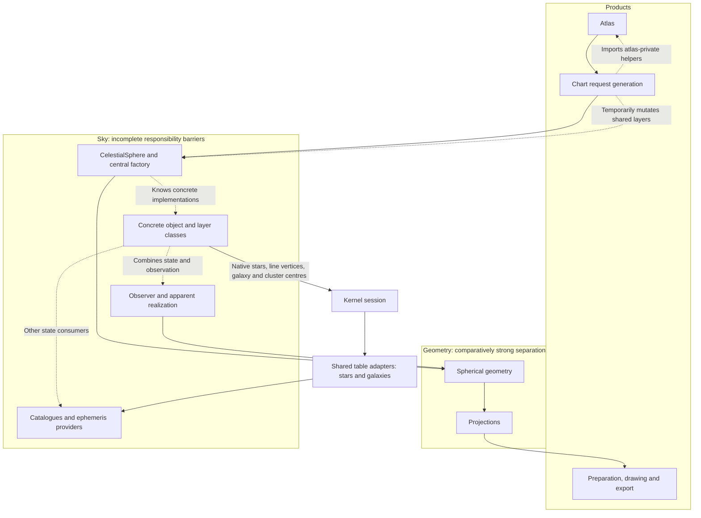
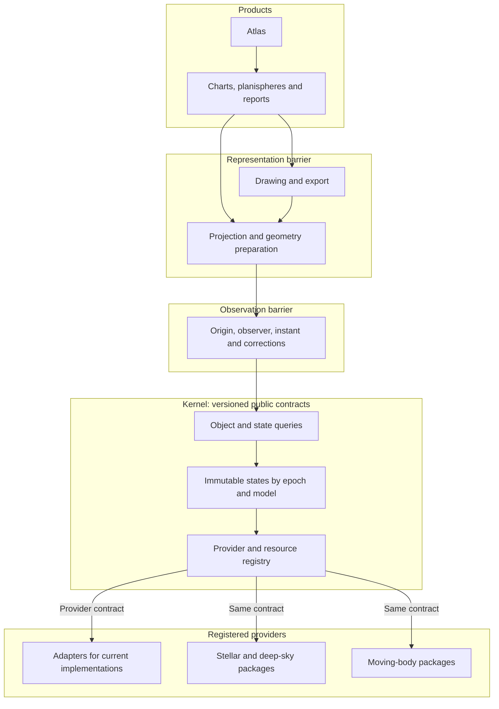

# Roadmap to v0.9.5: a frozen kernel and loadable astronomical packages

**Plan revision:** 6, 2026-10-19. **Status:** K3 partial stellar, galaxy and open-cluster centre routing;
Gaia acquisition and astronomical package extraction remain planned.
**Frozen functional baseline:** main `6708f54a0d8984c0be348b2c8cb02b311646a02b`.
Its Git tree is identical to `ea8dc505`, which passed 3,606 plugin-disabled Mac
tests in 1,136.74 s and 16 configuration-overlay tests in 4.03 s.

`v0.9.5` is a provisional release label requested for this work. The archived
[earlier coordinate target with that name](archive/pre_kernel_20261017/docs/developer/target_architecture_v0.9.5.md)
describes already accepted 49B/49C work; it does not implement this kernel.
Confirm the new release name against existing tags before creating a release.
No tag or package-version change is made here. The baseline is pinned by its
immutable commit and the [cleanup ledger](documentation_cleanup_v1.json).

## Release objective

**Current implementation status:** K1, native direction/reuse, SI Cartesian
and explicit time subsets plus the reusable provider conformance kit are
accepted through PR #242, main `8fea897f`. Native state queries retain their
explicit same-scale policy. Minor-body request-resource rollback is accepted
through PR #243, main `f5a0abf3`, with 3,400 Mac integration tests passing.
PR #244, main `d36b1786`, adds synchronous ordinary-request configuration
isolation (layer registry, horizon/disk aliases and point labels). It does not
yet route a product through the kernel. See the
[scope and gate](../../packages/wenu_kernel/README.md).
PR #246, main `e5bd7c16`, accepts shared request lifecycle and default
`wenu_chart atlas-sheet` dispatch (247 Mac tests passed). PR #247, main
`bf804cbb`, accepts native stellar realization through a real kernel/session and
legacy native lookup adapter, with Mac installation/output acceptance. PR #248
routes public `Stars.position`, explicit HIP lookup and native
constellation endpoints through that adapter, correcting source-epoch metadata.
It preserves source directions; no propagation is added. Observed astrometry,
native constellation-label anchors, other families and remaining non-chart
consumers stay open for subsequent K3 slices.
Relativistic/civil-time adapters, common observation services, Cartesian reuse
and SDK freeze remain ahead. PR #248 and the open-cluster correction in PR #249
are accepted at main `4a14e294`, with focused Mac gates and identical merged tree.
Neither closes K3.

Catalogue ingestion is a prerequisite to further provider migration: validate
required metadata, preserve original source fields in a Wenu standard format,
mirror a typed immutable record, and have consumers read it. The stellar path
and snapshot v3 implement this boundary. Resolve the remaining findings in the
[metadata audit](kernel_migration_audit_v1.md#catalogue-metadata-audit-2026-10-18),
especially per-source/row open-cluster epochs and nonstellar metadata loss,
before closing those provider adapters. Do not replace absent metadata with
catalogue-specific software literals.
The bounded open-cluster followup now consumes existing row epoch/source fields
and preserves source metadata in geometry and snapshot v4. Shared helper defaults,
full nonstellar metadata admission and the remaining fixed-catalogue snapshot
assumptions still require their own owner corrections. The current ingestion slice
preserves nonstellar source metadata/fields and normalizes declared angular
units, including globular radii, with atomic refusal and saved-sky checks.
The subsequent nonstellar admission record validates declarations, reports missing
facts, controls native/observed coordinate metadata and persists through snapshot
v5. Unknown epochs replace automatic J2000 stamps; old formats remain readable
without fabricating source facts. Strict admission refuses incomplete metadata,
while current charts retain an explicit legacy interpretation. Unitless legacy
inputs and this compatibility mode are not evidence of complete source semantics.
Required declarations depend on the model. Galaxy `static-direction` admission
does not require a measurement epoch/scale; any supplied epoch remains provenance.
Resolve remaining frame/origin/units/provenance gaps using source evidence rather
than inventing source facts. Other families retain their source-epoch requirements.
The SDK now admits explicit `static_direction` models with an optional source
epoch, while native/epoch direction requirements remain intact. Static coverage,
uncertainty, source identity and certified reuse retain their existing checks.
Galaxy centre consumers now route through that interface: public/native lookup,
chart outline/label centres and inputs to existing observer transformations.
The compatibility reference explicitly preserves unresolved source declarations;
strict physical metadata closure remains open. The shared immutable-table owner
is independent of concrete stellar/galaxy classes. Galaxy shape parameters and
late geometry stay above the kernel. Open-cluster source lookup now routes
public/native positions and inputs to existing observer transformations through
the same kernel/session interface, including saved skies. The immutable record
binds retained astrometry, units, masks and per-row source/epoch declarations.
Remaining K3 families/consumers have not yet migrated.

The open-cluster motion audit found retained Dias motions but omitted published
Hunt motions. Selected-centre and motion provenance must remain separate until
an explicit source-combination policy is admitted. Incomplete epochs also require
the accepted dev8 `catalogue_lookup` prerequisite; native/epoch requirements
remain intact and clusters do not inherit the galaxy static model. Production
now pins accepted main `9dd1909f`. The selected-cluster ingestion prerequisite
now has a versioned source-bound companion: 509 Hunt solutions, 502 radial
velocities and four explicitly unadopted Dias-only rows. The active 513-object
catalogue/selection and charts retain their bytes; explicit offline enrichment
mirrors all recovered fields in the existing metadata record. Next: resolve
remaining epoch-scale/origin facts and admit a physical propagation model, with
uncertainty/validity policy; missing cluster-mean covariances stay unknown. Other
families/consumers and the final SDK freeze remain ahead. See the
[motion audit](kernel_migration_audit_v1.md#open-cluster-motion-and-lookup-audit-2026-10-18).

Keep every existing Wenu capability while placing all scientific state access
behind a uniform kernel contract. Add Gaia DR3 astrometry for the stars already
in Wenu by default, with configurable membership and a later DR4 adapter.
Then extract astronomical families one by one into independently installable
Python packages. A compatible internal change in one package must require its
own tests and kernel conformance tests, not the tests of unrelated packages.

The kernel is complete only when all existing functionality consumes it.
Temporary adapters for old implementations are allowed; permanent parallel
position routes are not. This includes reports and non-chart calculations,
not just the visible atlas or a new Gaia demonstration.

## Ordered starting point

The [as-is functionality and test audit](kernel_migration_audit_v1.md) and
[pinned inventory](kernel_migration_inventory_v1.json) extend K1 before runtime
work starts. Test reorganization proceeds continually with the owner being
changed. Each K2 onward slice records preserved faults, old/new test locations,
isolated dependency evidence and its smallest justified gate. K3–K5 reconcile
every current capability and state consumer; K6–K8 extract each package's tests
and fixtures with its software. A package cannot close on folder separation
alone. K9 composes accepted packages rather than discovering test isolation
for the first time. See [testing policy](testing_policy.md).

1. **Completed:** accept and integrate PR #234; pin its tested production tree.
2. **This documentation milestone:** preserve original editions, archive
   superseded plans/diaries, consolidate current authority and repair active links.
3. **This documentation milestone:** publish this roadmap and both diagrams
   on the cleaned base. Review it before scientific runtime work begins.
4. Implement the bounded milestones below, each with an owner, explicit
   compatibility boundary and measurable exit gate.

## Current architecture

Arrows show calls/dependencies; dashed edges identify coupling to remove.
The existing projection and graphics pipeline is retained. The kernel edge
shows partial native stellar routing; dashed source paths remain to migrate.

| Intended barrier | As-is defect | Required replacement |
|---|---|---|
| Source catalogue / epoch state | Stellar native position ignores instant; moving bodies use different contracts | Typed state queries with explicit capabilities |
| Physical state / observer realization | Legacy layer fallback discards context | Common realization service over state interfaces |
| Kernel / domain packages | Central factory imports concrete classes | Registration against contracts; explicit application assembly |
| Immutable state / request | Mutable arrays, dictionaries, layers and resolver bindings | Immutable snapshots and request-owned sessions |
| Chart / atlas | Bidirectional imports and private furniture/report helpers | Public sheet-rendering contract owned below atlas |
| Package / independent test gate | Shared installation and historical documentation assertions | Isolated environments, provider conformance and owner suites |

The source evidence is in `sky/celestial_sphere.py`, `sky/maximal_sphere.py`,
`sky/sky_layer.py`, `objects/stars.py`, `charts/request_generation.py`,
`charts/atlas_publication.py` and `minor_body_resources.py`.
See [current architecture](current_architecture_v0.9.md) for precise limits.

## Proposed architecture

Arrows show requests/dependencies. The registry invokes providers through a
public protocol; application assembly discovers/registers concrete packages.
There is no static kernel import of stars, galaxies, orbits or drawing code.

Non-chart consumers query the same kernel/observation contracts without loading
projection or graphics. Constructed grids, cultural figures and reference
planes remain geometry services; they do not become fictitious physical bodies.
Constellation figures reference stellar identities, so endpoints follow the
selected stellar states. IAU boundaries retain their official defining frame;
propagating stars does not drag the official boundary with them.

## Kernel scope and public contract

The [K1 contract specification](kernel_contract_k1.md) defines the proposed
SDK names, typed records, operations, capability matrix, errors and independent
conformance gates. Its accepted implemented subset is documented in the SDK;
K5 all-consumer acceptance and final contract freeze remain open.

The kernel owns identity, typed time/state queries, capability admission,
provider registration, resource/provenance identity, immutable results,
validity checks and selective reuse. It may provide generic kinematic services
used by modules. Catalogue-specific decoding, Gaia cross-identification,
planetary ephemerides, SGP4 and object-specific models belong to providers or
their admitted numerical backends. No catalogue or renderer is mandatory for
importing the kernel.

The companion observer-realization layer owns origin selection, reception
instant, astrometric/apparent conventions, light time and supported corrections.
It may request multiple physical states, including retarded emission instants,
without mutating the catalogue. Reuse current coordinate and direction
authorities; moving an algorithm must not create a second scientific model.

The interface must uniformly express:

- Stable internal object identity plus edition-specific external identifiers.
- Query object set, evaluation instant and time scale; source reference epoch
  is retained separately, as is equinox where relevant to the frame.
- Direction-only versus Cartesian position/velocity capabilities. Do not
  manufacture distances or radial velocities for incomplete stellar solutions.
- Frame, origin, units, state/status, validity interval, model and uncertainty.
- Immutable data and metadata, precise resource hashes and failure semantics.
- Vectorized/batch evaluation and coverage requests suitable for tracks and
  epochs, not a scalar-only interface that forces thousands of hidden calls.
- Deterministic registration, optional-dependency isolation, resource/session
  lifetime, unload behavior and typed unsupported-capability failures.

The final names/signatures are frozen in K1, not invented by this roadmap.
Avoid requiring every object family to implement meaningless operations. A
common query/result envelope with explicit capabilities is uniformity;
pretending every source has a known six-dimensional state is not.

## Selective updates and invalidation

| Change | Recompute | Retain when scientifically valid |
|---|---|---|
| Stellar target epoch | Selected stellar states and star-connected geometry | Galaxy fixed-direction states and unrelated orbit states |
| Observer/site | Observer realization and its descendants | Observer-independent physical states |
| Projection | Projected geometry/preparation | Physical states and reusable realized geometry |
| Colour or label policy | Affected appearance/furniture | Astrometry, orbits and geometry |
| Provider/resource version | Its states and dependent realizations | States of unaffected providers |

Cache keys include provider/version, source/resource digest, model, requested
object set and relevant time/policy inputs. Static direction providers may
declare epoch invariance; the kernel must not falsely label them as newly
propagated measurements. Providers declare validity/dependencies, and tests
count evaluations to prove isolation. No in-place update of a shared snapshot.

## Angular tolerance and temporal reuse

A query may request an angular approximation tolerance, expressed in angular
units and attached to a declared direction/frame/status. This is separate from
catalogue measurement uncertainty, physical-model uncertainty, plot sampling
and provider resource coverage. No default chart precision is frozen here.
K1 defines explicit full-model evaluation and bounded-reuse policies.

Keep three epochs distinct: catalogue reference epoch, the anchor epoch of a
computed state, and the requested evaluation epoch. Propagation starts from the
authoritative source solution; deciding whether an existing computed direction
can be reused compares the request with its computed anchor, not with the
original catalogue epoch.

For a sufficiently short interval and approximately constant angular motion,

\[
\Delta\theta \simeq \mu\,|t-t_{\mathrm{anchor}}|,
\qquad
\Delta t_{\max}\simeq \frac{\epsilon}{\mu}.
\]

For Gaia, \(\mu=\sqrt{\mu_{\alpha *}^{\,2}+\mu_\delta^{\,2}}\); its RA
proper-motion component already includes the cosine of declination.
This estimate is an admission heuristic, not a universal guarantee. A provider
must supply a conservative bound for its admitted model and interval, including
the cached state's existing approximation error. Where applicable a bound may
take the form

\[
e_{\mathrm{reuse}}(t)
\le e_{\mathrm{anchor}}+
\mu_{\max}|\Delta t|+
\tfrac12 a_{\max}|\Delta t|^2
\le \epsilon.
\]

Here the speed/acceleration bounds apply over the whole certified interval.
Do not assume acceleration is zero or infinite validity merely because motion
data are missing. Without an admitted bound, evaluate the model instead of
silently reusing the direction. Respect resource/model coverage independently.

The provider knows the physical model; the kernel admits and reuses its
certificate without implementing stellar, asteroid or satellite equations.
A certificate identifies the anchor, applicable objects, model/resource/policy,
frame/status, interval, error metric and bound. The returned result preserves
both requested epoch and anchor provenance; reuse does not relabel an old
coordinate as an exact new evaluation. Unsupported tolerances fail explicitly
or use the documented full-model policy, never a hidden weaker tolerance.
Full-model evaluation means evaluation of the admitted model, not perfect
knowledge of the physical position.

### Required reuse behavior

- Start with vectorized propagation and exact-request caching. Benchmark the
  actual Wenu subset before adding per-star schedules or elaborate indexing.
  Under a direct rectilinear model, a longer epoch interval does not require
  integration through every intervening year; it increases scientific/model
  concerns rather than necessarily numerical workload.
- If beneficial, group stars by certified validity intervals or motion bounds.
  A few fast-moving stars must not force all stars or other providers to update.
- Refresh from the authoritative catalogue solution or an equivalent
  full-precision state with complete provenance. Do not accumulate successive
  rounded displacements or reset the error budget when a cache entry is reused.
- A cached state satisfying a loose tolerance cannot serve a tighter request
  unless its declared bound also satisfies that tighter request. Reuse from a
  more accurate entry is allowed when all other scientific identities match.
- For tracks or interval queries, certify the whole requested interval or
  partition/evaluate it appropriately; an endpoint check alone is insufficient.
- Physical-state reuse and observer-realization reuse have different keys and
  bounds. Proper-motion validity alone does not certify parallax, aberration,
  precession/nutation or Earth-rotation effects. Native angular bounds do not
  automatically bound an origin-translated apparent direction; the realization
  service must propagate the applicable state errors into its own error budget.
- Record the combined numerical approximation budget separately from
  measurement/model uncertainty. A 1-arcsecond reuse allowance does not
  guarantee 1-arcsecond knowledge of an ancient stellar position.
- Freeze deterministic anchor/selection policies where reproducible chart
  bytes are required. Cache warmness or request ordering must not silently
  change an accepted reproducibility contract; full-model comparisons remain
  the independent reference.

### Paper scale belongs above the kernel

A chart consumer may express displacement in a fraction of a raster pixel or
physical paper length, then convert it to an angular tolerance using the local
projection scale. Pixel-derived requests declare raster dpi; vector PDF/SVG
has no intrinsic pixel size. Use per-object bounds or a conservative maximum
magnification over the chart footprint. Stereographic scale varies across a
sheet, so a central-scale conversion alone is not a whole-chart guarantee.

The kernel/provider interface receives angular or appropriate physical-state
tolerances and scientific reference meaning, never B4/A4, dpi, fonts or
projection settings. Projection changes cannot invalidate the physical state
itself, although a newly tighter angular request may require reevaluation.
A uniform physical-state envelope need not pretend that every Cartesian
provider can certify an observer-independent apparent angular error.

### Native catalogue and optional common-epoch snapshots

The Wenu catalogue keeps stable identities, cross-identifications, membership
and each source's native astrometric solution/epoch immutable. An optional
common-epoch snapshot, for example J2025.0, is a derived cache for convenience,
not a replacement source catalogue or an asserted universal standard epoch.
Retain velocity/model and uncertainty/covariance information required for
further propagation. An epoch change does not rotate the ICRS axes or improve
the original astrometry. Ancient epochs use the original admitted solution
and validity/error model rather than chains of modern rounded snapshots.

### Acceptance evidence for K1, K2 and K4

K1 specifies units, error metrics, exact versus bounded policy, epoch meanings,
certificate composition and deterministic selection. K2 fake-provider tests
prove inside/outside and boundary behavior, mixed motion/update rates,
tolerance tightening, accumulated error accounting, call-count isolation,
independent observer invalidation and immutable provenance. K4 validates
stellar estimates against full propagation across the admitted epoch domain,
including high-motion/nearby stars, perspective effects, incomplete inputs
and uncertainty limits. Benchmarks must demonstrate benefit before an
optimization replaces the simpler vectorized reference.

## Gaia DR3 first, DR4 later

Keep membership separate from astrometric enrichment. Default membership is
the complete existing Wenu stellar population, including explicitly includable
stars and constellation vertices, not merely stars visible in the last chart.
Fetch only required matches and columns, not the full Gaia catalogue.

| Configurable concern | Required choices |
|---|---|
| Membership | Current Wenu stars by default; explicit IDs; later bounded region/magnitude/query selections |
| Astrometry edition | Explicit DR3 initially; future DR4 through the same adapter contract |
| Match/quality policy | Recorded cross-match evidence, ambiguity rules and usable solution types |
| Missing/insufficient data | Declared Hipparcos alternative, direction-only model or explicit failure |
| Epoch evaluation | Frozen baseline comparison or propagation to an explicit target epoch |
| Acquisition/storage | Explicit maintenance step, digest-bound small local snapshot and offline rendering |

Retain names, visual photometry, historical identifiers, component identity
and catalogue membership unless separately configured. Gaia G is not silently
substituted for existing V magnitude. Preserve unmatched bright/multiple stars;
missing Gaia data must not make them disappear.

Cross-identification must account for different reference epochs and proper
motion. Use supported catalogue cross-match evidence where available and
explicitly review ambiguous/multiple components. Do not assume identical
`source_id` across Gaia releases; identifiers are qualified by catalogue edition.
Record source input, match distances/criteria, confidence and unresolved cases.

DR3 astrometry uses its declared reference epoch (J2016.0), ICRS and time-scale
conventions. Preserve `pmra`'s cosine-declination convention, units, parallax,
radial velocity when available, uncertainties and correlations needed for the
chosen propagation model. Missing values are not zero. Non-positive parallax
is not a physical distance. Document degraded models and do not double-apply
parallax, aberration, precession or light time.

Implement an edition adapter and immutable snapshot schema so DR4 changes
data/decoding/model admission, not kernel or product APIs. Recheck DR4 schema,
epoch, identifier changes, solution types and known issues on release. Expected
astrometric improvement motivates DR4; never encode a blanket factor of two
as the uncertainty of every source or extrapolated ancient position.

Primary starting points, to be rechecked before acquisition design:

- [ESA Gaia DR3 overview](https://www.cosmos.esa.int/web/gaia/data-release-3)
- [ESA Gaia DR3 documentation](https://gea.esac.esa.int/archive/documentation/GDR3/)
- [Gaia archive access](https://www.cosmos.esa.int/web/gaia/gaia-archive)
- [Gaia credits](https://www.cosmos.esa.int/web/gaia/credits)
- [ESA DR4 planned contents](https://www.cosmos.esa.int/web/gaia/dr4)

Provider terms, supported batching, workload and redistribution are admission
checks before querying, not assumptions that this plan grants permission.
No network call belongs in rendering or ordinary numerical tests.

## Ancient constellations: scientific acceptance

Ancient diagrams are a required use case, not an automatic accuracy claim.
Define a validated epoch range and angular/error criteria before implementation
acceptance. Test multiple past/future epochs and high-motion/nearby/multiple
stars against an independent admitted numerical reference.

Keep the following independent:

1. Stellar propagation from catalogue epoch, including perspective effects
   where six-dimensional inputs support them and an explicit simpler model otherwise.
2. Orientation of the chosen coordinate frame; fixed ICRS does not precess.
   Choose and validate a long-term precession model where date-oriented axes
   are requested. Do not apply a short-range model beyond its admitted domain.
3. Time input: astronomical year numbering including year zero/BCE, Julian-day
   or equivalent continuous time, scale, calendar and input-date uncertainty.
   A historical source chronology is not solved by accepting a negative year.
4. Observer reconstruction: Earth rotation/Delta-T uncertainty, missing ancient
   EOP and terrestrial/planetary ephemeris coverage. Native barycentric ancient
   charts must not require a modern DE440s/IERS observer path unnecessarily.
5. Source/model limitations: binaries, missing radial velocity, acceleration,
   measurement covariance and long extrapolation. Quote honest positional
   uncertainty/model limits; DR4 does not remove dynamical uncertainty.

The existing Python datetime observer parser does not supply this contract.
No near-modern satellite elements are extrapolated into antiquity. Unsupported
epochs/capabilities fail explicitly while supported stellar-only requests work.

## Milestones and exit gates

Each row is a reviewable milestone, subdivided further if its diff cannot be
bounded. Runtime authority is accepted one milestone at a time.

| ID | Deliverable | Exit gate |
|---|---|---|
| K0 | Clean docs, pinned baseline, this roadmap and diagrams | Exact archival ledger, active links, current docs tests; no production/data changes |
| K1 | Public kernel/state/provider/observation contract and compatibility policy | Reviewed signatures, explicit tolerance/epoch/error-budget and validity contracts, capability/failure matrix and independent test gates |
| K2 | Minimal core package, registration, immutable states and selective reuse | Fake providers prove isolation, lifecycle, immutable state and tolerance-certified selective reuse, including boundary/tighter-request/error-accumulation cases |
| K3 | Adapters and mandatory routing for all current functionality | Complete consumer inventory, no bypasses, isolated request rollback and baseline compatibility evidence |
| K4a | Gaia DR3 identification and bounded local subset | Coverage/ambiguity report, exact schema/bytes/provenance, unchanged default membership/photometry |
| K4b | Stellar propagation, historical time and admitted epoch domain | Independent propagation/reuse comparison over the admitted epoch domain, declared numerical versus physical uncertainty/fallbacks, measured workloads and ancient specimens |
| K5 | Kernel and observer contract freeze | All consumers routed, conformance suite published, real star/deep-sky/moving-body coverage and accepted integration evidence |
| K6 | Extract `wenu_stars` first | Independently installed and tested against frozen core, including Gaia; product APIs unchanged |
| K7 | Extract one deep-sky family at a time | Each package passes its own science/conformance gate without other providers installed |
| K8 | Extract planets, asteroids, comets and satellites separately | Preserve each current scientific capability and incomplete-science limits; isolated install/test receipts |
| K9 | Release closure | Packaging combinations, compatibility matrix, scientific/visual/print acceptance and release naming/tag decision |

K3 must address request-layer rollback before sharing kernel state. Accepted
minor-body registration/resolver lifetime and ordinary-request configuration
journal (PR #244) restore original layer
identities/order and horizon/disk/point-label attributes, reject overlapping
builds on one sky, and preserve the lease after failed cleanup.
This does not claim thread safety or rollback of arbitrary external mutations.
No consumer is marked migrated by these prerequisites. PR #246 routes ordinary view/drawing, ordinary generation
and native atlas sheets through `open_chart_request_scope`, preserving their
geometry, helper order and observer requirements. Atlas producers use the
injected command or default to `wenu_chart atlas-sheet`; no direct-generator
fallback remains. Shared-scope failure tests and real serial/spawn/cold-saved
atlas equivalence passed on the Mac. This does not close the
chart/atlas private-helper cycle. Accepted PR #247 supplies a real native stellar
consumer, source-native semantics, saved/worker compatibility and a separate
installation gate. Accepted PR #248 extends the same adapter to public positions
and native figure vertices, with opaque-interface, changed-vector and refusal
tests plus saved/rendered consumer checks. Static galaxy centre routing now
uses the accepted static capability through shared immutable-table mechanics;
its source gaps remain explicit compatibility semantics. Native label anchors and observed
astrometry remain explicit ledger entries; neither slice adds a Gaia/motion model.
Break chart/atlas private-helper cycles with a public sheet contract while
preserving canonical rendering. Make changes in separate bounded slices;
do not combine structural movement, Gaia data replacement and appearance tuning.
K4 may develop alongside adapters, but K5 cannot close before both are accepted.

## Mandatory all-consumer migration ledger

K3 records each public entry point, state source, adapter, owner and verification:

- Ordinary chart families, constellation labels/lines, static deep-sky objects.
- Physical polar planispheres, reference grids/planes/horizon and fixed-sky use.
- Atlas design/index/publication, loaded/saved sky and worker reconstruction.
- Planet/Moon points, resolved disks, tracks and temporal sequences.
- Minor-body state/point/track, acquisition-result consumers and comet reports.
- Satellite propagation/crossing/report/track/illumination consumers, including
  non-chart APIs, planning advisory and bolometric/spectral radiometry.
- Python API, all eight installed CLI entry points, six canonical examples,
  packaged bilingual notebooks and compatible snapshot imports.
- Catalogue maintenance/acquisition, criteria, resource packaging and build
  helpers; pure copying/layout remains outside state queries.

Reconcile this ledger against every entry in the
[as-is functionality audit](kernel_migration_audit_v1.md) and its full source,
test and operational inventory. Located tests are not runtime coverage; each
migrated consumer needs an explicit public-path/failure acceptance receipt.

Not every operation needs physical state: pure layout and PDF assembly remain
pure. However, any operation obtaining scientific object positions/states must
go through the admitted kernel/provider route. Tests use instrumented providers
and prohibited-import/direct-access checks to detect bypasses; documentation
claims or wrapper naming alone are insufficient.

## Package layout and loading

Initially use a monorepository with separate project directories, each with
its own `pyproject.toml`, import namespace, dependencies and tests. Independent
packages do not require independent repositories. Names below are proposed.

| Package | Responsibility |
|---|---|
| `wenu_kernel` | Contracts, identity/time, registry, immutable state and resource lifecycle |
| `wenu_observation` | Common observer/origin/apparent realization over kernel interfaces |
| `wenu_stars` | Stellar source adapters, Gaia subsets and propagation policy |
| `wenu_open_clusters` | Open-cluster catalogues, membership/morphology and state capability |
| `wenu_globular_clusters` | Globular clusters |
| `wenu_galaxies` | Galaxy directions and morphology |
| `wenu_nebulae` | Nebular families; split only for genuine independent ownership |
| `wenu_planets` | Planets and natural satellites through admitted backends |
| `wenu_asteroids` | Asteroid resources and models |
| `wenu_comets` | Comet resources, models and capabilities |
| `wenu_satellites` | Artificial-satellite snapshots, propagation and supported products |

Application assembly selects an explicit allowlist of installed providers,
validates interface version/capabilities and registers them. Discovery may use
Python entry points; importing the core must not eagerly import every provider.
Do not use `wenu.__init__` as a common SDK that imports products and graphics.
One provider cannot depend on the concrete implementation of another; use
declared shared services/interfaces. Preserve legacy facades until callers
have a documented compatibility/migration path.

## Freeze and independent testing

Freeze contract semantics, error types, capability negotiation, serialization
versions, units and lifecycle as well as method signatures. Publish a small
conformance suite and example fake provider. Internal optimization may evolve
without breaking that contract; incompatible changes require a new explicit
kernel contract version and affected-consumer plan.

After acceptance, changing one provider internally runs that provider's science
and kernel conformance suite only. It must not require executing other provider
suites or their dependencies. Charts/atlases have their own public-contract
gates using deterministic admitted states. Integration/release checks are a
separate responsibility, not a routine tax on every module change.

During migration, select owner/contract/consumer gates from the actual diff.
Full integration is required for release closure or reviewed broad shared impact,
not automatically for each K3 revision. Independent package installation remains
a separate exit requirement. See the [testing matrix](testing_policy.md).
Do not promise universal independence while shared internals remain mutable.

## Explicit non-goals for this roadmap's first steps

No full Gaia mirror, new public-interest curation, wholesale graphics rewrite,
new ancient-calendar historical scholarship engine, expanded satellite science,
new Moonlight execution, or broad feature additions during structural migration.
Current science and appearance remain the baseline except for separately
reviewed astrometric corrections and bug fixes. Deferred work is retained in
the archived roadmap and [current scientific limits](scientific_contracts.md).
