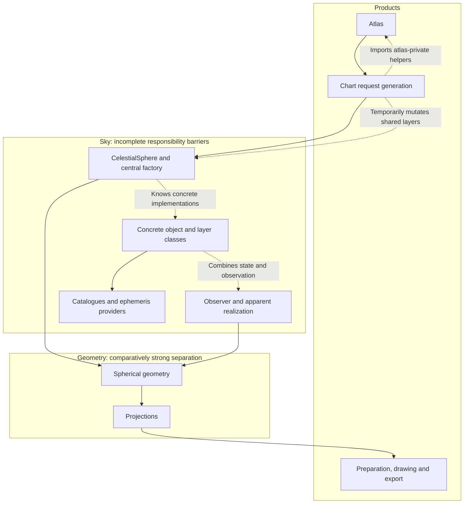
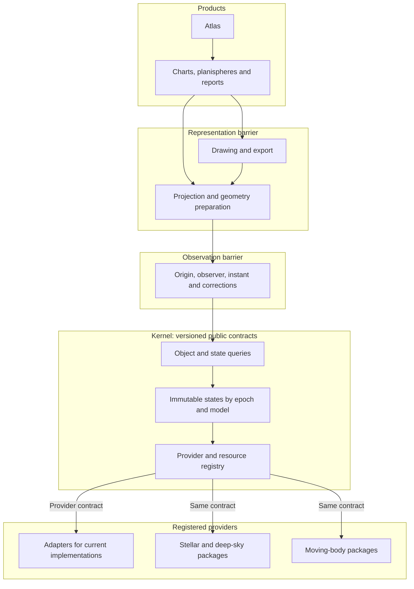

# Roadmap to v0.9.5: a frozen kernel and loadable astronomical packages

**Plan revision:** 1, 2026-10-17. **Status:** documentation for review; no
kernel, Gaia acquisition or package extraction is implemented by this change.
**Frozen functional baseline:** main `6708f54a0d8984c0be348b2c8cb02b311646a02b`.
Its Git tree is identical to `ea8dc505`, which passed 3,606 plugin-disabled Mac
tests in 1,136.74 s and 16 configuration-overlay tests in 4.03 s.

`v0.9.5` is a provisional release label requested for this work. The archived
[earlier coordinate target with that name](archive/pre_kernel_20261017/docs/developer/target_architecture_v0.9.5.md)
describes already accepted 49B/49C work; it does not implement this kernel.
Confirm the new release name against existing tags before creating a release.
No tag or package-version change is made here. The baseline is pinned by its
immutable commit and the [cleanup ledger](documentation_cleanup_v1.json).

## Release objective

Keep every existing Wenu capability while placing all scientific state access
behind a uniform kernel contract. Add Gaia DR3 astrometry for the stars already
in Wenu by default, with configurable membership and a later DR4 adapter.
Then extract astronomical families one by one into independently installable
Python packages. A compatible internal change in one package must require its
own tests and kernel conformance tests, not the tests of unrelated packages.

The kernel is complete only when all existing functionality consumes it.
Temporary adapters for old implementations are allowed; permanent parallel
position routes are not. This includes reports and non-chart calculations,
not just the visible atlas or a new Gaia demonstration.

## Ordered starting point

1. **Completed:** accept and integrate PR #234; pin its tested production tree.
2. **This documentation milestone:** preserve original editions, archive
   superseded plans/diaries, consolidate current authority and repair active links.
3. **This documentation milestone:** publish this roadmap and both diagrams
   on the cleaned base. Review it before scientific runtime work begins.
4. Implement the bounded milestones below, each with an owner, explicit
   compatibility boundary and measurable exit gate.

## Current architecture

Arrows show calls/dependencies; dashed edges identify coupling to remove.
The existing projection and graphics pipeline is retained.

| Intended barrier | As-is defect | Required replacement |
|---|---|---|
| Source catalogue / epoch state | Stellar native position ignores instant; moving bodies use different contracts | Typed state queries with explicit capabilities |
| Physical state / observer realization | Legacy layer fallback discards context | Common realization service over state interfaces |
| Kernel / domain packages | Central factory imports concrete classes | Registration against contracts; explicit application assembly |
| Immutable state / request | Mutable arrays, dictionaries, layers and resolver bindings | Immutable snapshots and request-owned sessions |
| Chart / atlas | Bidirectional imports and private furniture/report helpers | Public sheet-rendering contract owned below atlas |
| Package / independent test gate | Shared installation and historical documentation assertions | Isolated environments, provider conformance and owner suites |

The source evidence is in `sky/celestial_sphere.py`, `sky/maximal_sphere.py`,
`sky/sky_layer.py`, `objects/stars.py`, `charts/request_generation.py`,
`charts/atlas_publication.py` and `minor_body_resources.py`.
See [current architecture](current_architecture_v0.9.md) for precise limits.

## Proposed architecture

Arrows show requests/dependencies. The registry invokes providers through a
public protocol; application assembly discovers/registers concrete packages.
There is no static kernel import of stars, galaxies, orbits or drawing code.

Non-chart consumers query the same kernel/observation contracts without loading
projection or graphics. Constructed grids, cultural figures and reference
planes remain geometry services; they do not become fictitious physical bodies.
Constellation figures reference stellar identities, so endpoints follow the
selected stellar states. IAU boundaries retain their official defining frame;
propagating stars does not drag the official boundary with them.

## Kernel scope and public contract

The kernel owns identity, typed time/state queries, capability admission,
provider registration, resource/provenance identity, immutable results,
validity checks and selective reuse. It may provide generic kinematic services
used by modules. Catalogue-specific decoding, Gaia cross-identification,
planetary ephemerides, SGP4 and object-specific models belong to providers or
their admitted numerical backends. No catalogue or renderer is mandatory for
importing the kernel.

The companion observer-realization layer owns origin selection, reception
instant, astrometric/apparent conventions, light time and supported corrections.
It may request multiple physical states, including retarded emission instants,
without mutating the catalogue. Reuse current coordinate and direction
authorities; moving an algorithm must not create a second scientific model.

The interface must uniformly express:

- Stable internal object identity plus edition-specific external identifiers.
- Query object set, evaluation instant and time scale; source reference epoch
  is retained separately, as is equinox where relevant to the frame.
- Direction-only versus Cartesian position/velocity capabilities. Do not
  manufacture distances or radial velocities for incomplete stellar solutions.
- Frame, origin, units, state/status, validity interval, model and uncertainty.
- Immutable data and metadata, precise resource hashes and failure semantics.
- Vectorized/batch evaluation and coverage requests suitable for tracks and
  epochs, not a scalar-only interface that forces thousands of hidden calls.
- Deterministic registration, optional-dependency isolation, resource/session
  lifetime, unload behavior and typed unsupported-capability failures.

The final names/signatures are frozen in K1, not invented by this roadmap.
Avoid requiring every object family to implement meaningless operations. A
common query/result envelope with explicit capabilities is uniformity;
pretending every source has a known six-dimensional state is not.

## Selective updates and invalidation

| Change | Recompute | Retain when scientifically valid |
|---|---|---|
| Stellar target epoch | Selected stellar states and star-connected geometry | Galaxy fixed-direction states and unrelated orbit states |
| Observer/site | Observer realization and its descendants | Observer-independent physical states |
| Projection | Projected geometry/preparation | Physical states and reusable realized geometry |
| Colour or label policy | Affected appearance/furniture | Astrometry, orbits and geometry |
| Provider/resource version | Its states and dependent realizations | States of unaffected providers |

Cache keys include provider/version, source/resource digest, model, requested
object set and relevant time/policy inputs. Static direction providers may
declare epoch invariance; the kernel must not falsely label them as newly
propagated measurements. Providers declare validity/dependencies, and tests
count evaluations to prove isolation. No in-place update of a shared snapshot.

## Gaia DR3 first, DR4 later

Keep membership separate from astrometric enrichment. Default membership is
the complete existing Wenu stellar population, including explicitly includable
stars and constellation vertices, not merely stars visible in the last chart.
Fetch only required matches and columns, not the full Gaia catalogue.

| Configurable concern | Required choices |
|---|---|
| Membership | Current Wenu stars by default; explicit IDs; later bounded region/magnitude/query selections |
| Astrometry edition | Explicit DR3 initially; future DR4 through the same adapter contract |
| Match/quality policy | Recorded cross-match evidence, ambiguity rules and usable solution types |
| Missing/insufficient data | Declared Hipparcos alternative, direction-only model or explicit failure |
| Epoch evaluation | Frozen baseline comparison or propagation to an explicit target epoch |
| Acquisition/storage | Explicit maintenance step, digest-bound small local snapshot and offline rendering |

Retain names, visual photometry, historical identifiers, component identity
and catalogue membership unless separately configured. Gaia G is not silently
substituted for existing V magnitude. Preserve unmatched bright/multiple stars;
missing Gaia data must not make them disappear.

Cross-identification must account for different reference epochs and proper
motion. Use supported catalogue cross-match evidence where available and
explicitly review ambiguous/multiple components. Do not assume identical
`source_id` across Gaia releases; identifiers are qualified by catalogue edition.
Record source input, match distances/criteria, confidence and unresolved cases.

DR3 astrometry uses its declared reference epoch (J2016.0), ICRS and time-scale
conventions. Preserve `pmra`'s cosine-declination convention, units, parallax,
radial velocity when available, uncertainties and correlations needed for the
chosen propagation model. Missing values are not zero. Non-positive parallax
is not a physical distance. Document degraded models and do not double-apply
parallax, aberration, precession or light time.

Implement an edition adapter and immutable snapshot schema so DR4 changes
data/decoding/model admission, not kernel or product APIs. Recheck DR4 schema,
epoch, identifier changes, solution types and known issues on release. Expected
astrometric improvement motivates DR4; never encode a blanket factor of two
as the uncertainty of every source or extrapolated ancient position.

Primary starting points, to be rechecked before acquisition design:

- [ESA Gaia DR3 overview](https://www.cosmos.esa.int/web/gaia/data-release-3)
- [ESA Gaia DR3 documentation](https://gea.esac.esa.int/archive/documentation/GDR3/)
- [Gaia archive access](https://www.cosmos.esa.int/web/gaia/gaia-archive)
- [Gaia credits](https://www.cosmos.esa.int/web/gaia/credits)
- [ESA DR4 planned contents](https://www.cosmos.esa.int/web/gaia/dr4)

Provider terms, supported batching, workload and redistribution are admission
checks before querying, not assumptions that this plan grants permission.
No network call belongs in rendering or ordinary numerical tests.

## Ancient constellations: scientific acceptance

Ancient diagrams are a required use case, not an automatic accuracy claim.
Define a validated epoch range and angular/error criteria before implementation
acceptance. Test multiple past/future epochs and high-motion/nearby/multiple
stars against an independent admitted numerical reference.

Keep the following independent:

1. Stellar propagation from catalogue epoch, including perspective effects
   where six-dimensional inputs support them and an explicit simpler model otherwise.
2. Orientation of the chosen coordinate frame; fixed ICRS does not precess.
   Choose and validate a long-term precession model where date-oriented axes
   are requested. Do not apply a short-range model beyond its admitted domain.
3. Time input: astronomical year numbering including year zero/BCE, Julian-day
   or equivalent continuous time, scale, calendar and input-date uncertainty.
   A historical source chronology is not solved by accepting a negative year.
4. Observer reconstruction: Earth rotation/Delta-T uncertainty, missing ancient
   EOP and terrestrial/planetary ephemeris coverage. Native barycentric ancient
   charts must not require a modern DE440s/IERS observer path unnecessarily.
5. Source/model limitations: binaries, missing radial velocity, acceleration,
   measurement covariance and long extrapolation. Quote honest positional
   uncertainty/model limits; DR4 does not remove dynamical uncertainty.

The existing Python datetime observer parser does not supply this contract.
No near-modern satellite elements are extrapolated into antiquity. Unsupported
epochs/capabilities fail explicitly while supported stellar-only requests work.

## Milestones and exit gates

Each row is a reviewable milestone, subdivided further if its diff cannot be
bounded. Runtime authority is accepted one milestone at a time.

| ID | Deliverable | Exit gate |
|---|---|---|
| K0 | Clean docs, pinned baseline, this roadmap and diagrams | Exact archival ledger, active links, current docs tests; no production/data changes |
| K1 | Public kernel/state/provider/observation contract and compatibility policy | Reviewed signatures, capability/validity/failure matrix and proposed independent test gates |
| K2 | Minimal core package, registration, immutable states and selective reuse | Fake providers prove optional-dependency isolation, lifecycle, mutation rejection and selective call counts |
| K3 | Adapters and mandatory routing for all current functionality | Complete consumer inventory, no bypasses, isolated request rollback and baseline compatibility evidence |
| K4a | Gaia DR3 identification and bounded local subset | Coverage/ambiguity report, exact schema/bytes/provenance, unchanged default membership/photometry |
| K4b | Stellar propagation, historical time and admitted epoch domain | Independent numerical comparison, declared uncertainty/fallbacks and ancient constellation specimens |
| K5 | Kernel and observer contract freeze | All consumers routed, conformance suite published, real star/deep-sky/moving-body coverage and accepted integration evidence |
| K6 | Extract `wenu_stars` first | Independently installed and tested against frozen core, including Gaia; product APIs unchanged |
| K7 | Extract one deep-sky family at a time | Each package passes its own science/conformance gate without other providers installed |
| K8 | Extract planets, asteroids, comets and satellites separately | Preserve each current scientific capability and incomplete-science limits; isolated install/test receipts |
| K9 | Release closure | Packaging combinations, compatibility matrix, scientific/visual/print acceptance and release naming/tag decision |

K3 must address the request-layer rollback defect before sharing kernel state.
Break chart/atlas private-helper cycles with a public sheet contract while
preserving canonical rendering. Make changes in separate bounded slices;
do not combine structural movement, Gaia data replacement and appearance tuning.
K4 may develop alongside adapters, but K5 cannot close before both are accepted.

## Mandatory all-consumer migration ledger

K3 records each public entry point, state source, adapter, owner and verification:

- Ordinary chart families, constellation labels/lines, static deep-sky objects.
- Physical polar planispheres, reference grids/planes/horizon and fixed-sky use.
- Atlas design/index/publication, loaded/saved sky and worker reconstruction.
- Planet/Moon points, resolved disks, tracks and temporal sequences.
- Minor-body state/point/track, acquisition-result consumers and comet reports.
- Satellite propagation/crossing/report/track/illumination consumers, including
  non-chart APIs and planning advisory.
- Python API, installed CLI, examples and compatible snapshot imports.

Not every operation needs physical state: pure layout and PDF assembly remain
pure. However, any operation obtaining scientific object positions/states must
go through the admitted kernel/provider route. Tests use instrumented providers
and prohibited-import/direct-access checks to detect bypasses; documentation
claims or wrapper naming alone are insufficient.

## Package layout and loading

Initially use a monorepository with separate project directories, each with
its own `pyproject.toml`, import namespace, dependencies and tests. Independent
packages do not require independent repositories. Names below are proposed.

| Package | Responsibility |
|---|---|
| `wenu_kernel` | Contracts, identity/time, registry, immutable state and resource lifecycle |
| `wenu_observation` | Common observer/origin/apparent realization over kernel interfaces |
| `wenu_stars` | Stellar source adapters, Gaia subsets and propagation policy |
| `wenu_open_clusters` | Open-cluster catalogues, membership/morphology and state capability |
| `wenu_globular_clusters` | Globular clusters |
| `wenu_galaxies` | Galaxy directions and morphology |
| `wenu_nebulae` | Nebular families; split only for genuine independent ownership |
| `wenu_planets` | Planets and natural satellites through admitted backends |
| `wenu_asteroids` | Asteroid resources and models |
| `wenu_comets` | Comet resources, models and capabilities |
| `wenu_satellites` | Artificial-satellite snapshots, propagation and supported products |

Application assembly selects an explicit allowlist of installed providers,
validates interface version/capabilities and registers them. Discovery may use
Python entry points; importing the core must not eagerly import every provider.
Do not use `wenu.__init__` as a common SDK that imports products and graphics.
One provider cannot depend on the concrete implementation of another; use
declared shared services/interfaces. Preserve legacy facades until callers
have a documented compatibility/migration path.

## Freeze and independent testing

Freeze contract semantics, error types, capability negotiation, serialization
versions, units and lifecycle as well as method signatures. Publish a small
conformance suite and example fake provider. Internal optimization may evolve
without breaking that contract; incompatible changes require a new explicit
kernel contract version and affected-consumer plan.

After acceptance, changing one provider internally runs that provider's science
and kernel conformance suite only. It must not require executing other provider
suites or their dependencies. Charts/atlases have their own public-contract
gates using deterministic admitted states. Integration/release checks are a
separate responsibility, not a routine tax on every module change.

During the cross-cutting migration, final integrated candidates still require
the accepted integration evidence. This temporary obligation ends for a module
only after its isolation is demonstrated. See the [testing matrix](testing_policy.md).
Do not promise universal independence while shared internals remain mutable.

## Explicit non-goals for this roadmap's first steps

No full Gaia mirror, new public-interest curation, wholesale graphics rewrite,
new ancient-calendar historical scholarship engine, expanded satellite science,
new Moonlight execution, or broad feature additions during structural migration.
Current science and appearance remain the baseline except for separately
reviewed astrometric corrections and bug fixes. Deferred work is retained in
the archived roadmap and [current scientific limits](scientific_contracts.md).
