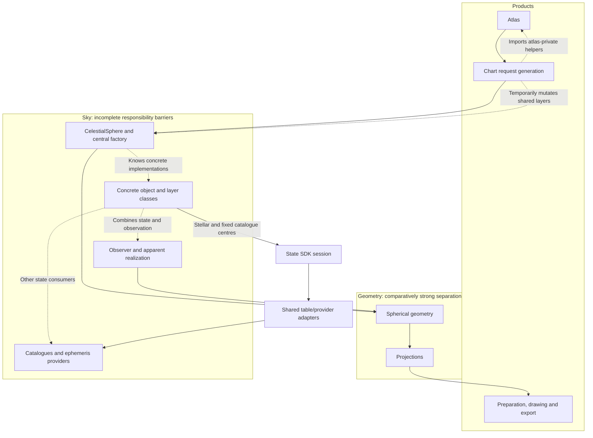
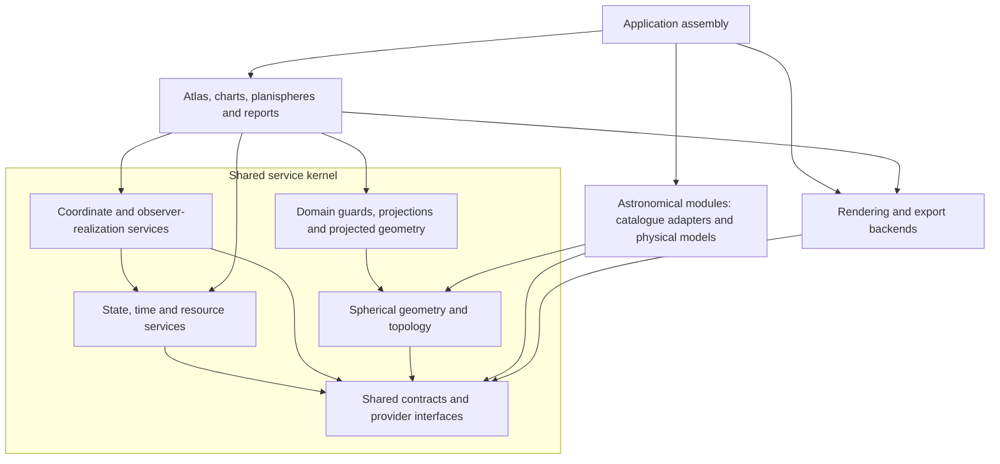

# Roadmap to v0.9.5: a frozen kernel and loadable astronomical packages

**Plan revision:** 41, 2026-10-20. **Status:** K3 partial stellar, galaxy and open-cluster centre routing;
Gaia acquisition and astronomical package extraction remain planned.
**Frozen functional baseline:** main `6708f54a0d8984c0be348b2c8cb02b311646a02b`.
Its Git tree is identical to `ea8dc505`, which passed 3,606 plugin-disabled Mac
tests in 1,136.74 s and 16 configuration-overlay tests in 4.03 s.

`v0.9.5` is a provisional release label requested for this work. The archived
[earlier coordinate target with that name](archive/pre_kernel_20261017/docs/developer/target_architecture_v0.9.5.md)
describes already accepted 49B/49C work; it does not implement this kernel.
Confirm the new release name against existing tags before creating a release.
No tag or package-version change is made here. The baseline is pinned by its
immutable commit and the [cleanup ledger](documentation_cleanup_v1.json).

## Release objective

Refactor existing Wenu functionality into kernel plus astronomical modules while
preserving its accepted behaviour and appearance. Gaia DR3 and the shared
proper-motion/parallax work are agreed scientific additions; they are identified
separately below rather than used to enlarge baseline migration implicitly.
No object expansion or morphology evolution is included.

This is the single authoritative roadmap. The detailed ledger below expands the
already documented scope in the [functionality audit](kernel_migration_audit_v1.md#current-functionality-ledger)
and [source/test inventory](kernel_migration_inventory_v1.json); it does not add
new scientific features. As-built APIs remain in the
[implementation reference](implementation_reference.md), scientific limits in
[scientific contracts](scientific_contracts.md), and verification in
[testing policy](testing_policy.md). Their roles do not replace user agreement.

## Current position and next-item selection

**Accepted baseline:** main `6e6fcd964a23d7aa5a4bc4e398e43381ad93977f`,
PR #289, tree identical to tested `9589a1391e2f8ad06a9f2c70753b887f40171ed5`.
K3.16 Mac acceptance retains 81 passing runtime cases at `61ceca37`, plus seven
comparison-retry cases at `9589a139` (the formerly failing case and six additional
mask/value contracts), 36 documentation and eight tooling cases. Fernando confirmed
clean synchronized main and branch cleanup. K3.17 is selected next under revision
41. This bounded acceptance does not close K3/K5.

| Track | Position |
|---|---|
| Baseline migration | K0 complete; K1 initial contracts and K2 foundation accepted; **K3 partial** |
| Gaia | K4a not implemented; K4b real stellar propagation/historical acceptance not implemented |
| Shared positional extension | AX.01–AX.12 accepted, ending with horizontal cluster CLI/TOML selection; reduced-input policies and real other-family adapters remain pending |
| Freeze/extraction/release | K5–K9 not complete; astronomical package extraction has not begun |
| Current authorized task | K3.17 constructed reference routing: inspect existing services, close demonstrated gaps and verify remaining consumers; selected 2026-10-20 |
| Next bounded submilestone | K3.18 remains pending; select separately after K3.17 acceptance |

Reduced-input models (AX.13) are agreed capability scope, but their placement as
the immediate next task was an agent sequencing decision, not a separate user
agreement. This revision removes that automatic next-step designation. Continuing
remaining K3 migration and continuing the positional extension are distinct
choices. K3.07 baseline migration was subsequently proposed explicitly and selected by Fernando; AX.13 remains pending.

The architecture documentation is accepted through PR #280, main
`abb68d9127068f9cc9ace6db8be0a8132a9f22ba`; 36 Mac documentation tests
passed at `a5f6c00f`. Fernando confirmed clean synchronized main and branch
cleanup. This documentation merge adds no runtime acceptance.

## Roadmap agreement and change control

Follow the [mandatory agent procedure](assistant_instructions.md#roadmap-control-mandatory-before-implementation).
Before implementing any extra item or changing agreed scope/order, discuss the
reason, alternatives, consequences, dependencies and acceptance gate with Fernando;
obtain explicit agreement; then document that agreement and the revised milestone
**before implementation**. An agent cannot authorize its own addition by editing
this document. A proposal may be recorded as proposed while awaiting a decision.

Stable IDs below identify reviewable deliverables. Numbering groups responsibility;
it does not claim that independent pending rows have an agreed serial priority.
Dependencies constrain execution. The selected next ID must be stated explicitly.
Existing scope may be decomposed in this documentation review without granting
blanket execution authority. Routine choices/fixes inside an agreed bounded item
remain part of that item; new deliverables or reordered work require change control.

| Plan change | Authority and scope | Effect on runtime authority |
|---|---|---|
| Revision 41: select K3.17 constructed references | Fernando’s 2026-10-20 “proceed” after PR #289 acceptance and clean main 6e6fcd96, following the explicit grids/planes/poles/boundaries/horizon/visibility/masks proposal | Inspect and reuse existing CoordinateService and kernel geometry/domain/projection routes; change only demonstrated routing gaps. Preserve definitions, sampling, frame/equinox meaning, observer-local horizon, masks, styles and pixels. Add owner/consumer returned-value/refusal and saved-sky evidence where absent; retain valid prior receipts. No new mathematics, scientific policy, SDK capability, dependency, source bytes or snapshot schema. Gate: constructed-reference-routing plus documentation; K3.18 resource/cache-lifetime work remains separate |
| Revision 40: select K3.16 metadata and v6 transport | Fernando’s 2026-10-20 “Agreed. Proceed.” after explicit explanation of saved-sky versions and the bounded v6 proposal; clean main 2b607d71 after PR #288 | Preserve byte-bound original diffuse source properties, distinguish declarations from compatibility interpretation, validate geometry before native output/warm reuse, and write v6 metadata transport. Read v1–v5 without source reload or invented metadata; older readers reject v6. Reuse established geometry services and unchanged science/topology/appearance. Gate: diffuse-geometry-routing plus documentation, covering admission/refusal, legacy/source-free transport and real atlas/polar output. No new SDK API/release, source bytes, physics or renderer change |
| Revision 39: select KG.07 correction | Fernando’s 2026-10-20 proceed after accepted PR #287 and clean main 9e71ab49 | Implement only G06.C1 at shared point projection; preserve source rows/IDs/metadata, strict numerical domains and finite formulas. Verify point batches, both real equidistant outputs without xfail, compatibility and isolated installed access; immutable corrected-kernel pin follows changed package bytes. No other G06.U item, new science or K3.16 activated |
| Revision 38: select KG.06 audit | Fernando’s 2026-10-20 proceed after accepted PR #286 and clean main 52c8315c | Audit every completed K deliverable and relevant accepted AX composition against actual service/caller boundaries. Record retained evidence, corrections and unresolved scope. Documentation/read-only probes only; KG.07 runtime correction remains separate |
| Revision 37: select KG.05 acceptance | Fernando’s 2026-10-20 proceed after accepted PR #285 and clean main 608bc91d | Compose existing services and verify isolated installed access plus real cold/restored atlas and polar PNG/PDF/SVG outputs. Reuse accepted numerical/packaging evidence; no production mathematics, dependency, source, schema or policy change. KG.06 remains separate |
| Revision 36: select KG.04 implementation | Fernando’s 2026-10-19 proceed after accepted PR #284 and clean main 59a4f2f9, following explicit clipping/three-projection/domain-topology proposal | Move existing mathematics behind agreed kernel leaves and legacy aliases. Preserve all formulas, domain/cap/hole/seam semantics and numerical dependencies; keep marker sizing/culling margin, label and chart/render policy in Wenu. Verify isolated installed services and affected consumers; no new algorithm, source bytes, observation model or snapshot schema |
| Revision 35: select KG.03 implementation and KG.02 placement | Fernando’s 2026-10-19 “proceed” after merging/reviewing PR #283 and clean main e0d56204, following the explicit KG.03 proposal to use the documented contracts and placement | Implement pure coordinate vocabulary, spherical/projected/frame/viewport records and current ring helper in existing wenu-kernel numerical leaves; optional geometry NumPy extra and immutable root pin follow the published KG.02 plan. Preserve stdlib base imports and same-object legacy aliases. Projections/clipping remain KG.04; no new scientific algorithm, source bytes or snapshot schema |
| Revision 34: select KG.02 design | Fernando’s 2026-10-19 “proceed” after accepting KG.01 and clean main at PR #282 | Define public geometry semantics, compatibility/dependency rules and concrete placement proposal. Extend existing kernel distribution with explicit numerical leaves and optional NumPy geometry extra as a proposal requiring explicit agreement before packaging edits. No implementation, dependency pin or new distribution is authorized by the design publication |
| Revision 33: select KG.01 assessment | Fernando’s 2026-10-19 “proceed” after clean main/cleanup receipt at PR #281 and the explicit KG.01 inventory proposal | Document existing services, source-verified dependencies/callers, import coupling, mutation semantics and located test oracles. Assessment only; KG.02 contracts/placement and KG.06 completed-K audit remain separate later work |
| Revision 32: geometry services before diffuse migration, followed by completed-K audit | Fernando’s 2026-10-19 agreement: “Indeed, and then audit what has already been migrated to the kernel to see whether it will need modification”, followed by “Proceed” to documenting the sequence | Insert KG.01–KG.07 before K3.16: assess services, establish interfaces, migrate spherical/topology and projection/domain services, audit completed K work, then apply and verify demonstrated corrections. Retain valid prior evidence without assuming every implementation is compliant. This task documents the sequence only; no new science, automatic package extraction or runtime backlog activation |
| Revision 31: agreed service-kernel boundary | Fernando’s 2026-10-19 clarification that spherical geometry/projections belong in the service kernel, followed by “Add these architectural decisions to wenu” | The state SDK is one kernel component. Shared geometry/topology/domain guards/projections and coordinate/realization services form the broader service kernel; catalogue science, product policy and rendering implementations retain separate owners. Withdraw the default geometry-query extension proposal. Preserve accepted bounded K receipts; K3.16 reuses existing geometry contracts first. Documentation only; no relocation, new package/API, snapshot version or automatic backlog activation |
| Revision 30: select and assess K3.16 | Fernando’s 2026-10-19 “proceed” after the diffuse-geometry proposal; clean main receipt at PR #279 | Record [source/contract assessment and alternatives](kernel_migration_audit_v1.md#k316-diffuse-geometry-assessment-and-architectural-resolution). Existing state-only SDK lacks geometry dispatch; new geometry capability and snapshot transport are proposed, not agreed. The decision is resolved by revision 31 below; the original new-capability proposal was not approved or implemented. No SDK/schema/source/renderer change was authorized by this assessment |
| Revision 29: select K3.15 | Fernando’s 2026-10-19 “Proceed” after the SNR-routing proposal; clean main receipt at PR #278 | Use SNR-owned source/provider identity with accepted shared lookup/cache mechanics. Preserve signed Green designations, radio diameters/flux, unknown PA circle policy, selected geometry and appearance. Gate: supernova-remnant-routing with changed-state/refusal and cold/restored atlas pixels. No source replacement, compact-object substitution, motion/expansion, SDK/schema/renderer or diffuse migration |
| Revision 28: select K3.14 | Fernando’s 2026-10-19 “Proceed” after the PN-routing proposal; clean main receipt at PR #277 | Use PN-owned source/provider identity with accepted shared lookup mechanics. Close PN native raw-coordinate and observed-symbol cache inputs while preserving curated criteria, selection order, filters, metadata and fixed symbols. Gate: planetary-nebula-routing, including changed-state/refusal and cold/restored atlas pixels. No source replacement, motion/expansion, SDK/schema/renderer or SNR migration |
| Revision 27: select K3.13 | Fernando’s 2026-10-19 “Proceed” after the globular-routing proposal; clean main receipt at PR #276 | Opt the dedicated globular owner into the accepted lookup and cache mechanics with its own source/provider identity. Preserve Harris data, half-light diameter, labels, selection and observer science. Gate: globular-routing, including changed-state/refusal, cold/restored geometry and actual atlas pixels. No source replacement, motion, SDK/schema/renderer or PN/SNR migration |
| Revision 26: select K3.12 | Fernando’s 2026-10-19 “proceed” after the bounded generic nonstellar/Messier/Caldwell proposal; clean main receipt at PR #275 | Reuse catalogue lookup for generic points, outlines, labels and named target centres; preserve independent membership, identity, selection, observation science and appearance. Verify returned-state/refusal and cold/restored routes with nonstellar-routing. No new motion, source replacement, SDK/schema/renderer or dedicated other-family routing |
| Revision 25: select K3.10 | Fernando’s 2026-10-19 “proceed” after the galaxy-closure proposal; clean main receipt at PR #274 | Apply accepted K3.09 lookup admission; preserve unqualified source dates as provenance without blocking static lookup; pre-query returned centres and bind warm observed caches to them. Verify all centre/outline/label/public/saved seams, refusal after cache fill and identical native pixels with galaxy-routing-closure. Existing constructed/unitless legacy compatibility stays disclosed. No source replacement, new physics, SDK, schema, renderer or other-family routing change |
| Revision 24: approved admission and PM-only policy | Fernando’s 2026-10-19 “Incorporate this to the policy and proceed” following his tens-of-thousands-of-years PM-only clarification | Record before implementation: catalogue lookup may retain explicit source gaps; known position/epoch and both PM components allow angular propagation without distance/RV and without a universal short cutoff. Accuracy/uncertainty/model limits control suitability. Selected runtime slice: K3.09 lookup-admission API/disclosure/refusal in existing owner; catalogue-coordinate-defaults gate. No family routing or AX.13 numerical implementation activated |
| Revision 23: K3.09 M5 assessment | Fernando’s 2026-10-19 “proceed” after the remaining source-assessment proposal; clean main receipt at PR #273 | Documentation/evidence only. [Assessment and concrete proposal](kernel_migration_audit_v1.md#m5-source-assessment-and-proposed-admission-distinction-2026-10-19). Lookup versus physical-motion admission and baseline closure with explicit compatibility limits are proposed, not approved. No source, runtime, SDK or sequence change is authorized by this revision |
| Revision 22: select K3.09 | Fernando’s 2026-10-19 “proceed” after the bounded K3.09 proposal; clean main receipt at PR #272 | Remove M4 shared implicit J2000 stamps without changing coordinates; audit and retain actual M5 missing source declarations and strict refusal; preserve known epochs and snapshot lineage. Gate: catalogue-coordinate-defaults with coordinate/point/grid/boundary callers and inherited nonstellar/snapshot admission tests. No source replacement, invented qualification, motion, SDK or renderer changes. K3.09 remains partial if M5 evidence is absent |
| Revision 21: select K3.08 | Fernando’s 2026-10-19 “proceed” after the bounded observed-consumer proposal; clean main receipt at PR #271 | K3.05–K3.07 prerequisites accepted. Route existing star/figure/label observation inputs through returned kernel state, retaining observer/time, selection, Skyfield/Astropy methods and appearance. Gate: observed-stellar-routing, including changed-state/refusal after cache fill, owner regressions and real observed-output comparison. No Gaia, propagation, new physics, SDK or rendering changes |
| Revision 20: select K3.07 | Fernando’s 2026-10-19 “Proceed” after the bounded native-label proposal | Implement K3.07 only, after accepted K3.05/K3.06. Preserve full-source membership, Serpens splitting, mean anchors, placement and appearance. Verify public-interface isolation, changed kernel results/refusal, native chart and saved-sky compatibility with the focused native-label gate; no observed migration, propagation, Gaia, projection or renderer changes |
| Revision 19: detailed intermediate ledger and strict governance | Fernando's 2026-10-19 request to write the full roadmap, expose intermediate milestones and require discussion/agreement/documentation for extra work | Documentation/instructions only; no new runtime item activated |

Future accepted changes record a change ID/date, the specific user agreement
(or accepted PR documenting it), affected milestone IDs, scope/dependency/order
changes and acceptance criteria. Do not record invented agreement or retroactively
mark work agreed merely because it was implemented.

Status vocabulary: **Accepted** means the bounded deliverable has an acceptance
receipt; **Partial** means named pieces work but the whole row/parent is open;
**Pending** means existing agreed scope without implementation acceptance;
**Optional/proposed** means not an activated obligation; **Excluded** means outside
this plan. Existing functionality in a pending migration row still works through
its current implementation; pending does not mean that feature is absent.

## Ordered starting point

The baseline, archival documentation and original coarse roadmap are complete
(K0). Use the detailed IDs and dependencies below for remaining work. Preserve
the canonical catalogue/provider → spherical → domain guard → projection →
projected → preparation → renderer → furniture/export flow. Every existing
scientific state consumer must migrate before closure; pure layout, copying and
PDF assembly remain pure services rather than artificial state providers.

K3 may use temporary adapters, but permanent state bypasses are not closure.
K4 can proceed alongside K3 after explicit task selection. **Both K3 and K4 must
close before K5; extraction follows K5 → K6 → K7 → K8, then K9 release closure.**
Test ownership/isolation work accompanies each migration/extraction rather than becoming an unrelated
science or appearance project. A compatible provider change eventually runs its
own science and conformance gate; integration/release checks have separate owners.

## Current architecture

Arrows show calls/dependencies; dashed edges identify coupling to remove.
The existing projection and graphics pipeline is retained. The kernel edge
shows the implemented state SDK component, not the whole intended service kernel;
shared geometry/projections remain in existing Wenu namespaces. Other source paths remain
to migrate. The accepted explicit cluster observer subset does not close the
legacy observation paths.

| Intended barrier | As-is defect | Required replacement |
|---|---|---|
| Source catalogue / epoch state | Stellar native position ignores instant; moving bodies use different contracts | Typed state queries with explicit capabilities |
| Physical state / observer realization | Legacy layer fallback discards context | Common realization service over state interfaces |
| Kernel / domain packages | Central factory imports concrete classes | Registration against contracts; explicit application assembly |
| Immutable state / request | Mutable arrays, dictionaries, layers and resolver bindings | Immutable snapshots and request-owned sessions |
| Chart / atlas | Bidirectional imports and private furniture/report helpers | Public sheet-rendering contract owned below atlas |
| Package / independent test gate | Shared installation and historical documentation assertions | Isolated environments, provider conformance and owner suites |

The source evidence is in `sky/celestial_sphere.py`, `sky/maximal_sphere.py`,
`sky/sky_layer.py`, `objects/stars.py`, `charts/request_generation.py`,
`charts/atlas_publication.py` and `minor_body_resources.py`.
See [current architecture](current_architecture_v0.9.md) for precise limits.

## Proposed architecture

**Agreed target boundary, 2026-10-19 (revision 31).** “Kernel” means a modular
collection of shared services for upper-level astronomical/product modules.
The existing separately installed state/provider SDK is one implemented component,
not the complete kernel. The target ownership below does not claim that services
have already moved packages or passed final K5 interface/dependency acceptance.

Arrows below are **source-code dependencies**, not a forced data-processing
sequence. State services may invoke registered providers through kernel-owned
interfaces without importing their concrete modules. Application assembly supplies
providers/backends; it is the boundary allowed to know concrete implementations.

The renderer depends on shared geometry/output contracts, not astronomical
catalogues or concrete state providers. Output-backend implementations remain
outside the kernel. Product-specific preparation (symbol sizes, labels, legends,
layout) stays outside generic geometry/clipping/projection services even where
those responsibilities currently share a file. A data-flow diagram alone is not
proof of a clean dependency boundary.

| Responsibility | Agreed owner | Boundary |
|---|---|---|
| Identity, typed state/time/reference/resource contracts, registration and lifetime | Shared kernel services; current state SDK is the implemented subset | No mandatory catalogue, concrete provider, acquisition or renderer import |
| Generic spherical geometry, topology, mathematical clipping/domain guards, projections and projected geometry | Shared kernel services | Know coordinates/geometry/contracts, not Harris/Gaia fields, atlas pages or Matplotlib artists |
| Generic coordinate/observer realization contracts and reusable orchestration | Shared service-kernel boundary | Explicit selected backends/resources; catalogue-specific/ephemeris algorithms remain provider/backend responsibilities; preserve existing scientific authorities |
| Catalogue decoding, source qualification, physical models and isophote ingestion | Astronomical modules/adapters | Produce admitted states or geometry and metadata; do not duplicate generic geometry/projection services |
| Chart/atlas composition, selection, labels, styles, layout and publication policy | Product modules | Compose public services; no kernel dependency on particular products |
| Matplotlib/SVG/PDF/PNG implementations and export | Rendering/output backends | Consume shared output contracts; do not own physical models or generic projection mathematics |

## Kernel scope and public contract

The [K1 specification](kernel_contract_k1.md) describes state/provider contracts
within this broader kernel, not every shared service's full API. K5 must review
all applicable public service contracts and dependency boundaries. Preserve
existing accepted state APIs and geometry/projection interfaces as the starting
point; do not build parallel equivalents to satisfy a diagram.

The kernel is internally modular. Consumers call the particular service they
need; there is no mandatory universal manager, state query, registry dispatch or
serialization round trip for a geometry operation. The state-contract component
can retain its stdlib-only isolation; this does not impose that dependency policy
on every numerical geometry component. Optional scientific backends remain
explicit. A conceptual kernel is not a demand for one class, one file, one wheel,
or eagerly importing all services. Package/dependency extraction remains governed
by the existing K3/K5–K9 milestones; this decision performs none of it.

Catalogue-specific decoding, Gaia cross-identification, planetary ephemerides,
SGP4 and object-specific models belong to providers or admitted backends. Generic
coordinate/observer realization uses their public contracts and preserves current
origin, reception-time and correction ownership. Moving responsibility must not
create a second scientific implementation.

Diffuse contours, constructed grids and reference planes use geometry services
without becoming artificial physical objects. Constellation figure endpoints
still consume stellar states where those states are required; IAU boundaries
retain their official defining frame. Kernel closure means each consumer uses
its **appropriate shared service and domain interface**, not that every feature
must issue a state query. Direct use of a public geometry service is valid routing.
A separate geometry-query protocol is considered only if a demonstrated discovery,
resource-lifetime or dispatch need cannot be met by existing interfaces, then uses
ordinary discussion/agreement/documentation before implementation.

### Effect on accepted K work

| Existing work | Disposition under the agreed boundary |
|---|---|
| K0 documentation/baseline and K1 initial state contracts | Keep receipts; correct scope/diagrams and include broader service contracts in final review |
| K2 state/time/resource/registration/reuse/conformance foundation | Retain as a kernel component; no reimplementation or wholesale test rerun from a documentation change |
| Accepted stellar, galaxy, cluster, generic nonstellar, globular, PN and SNR centre routes | Retain returned-state/source-admission/cache/refusal and compatibility evidence; physical/catalogue centres legitimately use state lookup |
| Existing spherical geometry, topology, clipping and projections | Retain implementations and scientific/visual tests; establish ownership/public imports and dependency isolation under KG.01–KG.05 before K3.16, then audit/correct completed K deliveries under KG.06–KG.07. Remaining K3.17/K3.18/K3.19/K3.39/K3.40 and K5 obligations stay open |
| K3.16 assessment | Keep M9 source/snapshot evidence. Withdraw the new geometry-query contract as default. Reassess through existing geometry interfaces; metadata transport still needs concrete design, without predetermining a new snapshot version |
| Remaining K3 and K5–K9 | Remain open. Accepted bounded routes do not certify complete service-kernel integration, extraction or final freeze |

There is **no blanket redo**. A specific adapter, interface or placement changes
only if its dependency/semantic assessment identifies a concrete violation, with
its own bounded evidence. Conceptual ownership does not automatically require
moving files. The current task records the architecture; it changes no runtime,
SDK capability, source bytes, dependency, snapshot schema or numerical behavior.

The interface must uniformly express:

- Stable internal object identity plus edition-specific external identifiers.
- Query object set, evaluation instant and time scale; source reference epoch
  is retained separately, as is equinox where relevant to the frame.
- Direction-only versus Cartesian position/velocity capabilities. Do not
  manufacture distances or radial velocities for incomplete stellar solutions.
- Frame, origin, units, state/status, validity interval, model and uncertainty.
- Immutable data and metadata, precise resource hashes and failure semantics.
- Vectorized/batch evaluation and coverage requests suitable for tracks and
  epochs, not a scalar-only interface that forces thousands of hidden calls.
- Deterministic registration, optional-dependency isolation, resource/session
  lifetime, unload behavior and typed unsupported-capability failures.

The state/provider vocabulary comes from K1; final public service APIs freeze
only after K5 acceptance. This roadmap does not freeze new signatures.
Avoid requiring every object family to implement meaningless operations. A
common query/result envelope with explicit capabilities is uniformity;
pretending every source has a known six-dimensional state is not.

## Selective updates and invalidation

| Change | Recompute | Retain when scientifically valid |
|---|---|---|
| Stellar target epoch | Selected stellar states and star-connected geometry | Galaxy fixed-direction states and unrelated orbit states |
| Observer/site | Observer realization and its descendants | Observer-independent physical states |
| Projection | Projected geometry/preparation | Physical states and reusable realized geometry |
| Colour or label policy | Affected appearance/furniture | Astrometry, orbits and geometry |
| Provider/resource version | Its states and dependent realizations | States of unaffected providers |

Cache keys include provider/version, source/resource digest, model, requested
object set and relevant time/policy inputs. Static direction providers may
declare epoch invariance; the kernel must not falsely label them as newly
propagated measurements. Providers declare validity/dependencies, and tests
count evaluations to prove isolation. No in-place update of a shared snapshot.

## Angular tolerance and temporal reuse

A query may request an angular approximation tolerance, expressed in angular
units and attached to a declared direction/frame/status. This is separate from
catalogue measurement uncertainty, physical-model uncertainty, plot sampling
and provider resource coverage. No default chart precision is frozen here.
K1 defines explicit full-model evaluation and bounded-reuse policies.

Keep three epochs distinct: catalogue reference epoch, the anchor epoch of a
computed state, and the requested evaluation epoch. Propagation starts from the
authoritative source solution; deciding whether an existing computed direction
can be reused compares the request with its computed anchor, not with the
original catalogue epoch.

For a sufficiently short interval and approximately constant angular motion,

\[
\Delta\theta \simeq \mu\,|t-t_{\mathrm{anchor}}|,
\qquad
\Delta t_{\max}\simeq \frac{\epsilon}{\mu}.
\]

For Gaia, \(\mu=\sqrt{\mu_{\alpha *}^{\,2}+\mu_\delta^{\,2}}\); its RA
proper-motion component already includes the cosine of declination.
This estimate is an admission heuristic, not a universal guarantee. A provider
must supply a conservative bound for its admitted model and interval, including
the cached state's existing approximation error. Where applicable a bound may
take the form

\[
e_{\mathrm{reuse}}(t)
\le e_{\mathrm{anchor}}+
\mu_{\max}|\Delta t|+
\tfrac12 a_{\max}|\Delta t|^2
\le \epsilon.
\]

Here the speed/acceleration bounds apply over the whole certified interval.
Do not assume acceleration is zero or infinite validity merely because motion
data are missing. Without an admitted bound, evaluate the model instead of
silently reusing the direction. Respect resource/model coverage independently.

The provider knows the physical model; the kernel admits and reuses its
certificate without implementing stellar, asteroid or satellite equations.
A certificate identifies the anchor, applicable objects, model/resource/policy,
frame/status, interval, error metric and bound. The returned result preserves
both requested epoch and anchor provenance; reuse does not relabel an old
coordinate as an exact new evaluation. Unsupported tolerances fail explicitly
or use the documented full-model policy, never a hidden weaker tolerance.
Full-model evaluation means evaluation of the admitted model, not perfect
knowledge of the physical position.

### Required reuse behavior

- Start with vectorized propagation and exact-request caching. Benchmark the
  actual Wenu subset before adding per-star schedules or elaborate indexing.
  Under a direct rectilinear model, a longer epoch interval does not require
  integration through every intervening year; it increases scientific/model
  concerns rather than necessarily numerical workload.
- If beneficial, group stars by certified validity intervals or motion bounds.
  A few fast-moving stars must not force all stars or other providers to update.
- Refresh from the authoritative catalogue solution or an equivalent
  full-precision state with complete provenance. Do not accumulate successive
  rounded displacements or reset the error budget when a cache entry is reused.
- A cached state satisfying a loose tolerance cannot serve a tighter request
  unless its declared bound also satisfies that tighter request. Reuse from a
  more accurate entry is allowed when all other scientific identities match.
- For tracks or interval queries, certify the whole requested interval or
  partition/evaluate it appropriately; an endpoint check alone is insufficient.
- Physical-state reuse and observer-realization reuse have different keys and
  bounds. Proper-motion validity alone does not certify parallax, aberration,
  precession/nutation or Earth-rotation effects. Native angular bounds do not
  automatically bound an origin-translated apparent direction; the realization
  service must propagate the applicable state errors into its own error budget.
- Record the combined numerical approximation budget separately from
  measurement/model uncertainty. A 1-arcsecond reuse allowance does not
  guarantee 1-arcsecond knowledge of an ancient stellar position.
- Freeze deterministic anchor/selection policies where reproducible chart
  bytes are required. Cache warmness or request ordering must not silently
  change an accepted reproducibility contract; full-model comparisons remain
  the independent reference.

### Paper scale belongs above the kernel

A chart consumer may express displacement in a fraction of a raster pixel or
physical paper length, then convert it to an angular tolerance using the local
projection scale. Pixel-derived requests declare raster dpi; vector PDF/SVG
has no intrinsic pixel size. Use per-object bounds or a conservative maximum
magnification over the chart footprint. Stereographic scale varies across a
sheet, so a central-scale conversion alone is not a whole-chart guarantee.

The kernel/provider interface receives angular or appropriate physical-state
tolerances and scientific reference meaning, never B4/A4, dpi, fonts or
projection settings. Projection changes cannot invalidate the physical state
itself, although a newly tighter angular request may require reevaluation.
A uniform physical-state envelope need not pretend that every Cartesian
provider can certify an observer-independent apparent angular error.

### Native catalogue and optional common-epoch snapshots

The Wenu catalogue keeps stable identities, cross-identifications, membership
and each source's native astrometric solution/epoch immutable. An optional
common-epoch snapshot, for example J2025.0, is a derived cache for convenience,
not a replacement source catalogue or an asserted universal standard epoch.
Retain velocity/model and uncertainty/covariance information required for
further propagation. An epoch change does not rotate the ICRS axes or improve
the original astrometry. Ancient epochs use the original admitted solution
and validity/error model rather than chains of modern rounded snapshots.

### Acceptance evidence for K1, K2 and K4

K1 specifies units, error metrics, exact versus bounded policy, epoch meanings,
certificate composition and deterministic selection. K2 fake-provider tests
prove inside/outside and boundary behavior, mixed motion/update rates,
tolerance tightening, accumulated error accounting, call-count isolation,
independent observer invalidation and immutable provenance. K4 validates
stellar estimates against full propagation across the admitted epoch domain,
including high-motion/nearby stars, perspective effects, incomplete inputs
and uncertainty limits. Benchmarks must demonstrate benefit before an
optimization replaces the simpler vectorized reference.

## Gaia DR3 first, DR4 later

Keep membership separate from astrometric enrichment. Default membership is
the complete existing Wenu stellar population, including explicitly includable
stars and constellation vertices, not merely stars visible in the last chart.
Fetch only required matches and columns, not the full Gaia catalogue.

| Configurable concern | Required choices |
|---|---|
| Membership | Current Wenu stars by default; explicit IDs; later bounded region/magnitude/query selections |
| Astrometry edition | Explicit DR3 initially; future DR4 through the same adapter contract |
| Match/quality policy | Recorded cross-match evidence, ambiguity rules and usable solution types |
| Missing/insufficient data | Declared Hipparcos alternative, direction-only model or explicit failure |
| Epoch evaluation | Frozen baseline comparison or propagation to an explicit target epoch |
| Acquisition/storage | Explicit maintenance step, digest-bound small local snapshot and offline rendering |

Retain names, visual photometry, historical identifiers, component identity
and catalogue membership unless separately configured. Gaia G is not silently
substituted for existing V magnitude. Preserve unmatched bright/multiple stars;
missing Gaia data must not make them disappear.

Cross-identification must account for different reference epochs and proper
motion. Use supported catalogue cross-match evidence where available and
explicitly review ambiguous/multiple components. Do not assume identical
`source_id` across Gaia releases; identifiers are qualified by catalogue edition.
Record source input, match distances/criteria, confidence and unresolved cases.

DR3 astrometry uses its declared reference epoch (J2016.0), ICRS and time-scale
conventions. Preserve `pmra`'s cosine-declination convention, units, parallax,
radial velocity when available, uncertainties and correlations needed for the
chosen propagation model. Missing values are not zero. Non-positive parallax
is not a physical distance. Document degraded models and do not double-apply
parallax, aberration, precession or light time.

Implement an edition adapter and immutable snapshot schema so DR4 changes
data/decoding/model admission, not kernel or product APIs. Recheck DR4 schema,
epoch, identifier changes, solution types and known issues on release. Expected
astrometric improvement motivates DR4; never encode a blanket factor of two
as the uncertainty of every source or extrapolated ancient position.

Primary starting points, to be rechecked before acquisition design:

- [ESA Gaia DR3 overview](https://www.cosmos.esa.int/web/gaia/data-release-3)
- [ESA Gaia DR3 documentation](https://gea.esac.esa.int/archive/documentation/GDR3/)
- [Gaia archive access](https://www.cosmos.esa.int/web/gaia/gaia-archive)
- [Gaia credits](https://www.cosmos.esa.int/web/gaia/credits)
- [ESA DR4 planned contents](https://www.cosmos.esa.int/web/gaia/dr4)

Provider terms, supported batching, workload and redistribution are admission
checks before querying, not assumptions that this plan grants permission.
No network call belongs in rendering or ordinary numerical tests.

## Ancient constellations: scientific acceptance

Ancient diagrams are a required use case, not an automatic accuracy claim.
Define a validated epoch range and angular/error criteria before implementation
acceptance. Test multiple past/future epochs and high-motion/nearby/multiple
stars against an independent admitted numerical reference.

Keep the following independent:

1. Stellar propagation from catalogue epoch, including perspective effects
   where six-dimensional inputs support them and an explicit simpler model otherwise.
2. Orientation of the chosen coordinate frame; fixed ICRS does not precess.
   Choose and validate a long-term precession model where date-oriented axes
   are requested. Do not apply a short-range model beyond its admitted domain.
3. Time input: astronomical year numbering including year zero/BCE, Julian-day
   or equivalent continuous time, scale, calendar and input-date uncertainty.
   A historical source chronology is not solved by accepting a negative year.
4. Observer reconstruction: Earth rotation/Delta-T uncertainty, missing ancient
   EOP and terrestrial/planetary ephemeris coverage. Native barycentric ancient
   charts must not require a modern DE440s/IERS observer path unnecessarily.
5. Source/model limitations: binaries, missing radial velocity, acceleration,
   measurement covariance and long extrapolation. Quote honest positional
   uncertainty/model limits; DR4 does not remove dynamical uncertainty.

The existing Python datetime observer parser does not supply this contract.
No near-modern satellite elements are extrapolated into antiquity. Unsupported
epochs/capabilities fail explicitly while supported stellar-only requests work.

## Milestones and exit gates

Each row is a reviewable milestone, subdivided further if its diff cannot be
bounded. Runtime authority is accepted one milestone at a time.

| ID | Deliverable | Status / closure requirement |
|---|---|---|
| K0 | Consolidated documentation and pinned functional baseline | Accepted; exact archive ledger and baseline preserved |
| K1 | Shared service-kernel contracts, including state/provider/observation and geometry/projection services | Initial state contracts accepted; broader service review/final public freeze remains K5 |
| K2 | Standalone state-SDK component: immutable states, registration, selective reuse and conformance | Accepted foundation; optional capabilities are not automatically promised |
| K3 | Route existing functionality through appropriate shared state, geometry, projection and realization services | Partial; every consumer below needs its own acceptance, including non-chart paths |
| K4a | Bounded offline Gaia DR3 identification/subset for current Wenu stars | Pending; membership, visual photometry and identifiers preserved |
| K4b | Real stellar propagation, incomplete-input policies, historical time and admitted epoch domain | Pending real-star acceptance; shared positional groundwork exists in AX |
| K5 | Close routing and freeze kernel/observer contracts | Pending; requires K3 + K4 and real provider/compatibility evidence |
| K6 | Extract `wenu_stars` first | Pending; isolated install/science/conformance and unchanged product APIs |
| K7 | Extract deep-sky families one at a time | Pending; each independently installed/tested against frozen interfaces |
| K8 | Extract planets, asteroids, comets and satellites separately | Pending; preserve each existing scientific capability and its limits |
| K9 | Release composition and acceptance | Pending; packaging, science, visual/print/classroom checks and explicit release naming |

## Intermediate milestones

The following is the complete known decomposition at the accepted repository
position above. It makes existing obligations visible; it is not a claim that
future source inspection cannot reveal a missing prerequisite. Such a discovery
uses change control before implementation rather than becoming hidden work.

### K0–K2: documentation, contract and foundation

| ID | Bounded result and exit evidence | Status / dependency |
|---|---|---|
| K0.01 | Pin the accepted baseline and preserve its exact tree/test receipt | Accepted: PR #234 / frozen baseline above |
| K0.02 | Archive superseded editions, consolidate current authority, repair links/inventory | Accepted: cleanup ledger and documentation gate |
| K0.03 | Publish the roadmap, architecture diagrams and contribution instructions | Accepted initial plan; revision 19 is the current documentation review |
| K1.01 | Inventory all existing capabilities, sources, public/operational consumers and test owners | Accepted audit/inventory baseline; reconcile continuously through K3 |
| K1.02 | Define identities, units, frames/origins/status, source/evaluation/observer epochs and failure capabilities | Initial contract accepted; no blanket physical-accuracy claim |
| K1.03 | Define numerical/physical uncertainty, validity, reproducibility and selective-reuse semantics | Accepted implemented subsets; final contract review in K5 |
| K2.01 | Provider registration, owned/borrowed resources, synchronous session lifetime and immutable records | Accepted foundation through PR #242 |
| K2.02 | Native direction evaluation, exact caching and provider-certified angular reuse | Accepted; boundary/tighter-query/order/isolation faults covered |
| K2.03 | Separate SI Cartesian state/velocity and independent error channels | Accepted SDK capability; no implicit Cartesian reuse guarantee |
| K2.04 | Explicit TimeService conversion admission, receipts and coverage | Accepted SDK subsets; concrete astrometric conventions/reception are AX.08–AX.09 |
| K2.05 | Shipped provider conformance kit and isolated installed consumer | Accepted; each new provider must satisfy its advertised capabilities |

### K3: migrate the complete existing functionality

Closure in this table means **routing/compatibility acceptance**, not new physics
or extraction into a package. Metadata source gaps remain visible; compatibility
admission is not a measured source fact. Each pending row is bounded further in
its agreed task proposal if necessary, before implementation. The audit coverage
map below ensures small/non-chart capabilities do not disappear in grouped rows.

| ID | Intermediate deliverable and completion criterion | Status / dependencies |
|---|---|---|
| K3.01 | Restore minor-body registry/resolver/resource state after setup, evaluation, export or close failure | Accepted PR #243; lifecycle prerequisite, not consumer routing |
| K3.02 | Journal ordinary-request layer order, aliases, horizon/disk/label configuration; reject overlapping builds | Accepted PR #244; no claim of general thread safety |
| K3.03 | Route ordinary generation, view/drawing and native atlas sheets through one request scope and installed dispatch | Accepted PR #246; chart/atlas helper cycle remains K3.21 |
| K3.04 | Bind stellar source metadata/epochs/units/provenance and source snapshots to immutable records | Accepted PR #248 and compatibility repair; M1–M3 addressed |
| K3.05 | Route native stellar geometry, public `Stars.position` and explicit HIP lookup through returned kernel states | Accepted PR #247–#248; source-native lookup, not stellar propagation |
| K3.06 | Route native constellation figure endpoints through public stellar identities/states | Accepted PR #248; retain faint endpoints, topology, labels and line gaps |
| K3.07 | Route native constellation-label anchor computation, preserving accepted placement | Accepted PR #271, main `23cba212`; 95 focused Mac cases, 36 documentation and 8 tooling cases passed; identical native pixels |
| K3.08 | Route existing observed stellar/figure/label consumers through state and observation boundaries | Accepted PR #272, main `d7ad9923`; 124 focused Mac, 36 documentation and 8 tooling cases passed; existing Skyfield/Astropy methods retained |
| K3.09 | Close nonstellar source admission/shared coordinate defaults and snapshot lineage without fabricated metadata | Accepted baseline admission PR #273–#274; 260 focused Mac, 36 documentation and eight tooling cases passed. Missing physical facts remain separately unqualified; no family routing or AX.13 numerical implementation claimed |
| K3.10 | Route galaxy centres/outline inputs/labels/public and saved consumers; close required source qualification | Accepted PR #275, main `a30efcdb`; 155 focused Mac, 36 documentation and eight tooling cases passed. Physical source origin/frame gaps stay separately unqualified |
| K3.11 | Route open-cluster source lookup/public/native/observed inputs and restored sources with row epochs/masks/order | Accepted bounded lookup routes; new motion is tracked separately in AX |
| K3.12 | Route generic nonstellar, Messier/Caldwell label-only/scientific points, identities and object-centre consumers | Accepted PR #276, main `922da34d`; 211 focused Mac, 36 documentation and eight tooling cases passed; independent membership/label policy preserved |
| K3.13 | Route globular-cluster centres and public/chart/saved consumers with own source admission | Accepted PR #277, main `fd6d7fa9`; 125 focused Mac, 36 documentation and eight tooling cases passed; physical source gaps remain explicit |
| K3.14 | Route existing planetary-nebula centre/geometry/selection consumers | Accepted PR #278, main `42adb84d`; 129 focused Mac, 36 documentation and eight tooling cases passed; motion remains AX.15 |
| K3.15 | Route existing supernova-remnant centre/geometry/selection consumers | Accepted PR #279, main `21653198`; 126 focused Mac, 36 documentation and eight tooling cases passed; motion remains AX.16 |
| K3.16 | Admit Milky Way/Magellanic source metadata and route diffuse celestial geometry | Accepted PR #289, main 6e6fcd96. Byte-bound metadata and v6 transport; explicit v1–v5 legacy admission. Mac 81 retained + seven retry, 36 documentation and eight tooling cases; unchanged kernel mathematics and no fabricated point-body states |
| K3.17 | Route constructed references: grids, equator/ecliptic/Galactic planes, poles, defining-frame boundaries, horizon/visibility/masks | Selected after K3.16 acceptance. Existing reference owners already use shared coordinate/geometry services; inspect remaining consumer/snapshot seams and verify closure. Preserve construction/realization separation from physical-object providers; acceptance pending |
| K3.18 | Close shared state/coordinate/observer adapters, resource lifetime and observed-cache invalidation across existing families | Partial: explicit nominal service accepted in AX; legacy consumers/metadata/resource identities still open |
| K3.19 | Decouple central sky/factory from concrete providers through application assembly; cover saved/loaded skies and workers | Partial: source snapshots/reconstruction accepted; uniform registry/consumer closure pending |
| K3.20 | Close all five ordinary chart families, target/group centres, masks, content, styles/detail and furniture state access | Partial: common scope and selected routes accepted; remaining consumers not certified migrated |
| K3.21 | Replace chart/atlas private-helper cycle with a public sheet contract; close atlas design/index/publication/report consumers | Partial dispatch/saved/worker paths accepted; public boundary and complete state routing pending |
| K3.22 | Migrate physical polar pairs, calendars, pages, pouches and sheet products without print/scene changes | Pending routing acceptance; retain both projections and classroom baseline |
| K3.23 | Close ordinary temporal sequence state/realization routes, playback and resume identities | Partial request/configuration seams accepted; complete state routing remains open |
| K3.24 | Close fixed-sky/frozen-baseline and rotating-horizon consumers with distinct anchor/local instants | Pending; preserve scientific and graphical references |
| K3.25 | Route major-planet/Moon states and apparent directions; preserve body/barycentre and one light-time owner | Pending; ephemeris identity cleanup M10 belongs here/K3.18 |
| K3.26 | Route resolved disks/appearance and observed/frozen-Earth sequences | Pending; preserve physical versus magnified display and chronology |
| K3.27 | Route natural-body tracks and temporal components through requested state samples | Pending; keep fixed chart axes and existing component admission |
| K3.28 | Route asteroid identities/states/tracks and offline resource consumers; move Ceres solution facts to a manifest | Pending; preserve coverage/digests/close semantics; M7 |
| K3.29 | Route comet identity/state/track/report/photometry consumers; keep discovery/acquisition outside deterministic rendering | Pending; preserve current models and unfinished-selection limits |
| K3.30 | Route antisolar constructed-reference consumers with observer-relative provenance | Pending; not a new physical body |
| K3.31 | Route satellite snapshots/elements/SGP4/TEME and observer transformations | Pending; preserve Vallado evidence, EOP/time/resource domains |
| K3.32 | Route sampled-provider satellite candidate evidence through explicit provider/maintenance boundaries | Pending; retain licensing/coverage and candidate-versus-exact distinction |
| K3.33 | Route exact satellite crossings, conservative batch selection and solved-track consumers | Pending; non-chart completeness and evidence routes are mandatory |
| K3.34 | Route satellite reports, lossless tabular interchange, CLI and planning advisories | Pending; preserve identities, nulls/Unicode, atomic output and offline behaviour |
| K3.35 | Route satellite illumination/finite-Sun shadow consumers without changing physical models | Pending; retain independent transition/orientation/domain oracles |
| K3.36 | Route bolometric/spectral solar radiometry and move edition-specific TSIS facts into resource metadata | Pending M8; preserve native sampling/integrals and current uncertainty limits |
| K3.37 | Close public Python, all eight installed commands, six examples, five notebooks/installers, overlays/presets and translations | Partial selected APIs/cluster CLI accepted; complete public-surface audit/acceptance pending |
| K3.38 | Close maintenance/curation/acquisition and resource/build consumer boundaries | Pending review; classify pure copy/layout separately; no automatic network execution |
| K3.39 | Verify geometry topology, domain guards, clipping, three projections, renderer/furniture/PNG/PDF/SVG stay pure and compatible | Partial existing tests/appearance accepted; final migrated-consumer verification pending, no graphics rewrite |
| K3.40 | Reconcile every audited source/public/operational consumer to a route and acceptance receipt, with no applicable service bypass | Pending final K3 gate; all applicable rows above must close before K5 |

For each row, the specific task identifies source and test owners from the
[audit](kernel_migration_audit_v1.md) and
[inventory](kernel_migration_inventory_v1.json), selected public entry points,
model/reference/resource semantics, compatibility/failure limits and its focused
science/conformance/consumer gate. Cold/saved/fresh-process/installed/output
checks apply where the changed boundary requires them, not as an automatic full
suite tax on every compatible provider revision.

Metadata audit closure maps explicitly: M1–M3 → K3.04–K3.07; M4/M5/M6 →
K3.09 and each affected family; M7 → K3.28; M8 → K3.36; M9 → K3.16;
M10 → K3.18/K3.25. Header/default repairs do not close unresolved source facts.

### K3 audit coverage map

Every capability in the pinned functionality ledger is represented below.
Coverage mapping is an obligation, not proof of implementation or acceptance.

| Existing audited capability | Detailed milestone IDs |
|---|---|
| Time, frame, origin, status, epoch/equinox | K1.02, K3.17–K3.18 |
| Position and Cartesian ephemeris protocols | K2.03, K3.18, K3.25–K3.31 |
| Observer lifetime, site and observed cache | K3.01–K3.03, K3.18 |
| Native catalogue assembly and reusable sky | K3.19 |
| Stars and visual symbols | K3.05, K3.08, K3.39, K4b.01 |
| Names, components and research policy | K3.04, K3.06–K3.08, K3.37 |
| Constellation figures, labels and official boundaries | K3.06–K3.08, K3.17 |
| Nonstellar/Messier points and object identity | K3.12 |
| Open clusters and curated selection | K3.11, K3.38, AX |
| Globular clusters | K3.13 |
| Galaxies and extended geometry | K3.10 |
| Planetary nebulae | K3.14, AX.15 |
| Supernova remnants | K3.15, AX.16 |
| Milky Way and Magellanic isophotes | K3.16 |
| Equatorial, ecliptic, Galactic and AltAz grids | K3.17 |
| Horizon, visibility and masks | K3.17 |
| Spherical/projected geometry and clipping | K3.39 |
| All three projection implementations | K3.39 |
| Five ordinary chart families and target/group centres | K3.20 |
| Styles, detail, modes, independent layer selection | K3.20, K3.37, K3.39 |
| Furniture, labels, references and physical legends | K3.20, K3.39 |
| Matplotlib and PNG/PDF/SVG export | K3.39 |
| Polar planisphere pairs and calendar | K3.22 |
| Polar pages, pouches, sheet assembly | K3.22 |
| Ordinary temporal sequences, resume and playback | K3.23 |
| Fixed-sky baseline and rotating-horizon reference | K3.24 |
| Major planets, Moon and apparent directions | K3.25 |
| Resolved disks, appearance and frozen/observed sequences | K3.26 |
| Natural-body tracks and temporal components | K3.27 |
| Numbered asteroids and offline minor-body resources | K3.28 |
| Comet discovery, identity, acquisition and photometry | K3.29 |
| Antisolar reference | K3.30 |
| Satellite element snapshots and SGP4/TEME | K3.31 |
| Sampled-provider satellite candidates | K3.32 |
| Exact crossings, batch selection and tracks | K3.33 |
| Exact reports, tabular interchange, CLI and advisories | K3.34 |
| Satellite illumination and finite-Sun shadows | K3.35 |
| Bolometric and spectral solar radiometry | K3.36 |
| Atlas geometry, layouts and standalone index | K3.21 |
| Atlas publication, reports, saved sky and workers | K3.19, K3.21 |
| Configuration overlays, preset resources and translations | K3.37 |
| Canonical examples and installers | K3.37 |
| Curation/acquisition, resource packaging and offline tools | K3.38 |

### AX: agreed shared positional extension

This track implements Fernando's explicit motion/parallax request using an
object-independent core and object-dependent source/centre adapters. It is
separate from baseline K3 routing; no pending AX row automatically blocks
unrelated K3 migration. Real stellar Gaia work is cross-referenced to K4b,
not counted as a second independent implementation.

| ID | Bounded deliverable and exit evidence | Status / dependency |
|---|---|---|
| AX.01 | Recover/source-bind cluster motion fields and qualify epochs, conventions, centre, distance and systemic-RV policy | Accepted companion/admission; 513 IDs retained, 502 complete-input solutions, eleven unavailable |
| AX.02 | Complete-input nominal rectilinear cluster provider through the SDK, finite explicit domain and honest errors | Accepted; qualification/numerical/conformance/installed evidence in inventory |
| AX.03 | Provider-certified angular reuse with reproducible full-model fallback | Accepted for native direction only; no translated apparent/Cartesian guarantee |
| AX.04 | Explicit native Python chart and restored-source motion adoption | Accepted PR #261; default lookup and source snapshots preserved |
| AX.05 | Document the observer handoff/correction/resource/coverage acceptance contract | Accepted PR #262; document alone did not enable runtime |
| AX.06 | Factor propagation into object-independent core and calling cluster adapter | Accepted PR #263; synthetic mixed-family reuse, not real star/PN/SNR ingestion |
| AX.07 | Publish distinct full Cartesian SI position/velocity admission from that same core | Accepted PR #264; independent numerical/conformance/install evidence |
| AX.08 | Explicit TCB/TDB time and spatial-convention conversion of actual SDK batches | Accepted PR #265; no relabelling or implicit source propagation |
| AX.09 | Explicit offline UTC/TT reception, local leap/final EOP and nominal ERFA observer inputs | Accepted PR #266; independent resource/code coverage, unknown total errors |
| AX.10 | Shared finite-distance observer realization: one translation, admitted deflection/aberration and vacuum AltAz | Accepted PR #267; independent parallax/Lorentz/composition/refusal evidence |
| AX.11 | Explicit observed Python chart/restored-source adoption and real output | Accepted PR #268; cold/saved/fresh-process geometry/pixels/output/refusal |
| AX.12 | Ordinary horizontal request/CLI/TOML model and ID selection with unchanged defaults | Accepted PR #269; selected local resources/domains/height and actual output; other frames not enabled |
| AX.13 | Configurable reduced-input models in the shared core: no-PM source-position approximation and PM with incomplete full inputs | Pending implementation; approved PM-only angular model needs position/epoch and both PMs, not distance/RV; no universal PM cutoff. No-PM initial ~200-year proposal remains pending acceptance; uncertainty/model limits explicit; execution order not selected |
| AX.14 | Real stellar source adapter to the shared motion/parallax core | Pending; same work as K4b.01/K4b.02, using K4a source qualification |
| AX.15 | Real PN positional adapter to the shared core | Pending; qualify nebular centre/central-star identity and available systemic inputs; no expansion |
| AX.16 | Real SNR positional adapter to the shared core | Pending; qualify shell centre/systemic motion; pulsar displacement or expansion RV is not automatically systemic centre motion |

Missing PM/RV/distance remains unknown, never a measured zero. Distance
availability governs observer parallax; missing-distance direction models cannot
invent finite-distance Cartesian state. Longer complete-input domains remain
explicit nominal/model admissions, not universal historical accuracy guarantees.
Expansion, internal cluster dynamics, morphology evolution and Galactic orbits
are excluded. Source-dependent qualification stays outside the generic core.

### KG: shared geometry services and completed-K audit

This agreed prerequisite sequence refines existing K1/K3/K5 responsibilities;
it does not replace their IDs or mark their parent milestones complete.
Execute KG.01 → KG.02 → KG.03 → KG.04 → KG.05 → KG.06 → KG.07,
then resume K3.16. KG.01 is accepted through PR #282, main 887408ae; 36 Mac documentation tests
passed at 20de328c. KG.02 is accepted through PR #283, main e0d56204, with 36 Mac documentation
tests. Fernando selected KG.03 and its published placement/optional-extra plan.
KG.03 is accepted through PR #284, main 59a4f2f9: 205 kernel, 8 tooling,
36 documentation and 236 focused Mac cases passed. KG.04 is accepted through PR #285, main 608bc91d: 205 kernel, 8 tooling,
36 documentation and 295 focused Mac cases. KG.05 evidence is accepted through PR #286, main 52c8315c: 15 composition,
36 documentation and eight tooling Mac cases, with two disclosed expected failures.
KG.06 is accepted through PR #287, main 9e71ab49, with 36 Mac documentation
cases. KG.07 is selected for the single G06.C1 correction. Select and accept one bounded task at a time.

| ID | Intermediate deliverable | Acceptance and dependency |
|---|---|---|
| KG.01 | Inventory existing spherical/projected geometry, topology, clipping/domain guards and projection implementations; map public imports, dependencies, callers, mutable state and tests | [Assessment delivered](kernel_migration_audit_v1.md#kg01-shared-geometry-service-inventory) against main cb40ede9; accepted through PR #282, main 887408ae, with 36 Mac documentation tests. Source-verified owners, 66 direct absolute-import consumer modules and five boundary findings recorded. No runtime migration or numerical acceptance claimed |
| KG.02 | Establish public kernel geometry contracts and a concrete incremental placement/dependency plan | [Design delivered](kernel_contract_k1.md#14-kg02-geometry-service-contracts-and-placement-plan), accepted through PR #283; placement/optional-extra implementation selected by Fernando’s subsequent KG.03 proceed. Specifies existing units/rings/metadata/aliasing, projection capabilities/failures and canonical/legacy identity. KG.03 implementation remains separate; no numerical or packaging change made |
| KG.03 | Migrate existing spherical geometry and topology behind the agreed public kernel interfaces | Implemented for acceptance: kernel dev9 pure vocabulary, records/frame/viewport, explicit ring helper, optional geometry NumPy extra and same-class legacy facades; root pins kernel 6d630885. Accepted through PR #284, main 59a4f2f9: 205 kernel, 8 tooling, 36 docs and 236 focused Mac cases. Projection-specific topology/clipping is addressed separately in KG.04 |
| KG.04 | Migrate mathematical domain guards, clipping, projections and projected geometry behind the agreed services | Implemented for acceptance: kernel dev10 geometry.clipping/domain and all-three projections; legacy aliases, unchanged AST bodies, installed isolated numerical consumers and explicit owner/consumer gate. Root pins ba591f15. Accepted through PR #285, main 608bc91d: 205 kernel, 8 tooling, 36 docs and 295 focused Mac cases; chart/render policy retained outside kernel |
| KG.05 | Accept the composed geometry-service boundary and representative application integration | Accepted through PR #286 at main 52c8315c (15 composition passes, two strict expected failures, 36 documentation and eight tooling Mac passes); [evidence and G05-1 finding](kernel_migration_audit_v1.md#kg05-composed-geometry-acceptance) accepted with the disclosed gap. Stereographic polar and atlas outputs are checked; equidistant full-catalogue composition remains an explicit strict expected failure for KG.06/KG.07, not closed integration. KG.04 accepted. Demonstrate permitted imports and independent service testing without concrete catalogues/products/renderers; test installed service access where packaging changes. Verify representative cold/restored atlas and planisphere geometry and actual PNG/PDF/SVG outputs using closest existing owners. No graphics rewrite or full-suite repeat by default |
| KG.06 | Audit all completed K deliveries against the established service boundary | [Per-deliverable audit](kernel_migration_audit_v1.md#kg06-completed-k-service-boundary-audit) accepted through PR #287 at main 9e71ab49; 36 Mac documentation cases. One demonstrated correction G06.C1 (G05-1) and explicit retained/open scopes; no blanket redo. KG.05 accepted. Record each completed K ID/PR, actual implementation/callers, dependency direction, appropriate state/geometry service use, and disposition: no change, concrete correction, or unresolved proposal. Cover accepted state/time/resource foundations, source/provider admission, migrated stellar/figure/label and deep-sky consumers, request/cache/restored paths. Review AX composition only where it affects those K seams; do not activate new AX science. Retain evidence only for claims it still supports |
| KG.07 | Apply and accept the audit’s demonstrated corrections within existing K obligations | Implemented for acceptance in kernel dev11, immutable pin f0a2e247. New point-batch regressions fail before the fix; all four real polar specimens now require success without xfail. Complete Mac acceptance pending. Selected following KG.06 acceptance. Bounded correction G06.C1: repair shared point-geometry finite-row dispatch, preserve strict scalar/domain validation, source membership/IDs/metadata and output compatibility, remove the two G05-1 expected-failure markers after real acceptance. See the audit’s correction contract and owner/gate map. No other runtime item is activated. KG.06 accepted is the prerequisite. Enumerate each correction, owner, affected public consumers and focused gate before editing. Preserve numerical/scientific behavior, identities, refusal/cache semantics, legacy APIs and atlas appearance. Rerun affected owner/seam/output checks; retain unaffected receipts. Explicitly close with no code change if the audit proves none necessary. Extra scope returns to change control |

The audit is not a blanket redo, nor a presumption that earlier work needs no
changes. KG.06 supplies evidence for that decision. KG.07 cannot conceal an
unlisted capability or architectural redesign. KG completion does not freeze
the entire kernel, close K3/K5, or extract astronomical packages. K3.17–K3.40
retain their remaining consumer obligations after this prerequisite work.
K3.16 resumes only after the service and correction acceptance records are
documented; diffuse source qualification and truthful legacy snapshot metadata
remain its separate responsibilities.

### K4a–K4b: Gaia and real stellar propagation

| ID | Intermediate deliverable and exit evidence | Status / dependency |
|---|---|---|
| K4a.01 | Fix current Wenu membership/component/photometry contract and edition-qualified schema, including future DR4 adapter boundary | Pending; no full Gaia mirror or silent V-to-G substitution |
| K4a.02 | Agree bounded acquisition/matching/quality/missing-data policy after checking current primary API/terms/licensing | Pending; before any acquisition; rendering/tests remain offline |
| K4a.03 | Cross-identify the required DR3 sources with epoch/PM-aware evidence and explicit ambiguous/unmatched/component cases | Pending; K4a.01–K4a.02; no nearest-neighbour guess silently accepted |
| K4a.04 | Publish immutable bounded DR3 subset with exact bytes, edition/epoch/units/provenance, uncertainties/correlations and match evidence | Pending; K4a.03 and redistribution admission |
| K4a.05 | Accept coverage/ambiguity report and unchanged default membership, names, cross-IDs and visual photometry | Pending K4a closure; bright/multiple/unmatched stars cannot disappear |
| K4b.01 | Real star adapter/full-input propagation through the shared core | Pending; K4a source admission, AX.06–AX.10; same work as AX.14 |
| K4b.02 | Adopt admitted incomplete-input models and configured lookback/error/refusal policies for real stars | Pending; AX.13 and source availability/quality; no invented measurements |
| K4b.03 | Admit explicit historical time/calendar/year-zero/BCE and source/input-date uncertainty semantics | Pending; native ancient state must not require modern observer resources unnecessarily |
| K4b.04 | Qualify requested frame orientation/long-term precession separately from physical source motion and historical observer reconstruction | Pending; independent model/domain/uncertainty admission, not extrapolated modern EOP |
| K4b.05 | Qualify epoch domains/measurement and model uncertainty, perspective, binaries and missing inputs against independent references | Pending; K4b.01–K4b.04; no universal DR4 improvement factor |
| K4b.06 | Accept propagation/reuse comparisons, measured workloads and ancient specimens; connect propagated IDs to applicable consumers | Pending K4b closure; K3 stellar/figure/label consumers and accepted science/visual criteria |

### K5–K9: freeze, extraction and release

| ID | Intermediate deliverable and exit evidence | Status / dependency |
|---|---|---|
| K5.01 | Reconcile all K3 consumers and K4 source/propagation acceptance; no hidden state bypass | Pending K3 + K4 closure |
| K5.02 | Review final state/time/observer/error/capability/failure/serialization/lifecycle contract | Pending; unqualified errors remain unknown and unsupported capabilities explicit |
| K5.03 | Accept real star/deep-sky/moving-body conformance, isolation, installation and legacy compatibility matrix | Pending; real providers, not only synthetic demonstrations |
| K5.04 | Explicitly approve/version the frozen SDK/observer contract and its compatibility rules | Pending K5.01–K5.03; package extraction cannot precede this gate |
| K6.01 | Extract stellar source/data/provider/tests into `wenu_stars`, preserving names/components/Gaia/provenance and legacy facade | Pending K5; first astronomical package |
| K6.02 | Independently install/import/collect/run stellar science and conformance without unrelated providers | Pending K6.01; no broad-facade dependency disguised as isolation |
| K6.03 | Accept application assembly and existing Python/CLI/chart/saved star consumers against the extracted package | Pending K6.02; unchanged product APIs and accepted outputs |
| K7.01 | Extract galaxy responsibilities and their own resources/science/conformance/install/consumer gate | Pending K5 and first stellar extraction; no fixed order among later independent families selected |
| K7.02 | Extract open-cluster responsibilities and their own source/lookup/motion/install/consumer gates | Pending same prerequisites; retain shared core/service use |
| K7.03 | Extract globular-cluster responsibilities with independent science/install/consumer acceptance | Pending same prerequisites |
| K7.04 | Extract PN responsibilities with qualified source/criteria/display separation and independent gate | Pending same prerequisites; no expansion |
| K7.05 | Extract SNR responsibilities with independent source/geometry/science/install gate | Pending same prerequisites; no expansion |
| K7.06 | Place remaining nonstellar/Messier/diffuse responsibilities at justified package boundaries and prove isolation/consumer parity | Pending; no new package is invented merely to match a filename |
| K8.01 | Extract planets/natural satellites with existing state/apparent/disk/track science and independent installed gate | Pending K5–K7 closure; then one agreed package at a time |
| K8.02 | Extract asteroids with identity/resource/acquisition separation and science/conformance/install gate | Pending same prerequisites |
| K8.03 | Extract comets with current physical/photometric/maintenance contracts and independent gate | Pending same prerequisites |
| K8.04 | Extract artificial satellites with current propagation/crossing/report/illumination/radiometry capabilities and independent gates | Pending same prerequisites; no new reflected-light/detector/Moonlight science |
| K8.05 | Accept explicit application provider allowlist/loading and cross-package composition with compatible facades | Pending extracted-provider receipts; core imports no concrete astronomical package |
| K9.01 | Validate installed package combinations and compatibility/version/resource matrix | Pending extraction/composition closure |
| K9.02 | Run justified release science/integration and preserved functionality checks | Pending; focused per-provider receipts do not substitute for release integration |
| K9.03 | Accept visual, print and classroom specimens separately from numerical acceptance | Pending; preserve atlas/planisphere physical sizes, labels, symbols and fonts |
| K9.04 | Close release documentation/configuration/eight commands/six examples/five notebooks and installation/distribution | Pending; reconcile shipped artifacts with accepted source and dependencies |
| K9.05 | Confirm release name/version against existing tags, approve release and tag/publish | Pending explicit release decision; provisional v0.9.5 label is not permission to publish |

K7/K8 list known family obligations, not an automatically agreed serial family
order or permission to change package boundaries. Each extraction needs its
bounded task and actual dependency/conformance gate. Package names below remain
proposals until that boundary is agreed; the required independent responsibilities
and preservation of existing capabilities are the roadmap obligations.

### Optional proposals and exclusions

These were mentioned in earlier roadmap text, but are **not activated milestones**
or automatic prerequisites: Cartesian temporal reuse/error certificates,
canonical provider schedules, persisted evaluated/common-epoch state formats,
additional observer correction/absolute-error research, and extending the new
cluster motion CLI to additional frames. If one is needed, discuss, agree and
record its scope/dependencies/gate before implementation. This does not defer
K3's obligation to preserve/reroute all already-existing chart frames or K4's
agreed scientific-domain qualification.

The existing source snapshots remain immutable source catalogues. No optional
optimization may replace source facts or retroactively reclassify old snapshots.
Non-goals at the end of this document remain excluded; a roadmap revision cannot
silently activate them.

## Cluster observer implementation order

The [observer contract](scientific_contracts.md#cluster-observer-realization-contract)
records the admitted nominal service and explicit Python chart/saved adoption.
The following implemented boundaries correspond to AX.07–AX.12, preserving
PR #261 defaults/native semantics. They are acceptance context, not a new task queue:

The shared direction engine and calling cluster adapter are now factored;
synthetic mixed-family evaluation is verified. Explicit Cartesian output now retains SI position/velocity through that same
engine. This does not adopt other source catalogues, reduced-input models,
expansion or other-family chart adoption. The separate object-independent observer
service now supplies parallax/apparent vacuum directions. Future motion work
uses these owners rather than a new engine for each family.

1. **Implemented:** publish the existing admitted cluster SI position/velocity through a distinct
   Cartesian admission in the shared object-independent engine using the accepted SDK. Verify its own evidence,
   conformance, source/time/refusal, isolation and installed-consumer contract.
   Do not infer a Cartesian numerical bound from the direction cone certificate.
2. **Implemented input-context subset:** explicit TCB/TDB TimeService adapter,
   Cartesian convention scaling, and an offline UTC/TT reception service with
   caller-verified leap/final IERS-B data and installed ERFA identity. Its analytic
   EPV00/APCO Earth/observer PV is explicitly TDB-compatible BCRS, separate from
   the legacy Skyfield SPK. Caller TT coverage is checked against every resource;
   total numerical/physical errors remain unknown.
   The input context alone does not establish a universal observation accuracy/date range.
3. **Implemented nominal service:** explicit source/reception model admission;
   one common-coordinate subtraction; finite-source solar monopole deflection;
   combined annual/diurnal aberration; final-CIP CIRS and vacuum horizon output.
   Source/evaluation/reception records and unknown errors are retained.
   Independent parallax/range and Lorentz checks, separate Astropy finite-path
   comparison, actual kernel/installed-cluster queries and corruption/refusal
   gates cover this slice. Observer corrections recompute each call; no
   observer cache, temporal certificate, total accuracy guarantee, retarded
   target model or additional stellar light time is admitted.
4. **Implemented Python adoption:** explicit reception-context cluster chart/saved
   consumers query full Cartesian states and use the shared service. Cold/saved/
   fresh-process degree geometry, pixels, SVG output and refusal gates cover the
   canonical route. Ordinary horizontal request/CLI/TOML selection now composes this same service
   using selected IDs and explicit local resources/code identity, finite TT/TCB
   domains and qualified WGS84 height. Other layers retain their existing routes. Preserve default lookup and canonical
   projection/rendering. Any evaluated-state snapshot format is separately admitted.

See the [acceptance matrix](testing_policy.md#cluster-observer-contract-and-implementation-gates).
AX.13 records the agreed reduced-input policy scope; AX.14–AX.16 record real
other-family adapters. Their next execution order is not selected by this document.
The former 1,000-year PM-only proposal is superseded by Fernando’s 2026-10-19
clarification: PM-only propagation may span tens of thousands of years where
adequate for the requested angular accuracy; no universal cutoff or accuracy
guarantee follows. Distance/RV are optional for angular PM-only propagation,
with separate parallax/perspective capabilities. The initial no-PM ~200-year
proposal remains pending acceptance. Native-model coverage does not establish historical
Earth orientation or observer accuracy. Additional error/correction proposals
require the explicit change-control procedure above.

## Mandatory all-consumer migration ledger

K3 records each public entry point, state source, adapter, owner and verification:

- Ordinary chart families, constellation labels/lines, static deep-sky objects.
- Physical polar planispheres, reference grids/planes/horizon and fixed-sky use.
- Atlas design/index/publication, loaded/saved sky and worker reconstruction.
- Planet/Moon points, resolved disks, tracks and temporal sequences.
- Minor-body state/point/track, acquisition-result consumers and comet reports.
- Satellite propagation/crossing/report/track/illumination consumers, including
  non-chart APIs, planning advisory and bolometric/spectral radiometry.
- Python API, all eight installed CLI entry points, six canonical examples,
  packaged bilingual notebooks and compatible snapshot imports.
- Catalogue maintenance/acquisition, criteria, resource packaging and build
  helpers; pure copying/layout remains outside state queries.

Reconcile this ledger against every entry in the
[as-is functionality audit](kernel_migration_audit_v1.md) and its full source,
test and operational inventory. Located tests are not runtime coverage; each
migrated consumer needs an explicit public-path/failure acceptance receipt.

Not every operation needs physical state: pure layout and PDF assembly remain
pure. However, any operation obtaining scientific object positions/states must
go through the admitted kernel/provider route. Tests use instrumented providers
and prohibited-import/direct-access checks to detect bypasses; documentation
claims or wrapper naming alone are insufficient.

## Package layout and loading

Initially use a monorepository with separate project directories, each with
its own `pyproject.toml`, import namespace, dependencies and tests. Independent
packages do not require independent repositories. Names below are proposed.

| Package | Responsibility |
|---|---|
| `wenu_kernel` | Contracts, identity/time, registry, immutable state and resource lifecycle |
| `wenu_observation` | Common observer/origin/apparent realization over kernel interfaces |
| `wenu_stars` | Stellar source adapters, Gaia subsets and propagation policy |
| `wenu_open_clusters` | Open-cluster catalogues, membership/morphology and state capability |
| `wenu_globular_clusters` | Globular clusters |
| `wenu_galaxies` | Galaxy directions and morphology |
| `wenu_nebulae` | Nebular families; split only for genuine independent ownership |
| `wenu_planets` | Planets and natural satellites through admitted backends |
| `wenu_asteroids` | Asteroid resources and models |
| `wenu_comets` | Comet resources, models and capabilities |
| `wenu_satellites` | Artificial-satellite snapshots, propagation and supported products |

Application assembly selects an explicit allowlist of installed providers,
validates interface version/capabilities and registers them. Discovery may use
Python entry points; importing the core must not eagerly import every provider.
Do not use `wenu.__init__` as a common SDK that imports products and graphics.
One provider cannot depend on the concrete implementation of another; use
declared shared services/interfaces. Preserve legacy facades until callers
have a documented compatibility/migration path.

## Freeze and independent testing

Freeze contract semantics, error types, capability negotiation, serialization
versions, units and lifecycle as well as method signatures. Publish a small
conformance suite and example fake provider. Internal optimization may evolve
without breaking that contract; incompatible changes require a new explicit
kernel contract version and affected-consumer plan.

After acceptance, changing one provider internally runs that provider's science
and kernel conformance suite only. It must not require executing other provider
suites or their dependencies. Charts/atlases have their own public-contract
gates using deterministic admitted states. Integration/release checks are a
separate responsibility, not a routine tax on every module change.

During migration, select owner/contract/consumer gates from the actual diff.
Full integration is required for release closure or reviewed broad shared impact,
not automatically for each K3 revision. Independent package installation remains
a separate exit requirement. See the [testing matrix](testing_policy.md).
Do not promise universal independence while shared internals remain mutable.

## Explicit non-goals for this roadmap's first steps

No full Gaia mirror, new public-interest curation, wholesale graphics rewrite,
new ancient-calendar historical scholarship engine, expanded satellite science,
new Moonlight execution, or broad feature additions during structural migration.
Current science and appearance remain the baseline except for separately
reviewed astrometric corrections and bug fixes. Deferred work is retained in
the archived roadmap and [current scientific limits](scientific_contracts.md).

