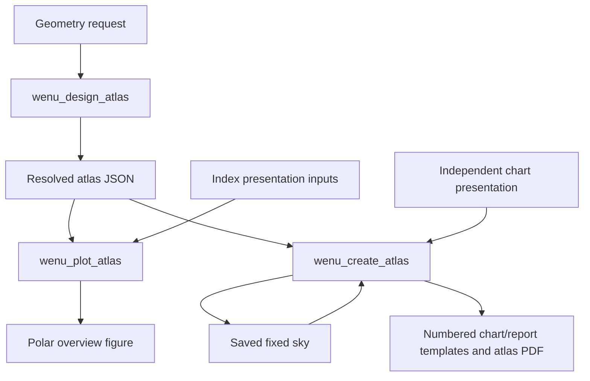

# Creating a sky atlas

**Status (2026-10-10): designer and index plotter accepted and merged.**
The designer was accepted and merged in PR #220 after 413 focused and 3,270
full Mac tests. `wenu_design_atlas` produces resolved JSON;
`wenu_plot_atlas` now consumes it with independent version-1 presentation TOML.
`wenu_create_atlas` now has a chart-page production candidate; see the current
CLI below. Matching report templates and JSON sidecars are available for every
chart; an index PDF enables facing-page assembly. Object inventories and
curation remain pending.
PR #221 passed 543 focused and all 3,313 Mac tests plus SVG visual inspection;
it merged at `49b29d6a`, with branch cleanup and clean Mac synchronization confirmed.
Existing charts continue to use [`wenu_chart`](configuration.md).

## Commands and inputs



| Command | Inputs | Outputs |
|---|---|---|
| `wenu_design_atlas` | Version-1 geometry TOML: page/margins, stereographic field, minimum overlap, overview meridian/band and placement seed; fixed supported orientation/numbering | **Only** a versioned, resolved atlas JSON; no figure and no astronomical catalogue selection |
| `wenu_plot_atlas` | Resolved JSON plus independent overview layout, astronomical layers, typography and export choices | The two overlapping polar overview maps as an index figure, in PNG, PDF or SVG |
| `wenu_create_atlas` | Resolved JSON, independent chart presentation, optional saved fixed sky, chart selector and magnitude override | Numbered chart/report templates and JSON sidecars, optional index/report spreads, ordered atlas PDF and completion manifest; object inventories and curation remain planned |

For example, keep the roles in separately versioned files:
`atlas_design_request_v1.toml`, `atlas_design_v1.json`,
`atlas_index_style_v1.toml` and `atlas_publication_v1.toml`.
The design TOML and designer syntax are specified below. Index TOML is specified below; publication
TOML for facing reports remains proposed; the chart-page presentation candidate is specified below. The JSON is generated by the designer, rather than
manually assembling a list of chart footprints. Increment the filename version
when handing off a changed input or product.

## What the user prepares

1. **Prepare the geometry request.** Choose the physical page, margins (including
   binding), projection and approximate angular field. The starting edition uses
   ISO B4 landscape (353 × 250 mm), with a chart on each right-hand page.
   Choose overlap between neighbouring sheets, the RA of the common meridian
   for the overview pair, and the total angular width of their shared equatorial
   band. Select an initial region (Orion is the proposed starting region),
   orientation and editorial ordering. Compare candidate field sizes, for example
   30°, 40° and 50°, before adopting one; these are trials, not defaults.
2. **Generate and inspect the design.** The designer resolves centres and coverage
   into JSON. Prepare the separate index presentation input and use the plotter
   to examine coverage, sheet numbers and navigation. Iterate on geometry if
   there are gaps, unsuitable fields or inconvenient page joins. Freeze a design
   revision before substantial curation.
3. **Prepare the index presentation input.** Choose the size of the overview
   figure, margins, labels, colours and layers. Optional layers include stars,
   Milky Way, Magellanic Clouds, constellation lines, boundaries and abbreviations.
   Stars of magnitude 4 or brighter are an initial trial, not an adopted limit.
   These choices do not alter sheet coverage or numbers.
4. **Prepare the publication and curation input.** Choose chart layers, selected
   star names and Bayer labels, magnitude limits, appearance and output formats.
   Supply the object selections and notes for reports, indicating interest for
   naked-eye, binocular and amateur-telescope observation; categories may
   overlap. Unreviewed suitability remains pending, rather than being inferred
   from a magnitude threshold.
5. **Produce and review a small sample first.** Create the first chart/report
   pairs, beginning around Orion and a contrasting region, then refine star
   symbols, labels and report layout. After accepting the sample, generate the
   remaining pairs and curate them chart by chart. Keep unplotted objects indexed
   for future zoom subcharts instead of deleting catalogue entries.

## Coverage and the polar index

Each sheet has a centre on the celestial sphere defining its tangent plane,
an orientation, a projection and a useful rectangular viewport. Its spherical
footprint follows from projecting that rectangle; it is not an arbitrary
rectangle of RA and declination. The approximate field size, projection and
page aspect ratio jointly determine its dimensions. Individual sheets overlap
and cover the entire sphere, including two actual polar atlas sheets.

The two **polar overview maps** are separate from those polar atlas sheets.
Their common meridian runs through the centre of the shared area; the opposite
meridian is 12 hours away. The shared band width is a total angular width measured
along that meridian. With a symmetric example width of 20°, the northern overview
extends to declination −10° and the southern overview to +10°. This is an example,
not a default. The shared band, neighbouring-sheet overlap and physical overlap
of the two overview shapes on paper are three different quantities.

The plotter should show the overview maps side by side with their inner contours
clipped/composed across the common area. The roughly one-third shared appearance
is a visual goal to assess in a prototype, not a fixed conversion from angular
width to paper spacing. Index borders show each sheet's primary area without its
overlap; the actual sheet footprint includes that overlap. A sheet appearing in
both overviews has the same number.

Individual sheet projection remains a decision to compare. A tangent plane
alone does not choose between stereographic and gnomonic projection. A finite
gnomonic polar sheet cannot extend to the equator. Stereographic projection is
the intended starting point for the hemispheric overviews; it does not settle
the projection or extent of the individual polar atlas sheets.

## What the resolved JSON records

The versioned JSON must contain the resolved design, not only the generator
recipe: schema version and design revision; coordinate frame and applicable
equinox conventions; paper and useful rectangle; sheet identifiers and editorial
numbers; centres, orientations, projections and projected extents; spherical
footprints, primary areas and neighbours; overview common meridian and shared
band; and generator/input provenance. Stellar source epochs are distinct from
coordinate equinox conventions.

Internal identifiers and editorial numbers have different purposes. The
reproducible numbering rule and identifier behaviour after a redesign use the implemented band rule below; arbitrary retiling must not silently
reuse identities.
Coverage validation must detect gaps and measure overlap. Report ownership
should use primary areas, with cross-references for overlap; extended objects
need footprint-aware membership, not just a centre test.

## Changing a finished design

| Change | User action |
|---|---|
| Individual page useful rectangle, angular field, sheet projection, centres or overlap | Revise geometry input and regenerate the JSON; review numbering and coverage |
| Index size, layout, typography, optional astronomical layers or export format | Revise index presentation input and rerun the plotter with the same JSON |
| Selected objects, chart appearance, notes or report categories | Revise publication/curation input and rerun the affected chart/report products |

Each right-hand chart page is paired with a left-hand landscape page containing
the legend, magnitude key, object report and navigation. Chart pages prioritise
astronomical content; selected Bayer labels and optional constellation boundaries
are envisaged. Coordinate furniture remains an editorial decision.

The producer should reuse the existing chart composition and export pipeline,
initially through orchestration of canonical chart requests or `wenu_chart`
calls after an interface audit. There is no separate rendering pipeline planned.

Implementation stages and acceptance gates are recorded in the
[active developer roadmap](../developer/post_v0.9_architecture_roadmap.md#atlas-organisation-checkpoint-2026-10-09).


## Geometry specimen API available for review

The original specimen milestone supplies Python records in
`wenu.atlas_design`, independently of the installed designer described below.
Define a right-hand page
with explicit margins, a common-meridian RA and total shared-band width, and
an explicit list of sheet centres and horizontal field widths. Nonpolar sheets
default to north up and increasing RA to the left; polar sheets require a
meridian orientation. Angular height is derived from the useful paper rectangle
through the projection. This lets us test physical scale without a star catalogue.

`AtlasGeometrySpecimen` can write/read a versioned file such as
`atlas_geometry_specimen_v1.json`. Its document kind explicitly says specimen
and its coverage status is `unverified`; it must not be used as a finished
whole-sky design. The API checks duplicate identities, invalid coordinates,
unknown JSON keys and disagreement between stored and recomputed geometry.
Diagnostic edge samples do not prove full-sky coverage. Primary areas,
neighbours and automatic placement come later. See the
[specimen API reference](../developer/implementation_reference.md#atlas-geometry-specimen-api-candidate).


## Band-coverage comparison API available for review

This next Python prototype can resolve and validate a complete conservative
band layout. The installed designer adapts this same Python API; the plotter and producer
commands remain planned. It does not
produce an index picture or report pages.

Prepare the physical page and margins, a horizontal field, a minimum angular
overlap between sheets and a separate placement seed RA. The overview join RA
and shared band remain independent. For example, the following is a Python
API example, not the future CLI or TOML format:

```python
from wenu.atlas_design import (
    AtlasPageGeometry, AtlasOverviewGeometry, design_band_atlas,
)

atlas = design_band_atlas(
    "b4-trial", 1,
    AtlasPageGeometry(353, 250, 10, 10, 20, 10),
    AtlasOverviewGeometry(join_ra_deg=82.5, shared_band_width_deg=20),
    field_width_deg=40, overlap_deg=2, seed_ra_deg=82.5,
)
atlas.write_json("atlas_band_trial_v1.json")
print(atlas.validation())
```

With these page/margin/overlap inputs, 30°, 40° and 50° fields give
**236, 128 and 80 sheets**. These are comparison cases, not accepted defaults.
The conservative placement uses the cap inside the shorter side of each
rectangle and therefore uses more sheets than a layout exploiting its full
width. An equatorial row includes the selected seed centre; the number of
sectors decreases toward the polar sheets. Numbering runs south to north,
with increasing RA from the seed in each row.

The JSON stores the resolved centres and primary ownership regions. Its
reader revalidates the whole-sphere partition and containment without
re-running placement. Primary regions partition the sky; full tangent-plane
rectangles include overlap. Shared-boundary neighbours are reciprocal; the
stored overlap is a conservative lower bound, not an actual intersection area.
The coverage check is analytic with a numerical guard, not a sampled-sky
claim or formal interval proof.

Changing overview join/band geometry preserves sheet centres, coverage and
IDs. Changing the page, field, overlap or placement seed requires a new
design revision and a new identifier namespace. Keep each trial JSON under
its own versioned filename and review coverage and sheet count before curation.
The prototype accepts stereographic fields from 5° to 120°, a remaining
inscribed cap of at least 1°, and at most 4,096 sheets; it fails explicitly
if the request cannot fit these bounds. It does not support arbitrary moved
centres or gnomonic tiling yet.

## First visual band-layout specimen (candidate)

The developer example `tools/render_atlas_band_overview_v1.py` now reads a resolved
`AtlasBandTiling` JSON and writes PNG, PDF and SVG. It is a geometry-only
review helper, not the installed `wenu_plot_atlas` command or a finished index.
For a JSON produced by the Python API above:

```bash
python tools/render_atlas_band_overview_v1.py \
  atlas_band_trial_v1.json atlas_overview_40_v1
python tools/render_atlas_band_overview_v1.py \
  atlas_band_trial_v1.json atlas_footprints_40_v1 --footprints
```

Choose a new versioned output prefix on each changed review. Existing products
are preserved. Plotting reads/revalidates the stored geometry; it does not
regenerate placement or change the JSON. Presentation is separate from design.

The two stereographic disks extend to the stored north/south limits. The join
meridian points inward on both disks. Numbers are the persisted editorial
numbers, placed at sheet centres visible in each view; a shared-band centre
has the same number on both. Thin rim fragments of primary regions are drawn
without moving an off-view centre's number onto the rim. Every sheet centre
appears in at least one disk, including both actual polar sheets.

Blue borders show primary ownership. Optional magenta outlines show sampled
complete inverse-defined rectangular footprints, including overlap; green
highlights the primary owner of the seed RA at declination zero. Ocher lines
identify the equator, shared-band boundaries and join meridian. Display samples
are not new coverage evidence; the JSON's analytic validation is authoritative.

For this first comparison, disks remain separate so no sky area is concealed
by paper composition. The intended overlapping/clipped index layout, optional
astronomical layers and individual chart/report pages remain subsequent work.
Review 30°, 40° and 50° specimens (236/128/80 sheets for the example geometry)
before adopting a field. The conservative band algorithm remains a trial,
not an optimized atlas layout.

## Five-interior-band comparison (candidate)

A second Python layout follows the requested structure: one equatorial band,
two further bands per hemisphere, and one actual chart at each pole. It uses
the full B4 rectangles rather than an inscribed cap for interior coverage:

```python
from wenu.atlas_design import (
    AtlasPageGeometry, AtlasOverviewGeometry, design_five_band_atlas,
)
atlas = design_five_band_atlas(
    "b4-five-band", 1,
    AtlasPageGeometry(353, 250, 10, 10, 20, 10),
    AtlasOverviewGeometry(82.5, 20),
    field_width_deg=50, overlap_deg=0.25, seed_ra_deg=82.5,
    equatorial_half_height_deg=17, middle_boundary_dec_deg=45,
)
atlas.write_json("atlas_five_band_v1.json")
```

This trial has **34 sheets**: 8 equatorial, 7 in each inner sub-equatorial
band, 5 in each outer band and 2 polar. All useful rectangles are 323 × 230 mm
and share the same 50° central horizontal field/physical scale. Primary RA
intervals are 45°, 360/7° (about 51.43°) and 72°, respectively; these are
ownership widths, not the complete footprint's RA span at every declination.
The equatorial primary band runs from −17° to +17°, inner bands to ±45°,
outer bands to about ±72.1833°, and polar ownership covers the remaining caps.
These primary boundaries are not straight borders of the projected footprints.

The requested 0.25° (15 arcminutes) is a **minimum** overlap near every shared
primary boundary. Actual overlap varies across rectangular footprints and can
be larger, including near corners and poles. It is not a uniform 0.25° strip
everywhere. The new analytic check covers entire primary sectors and reserves
their angular neighbourhoods inside all four rectangle edges; display samples
do not establish the no-gap claim. Exactly contiguous bands and full RA
partitions cover the sphere. This is a guarded floating-point argument,
not formal interval arithmetic or a globally optimal tiling.

Render the same JSON with the existing review tool:

```bash
python tools/render_atlas_band_overview_v1.py \
  atlas_five_band_v1.json atlas_five_band_overview_v1
python tools/render_atlas_band_overview_v1.py \
  atlas_five_band_v1.json atlas_five_band_footprints_v1 --footprints
```

The earlier cap-based comparison stays available. This alternative requires
visual review before adopting its field, latitude boundaries or overlap.

## Composed astronomical index candidate (2026-10-09)

The geometry, separate-view plotter and five-band comparison were accepted,
merged and Mac-cleaned through PRs #216–#218 at main `cca31a82`. The following
candidate extends the same developer tool; only the designer command described below is installed; the plotter and
producer commands remain planned.

```bash
python tools/render_atlas_band_overview_v1.py \\
  atlas_five_band_v1.json atlas_joined_overview_v1 \\
  --joined --astronomy --star-magnitude-limit 5.5
python tools/render_atlas_band_overview_v1.py \\
  atlas_five_band_v1.json atlas_joined_footprints_v1 \\
  --joined --astronomy --star-magnitude-limit 5.5 --footprints
```

Each invocation reads and revalidates the resolved JSON, then writes PNG, PDF
and SVG under a new versioned prefix. Plotting does not rerun placement or
modify the JSON. Omitting `--joined` retains separate disks; omitting
`--astronomy` retains geometry-only review. The magnitude limit must be
finite, positive and at most 11.

The north disk is on the left and the south disk on the right. Equal physical
projection scales put the inward equatorial point at the JSON's join RA at
one common page position. Caps beyond the equator produce intersecting disk
contours. A vertical bisector chooses north content on the left and south
content on the right inside the paper lens. Each complete own hemisphere
survives this cut, so the composition preserves all-sky coverage. Both full
outer contours remain visible. A zero-width shared band gives tangent disks.

The common sky band is an RA-complete declination band, not the small lens on
the page. The two polar projections agree at the join point and cannot be
registered point for point throughout that band. Shared objects and primary
numbers can appear in both views. Sheet overlap, shared sky-band width and
page-contour intersection remain different quantities.

Optional astronomical content uses existing Hipparcos stars, western
constellation figures/abbreviations and D3-Celestial Milky Way rings through
`CelestialSphere.draw_chart()`. It uses native catalogue ICRS directions;
there is no observer, time, ephemeris, apparent-place calculation or proper-
motion propagation. Hipparcos coordinates/figure vertices/derived label
anchors retain their native J1991.25 catalogue epoch; morphology carries no
stellar epoch. This is an orientation index, with the existing catalogue and
source provenance, not a current-date observing chart. Faint constellation
vertices remain available to figures independently of the stellar marker cut.
The filled Milky Way preserves source ring holes and handedness. Index
appearance and density do not alter the B4 chart layout or coverage certificate.


The accepted lower-density index can be reproduced with stars through magnitude
4.5, the faint OL1 Milky Way envelope added to OL2–OL5, and both Magellanic
Clouds. These are optional plotting choices; the default remains magnitude
5.5 with OL2–OL5 and no Clouds. Use a new versioned output prefix:

```bash
python tools/render_atlas_band_overview_v1.py atlas_five_band_v1.json atlas_joined_overview_mag45_v2 --joined --astronomy --star-magnitude-limit 4.5 --include-lowest-mw-isophote --magellanic-clouds
python tools/render_atlas_band_overview_v1.py atlas_five_band_v1.json atlas_joined_footprints_mag45_v2 --joined --astronomy --footprints --star-magnitude-limit 4.5 --include-lowest-mw-isophote --magellanic-clouds
```

`--include-lowest-mw-isophote` and `--magellanic-clouds` require `--astronomy`.
The Clouds use all four levels from each existing Gaia-derived source snapshot,
with their source rings, holes and compound grouping retained. Their native ICRS
morphology is realized in the existing Magellanic Cloud layer, with no observer
or assigned epoch; the usual observed rendering remains available. The same
resolved JSON and its chart IDs, scale, primary regions and coverage are used.


## Installed geometry designer candidate

`wenu_design_atlas --config REQUEST_TOML --output NEW_JSON` is the installed
adapter for the existing complete stereographic band designers. It produces
only one resolved JSON, with diagnostics on stderr. It does not produce a
figure, read a catalogue, construct an observer or use a network service.
This milestone exposes the supported geometry methods; it does not adopt the
example's page/profile values as universal defaults or finish atlas publication.

The repository example `examples/atlas_design_request_v1.toml` reproduces the
accepted 34-sheet B4 layout. After updating the editable installation, run:

```bash
wenu_design_atlas --config examples/atlas_design_request_v1.toml --output /tmp/atlas_design_v1.json
```

The module route `python -m wenu.cli.atlas` accepts the same arguments.
Choose a new versioned destination for each review. The output parent must
already exist. Existing files and symlinks are rejected, including a file that
appears during publication. The complete JSON is published atomically; failed
validation produces no JSON and publication failures remove temporary files.
Ordinary input/filesystem failures exit 2 with a concise error; interruption
exits 130. There is no overwrite flag. Input TOML is left unchanged.

### Version-1 request contract

This is a separate atlas protocol, not a schema-v2 `wenu_chart` overlay.
All keys are closed: missing required keys, unknown keys and duplicate TOML
definitions are errors. Every geometric number must be finite, with no numeric
strings or Boolean substitutes. The top-level fields are:

| Field/table | Required content |
|---|---|
| `schema_version` | Integer `1` |
| `document_kind` | `"wenu-atlas-design-request"` |
| `design_id`, `revision` | Nonempty trimmed identity; positive integer revision |
| `coordinate_frame`, `projection` | `"icrs"`, `"stereographic"` |
| `[page]` | `width_mm`, `height_mm`, `top_mm`, `bottom_mm`, `inner_mm`, `outer_mm` |
| `[overview]` | Exactly one of `join_ra_deg` or `join_ra_hours`, plus `shared_band_width_deg` |
| `[tiling]` | `algorithm`, `field_width_deg`, `overlap_deg`, exactly one of `seed_ra_deg` or `seed_ra_hours`; optional `max_sheets` (default 4096) |

RA is in [0,360) degrees or [0,24) hours; explicit hours convert by 15 degrees
per hour. Persisted JSON always uses degrees. Page width/height are positive;
margins are nonnegative and must leave a positive useful rectangle. The field
is the full central horizontal angular span in [5,120] degrees. Height follows
from the projected useful-paper aspect, not direct angular scaling. Minimum
sheet overlap is nonnegative degrees; it is independent of the overview's
total shared band in [0,180) degrees and of the physical index lens.

Algorithm `five_band` additionally requires `equatorial_half_height_deg` and
`middle_boundary_dec_deg`. Ordered positive boundaries must fit the resolved
polar extent and sheet budget. Algorithm `cap_bands` rejects these profile
keys and chooses its own latitude-band count using the accepted inscribed-cap
method. Infeasible requests fail instead of returning a partial atlas.

Interior sheets are north up with RA increasing left; the seed orients polar
sheets and places a centre in every interior row. The overview join RA does
not control placement. Numbering runs south to north and increasing RA from
the seed within each row. Arbitrary orientations, editorial reorderings,
free-centre layouts, gnomonic projection and other coordinate frames are not
supported by request version 1; they require a later contract.

### Resolved output and subsequent plotting

Output retains the existing schema-v1 `wenu-atlas-band-tiling` format without
adding a second wrapper. It stores exact resolved sheet geometry, physical
page, primary bands, overview geometry, seed/overlap, versioned generator
method, reciprocal neighbours and recomputable validation. It contains no
generated timestamp. Keep the generating TOML alongside the JSON; the JSON
does not embed the original TOML bytes or its processing-only sheet budget.
Equivalent hours/degrees inputs produce identical JSON. The embedded geometry
specimen remains unverified in isolation; whole-sphere evidence belongs to
the outer band-tiling envelope. This is guarded analytic floating-point
validation, not formal interval certification or globally optimal tiling.

The unchanged developer tool reads this output directly, without rerunning
placement. For example:

```bash
python tools/render_atlas_band_overview_v1.py /tmp/atlas_design_v1.json /tmp/atlas_index_v1 --joined --astronomy --star-magnitude-limit 4.5 --include-lowest-mw-isophote --magellanic-clouds
```

The installed `wenu_plot_atlas` adapter is the next milestone; individual
chart/report pairs and their publication inputs follow separately.


## Installed index plotter candidate

`wenu_plot_atlas --design RESOLVED_JSON --config PRESENTATION_TOML --output-prefix NEW_PREFIX`
reads and revalidates the existing design. It never reruns placement, changes
sheet identity/numbers or rewrites JSON. Export a joined index using the authored
`examples/atlas_index_style_v1.toml`:

```bash
wenu_plot_atlas --design /tmp/atlas_design_v1.json \
  --config examples/atlas_index_style_v1.toml \
  --output-prefix /tmp/atlas_index_v1
```

Use a fresh prefix with no extension and an existing parent directory. The
command prints the produced paths. Requested existing files and symlinks are
preserved. All formats render in a temporary directory before no-clobber
publication; render failure, a concurrent destination or interruption cleans
this invocation's outputs. Multiple-file publication is not a transactional
filesystem operation across a process crash.

The closed schema requires `schema_version = 1`,
`document_kind = "wenu-atlas-index-presentation"` and every field below.
Unknown keys, duplicate list entries, missing fields and unsupported versions
are rejected; schema-v2 chart configuration is a different input.

| Table | Required fields and meaning |
|---|---|
| `layout` | `joined`, `footprints`: booleans; `width_mm`, `height_mm`: figure dimensions from 50 to 1,000 mm. These do not change atlas-sheet paper geometry. |
| `content` | `layers`: any subset of `stars`, `constellation_lines`, `constellation_labels`, `milky_way`, `magellanic_clouds`; an empty list makes a geometry-only index. `star_magnitude_limit`: finite −2 through 11. `milky_way_levels`: a unique subset of `ol1`–`ol5`, nonempty exactly when Milky Way is enabled. |
| `typography` | `heading_size_pt`, `number_size_pt`, `text_size_pt`: 2–72 pt. These control index headings, sheet numbers and explanatory text. Astronomical labels use the canonical atlas style. |
| `colours` | `paper_color`, `ink_color`, `border_color`, `highlight_color`, `guide_color`, `footprint_color`: Matplotlib colour strings controlling index furniture and overlays; catalogue layers use canonical atlas styling. |
| `export` | `formats`: a nonempty unique subset of `png`, `pdf`, `svg`; `dpi`: integer 72–1,200; `transparent`: boolean for figure background. No tight crop, so physical figure dimensions remain fixed. |

The supplied example retains the accepted joined composition, magnitude 4.5,
OL1–OL5, both Clouds and footprint overlay. The join RA, shared sky band and all
34 numbers come from JSON; layout controls their figure presentation. A joined
pair bisects the paper lens while preserving both complete contour guides.
Separate disks use `joined = false`. Primary borders exclude sheet overlap;
`footprints = true` adds the sampled complete sheet boundaries.

Native Hipparcos J1991.25 directions and fixed ICRS morphology retain their
source identities, without observer, ephemeris or epoch propagation. Lines and
abbreviations need catalogue vertices internally even when stars are hidden.
IAU constellation boundaries and moving/observer layers are not admitted by
this first index presentation schema. They require their own coordinate seam.
The earlier developer tool remains a compatibility adapter to this same owner.
Chart/report-page production is the next separate milestone.


### Configurable celestial veil

The optional `[veil]` table contains exactly `enabled` (boolean), `color`
(a Matplotlib colour string) and `opacity` (finite number from 0 to 1).
Opacity 0 is completely transparent; 1 hides the celestial objects completely.
Omitting this table disables the veil, preserving version-1 input compatibility.

`examples/atlas_index_style_v2.toml` retains the preceding astronomical choices
and adds a white veil with opacity 0.55. It remains a schema-version-1 input;
`v2` versions this authored example and its changed appearance.

The veil is drawn inside each projected cap above celestial objects and below
primary borders, footprint overlays, guides and sheet numbers. It follows the
joined-lens clipping and export DPI, leaving outer paper and explanatory text
unchanged. It has no effect on geometry-only indices, disabled/zero-opacity
views or the source JSON. Use a fresh output such as `atlas_index_v2`.

### Atlas SVG hierarchy

The index declares semantic identities before export. Each hemisphere contains
celestial content (existing catalogue layers, constellations and isophotes), a
veil, atlas charts keyed by JSON chart number, guides and its heading. Global
furniture names the title, subtitle and legends. For example,
`chart-14-primary-boundary-north`, `chart-14-footprint-south` and
`chart-14-number-label-north` carry `data-chart-number` and `data-role`.
Star marker instances use catalogue HIP identifiers, such as
`star-hip-24436-south`; repeated decorative marker overlays have distinct IDs.
Constellation and morphology identities retain their canonical source keys
with a hemisphere suffix. Every SVG ID is unique across the paired index.

Editor groups expose one **North Disk** and one **South Disk**. Each contains
Stars (individual HIP markers), Constellations (one group per canonical
abbreviation, with Lines and Label), Milky Way, optional Magellanic Clouds,
Veil, Guides, Charts and Heading. Each chart occurs once per visible disk:
`Charts → Chart 21 → Primary Boundary / Full Footprint / Label`.
Boundaries are directly editable paths. The Label retains only its editable
Text and white Background, preserving the number's backing box; anonymous
backend wrappers and repeated semantic ancestors are removed. A chart wholly
outside a disk does not create an empty footprint or chart group.

Chart furniture is drawn together, in ascending chart-number order, above the
veil and guides in every format. Within each chart the primary boundary is
followed by its full footprint and number. Constellation lines and labels are
also grouped together, below star symbols. This explicitly declared order
permits one physical group per chart or constellation without SVG-only
reordering of celestial geometry. Full joined contours belong to their own
disk and remain unclipped. SVG explicitly retains the intersection of each
disk's half-page rectangle and native path clip, matching PNG/PDF at the join. Global Title, Subtitle and Legends are separate.
Technical marker definitions and clip paths retain backend-owned identifiers.

## Publication batch contract candidate (2026-10-10)

The next command, `wenu_create_atlas`, is **not runnable** yet.
Its [audit and proposed publication contract](../developer/post_v0.9_architecture_roadmap.md#atlas-publication-audit-and-batch-contract-candidate-2026-10-10)
separates design geometry, presentation/curation and execution settings.

Chart selection will accept a comma-separated union of numbers, inclusive
ranges and case-insensitive groups: `3..6,20..21`, `S`, `N`, `E`,
`S,20..21,34`, or `all`. S/N/E mean negative/positive/zero centre
declination in the resolved design. They do not mean every footprint crossing
a hemisphere. Polar sheets belong to S or N. In the accepted 34-sheet example,
S = 1..13, E = 14..21 and N = 22..34. Numbers retain their atlas identities;
duplicates disappear and output follows atlas-number order. Invalid or empty
requests fail before catalogue loading.

An explicit preparation operation alongside `wenu_plot_atlas` will load and
prepare the full admitted sky once and save a versioned data bundle on disk.
Its content profile is independent of which stars appear in the index image.
The third command will consume that bundle and publication parameters. Later
invocations reuse its verified records without rebuilding the sphere or loading
the original catalogues; reading and validating the snapshot still takes time.
An insufficient snapshot fails explicitly rather than silently omitting objects.
This persistence is proposed; the installed plotter currently exports figures only.

Independent processes will select, project,
place labels, render and report each chart from that prepared data. A worker
must not reload the catalogues or reconstruct the whole sphere per chart.
Mac spawn startup and memory transport must be measured; worker count is an
execution setting and does not change chart content. Serial execution remains
available for comparison. Worker cleanup preserves the reusable sky bundle.
Reusing the sky does not automatically skip already rendered chart files.

Each right-hand chart page retains the exact JSON paper/viewport/scale, with
a mirrored left-hand report page. For the B4 example each page is 353 x 250 mm.
The initial native atlas retains Hipparcos J1991.25 positions in ICRS, with no
observer, current-date propagation or moving objects. Additional native layers
require explicit admission. Reports retain catalogue identity, primary versus
overlap membership, designation cautions and authored notes; pending observing
interest is not inferred from magnitude alone.

The initial publication review will use Orion and a contrasting region, before
a full batch. All requested pairs must succeed before a completed publication
is exposed. Failures identify the chart; report overflow cannot silently remove
objects. New versioned destinations preserve earlier reviews. Exact schema
keys, installed syntax and runtime behavior remain candidates, not implemented
features.


### Planning a selected publication batch (Python API)

The first publication runtime slice plans sheets without drawing them. Selection
accepts `all`, comma-separated numbers, inclusive ranges such as
`3..6,20..21`, and unions with case-insensitive `S`, `N`, `E`.
Groups follow sheet centre declination; overlapping footprints do not change
group membership. Numbers retain atlas order and are never renumbered.

For a validated design, use the advanced API:

```python
from pathlib import Path
import hashlib
from wenu.atlas_design import AtlasBandTiling
from wenu.charts.atlas_publication import AtlasPublicationBatchRequest

raw = Path("atlas_design_v1.json").read_bytes()
atlas = AtlasBandTiling.from_json(raw.decode("utf-8"))
request = AtlasPublicationBatchRequest.from_dict({
    "schema_version": 1,
    "document_kind": "wenu-atlas-publication-batch-request",
    "publication_id": "book-atlas", "revision": 1,
    "design_id": atlas.geometry.design_id,
    "design_revision": atlas.geometry.revision,
    "design_sha256": hashlib.sha256(raw).hexdigest(),
    "charts": "3..6,20..21", "jobs": 2,
})
plan = request.resolve(raw)
print(plan.chart_numbers, plan.worker_count)
```

An independently authored request must retain the expected hash and identity;
recomputing its hash from a changed design intentionally creates a new binding.
Optional resolution overrides `charts=` and `jobs=` are retained in the plan.
Worker count is capped at the number of selected sheets. Planning constructs no
celestial sphere and starts no workers. The installed atlas producer, persisted
full-sphere data and parallel chart rendering remain upcoming milestones.


### Saving native celestial content (Python API candidate)

You can now prepare a reusable data bundle independently of index formatting:

```python
from pathlib import Path
from wenu.sky.native_snapshot import (
    prepare_native_sky_snapshot, read_native_sky_snapshot,
)

raw = Path("atlas_design_v1.json").read_bytes()
digest = prepare_native_sky_snapshot(raw, "native_sky_v1")
# In a later Python session, reuse the same saved revision:
snapshot = read_native_sky_snapshot("native_sky_v1",
                                    expected_manifest_sha256=digest)
snapshot.require(layers=("stars", "constellation_lines"),
                 star_magnitude_limit=6)
sky = snapshot.make_sky()
```

Save the returned manifest digest alongside your project to bind later reuse to
the selected revision. The bundle contains the exact design and the entire
admitted native sphere, with stellar coverage through magnitude 11 by default,
all western figures, all Milky Way levels and both Clouds. Index brightness
limits and chart selection cannot prune it. Stars retain their native J1991.25
ICRS positions and frozen designations/research evidence. Loading a bundle reads
and verifies its data, then constructs local native layer views without loading
the original catalogues again. A changed installed catalogue does not silently
refresh a saved bundle; prepare a new versioned destination explicitly.

Insufficient coverage, unsupported layers or corrupted data produce an error.
Version 1 excludes deep-sky objects and IAU boundaries. Version 2 adds the
fixed-content layers described below; moving bodies and observer coordinates
remain excluded. Existing bundles are never overwritten; partial
publication cannot be admitted without its final manifest. This API is the data
layer milestone. Snapshot flags for the installed plotter, the installed atlas
producer and parallel workers remain next steps.


### Required complete-content coverage

The tested native snapshot API is the accepted persistence foundation. The
required final atlas bundle includes all fixed celestial object types supported:
its deep-sky catalogues as well as the stellar/isophote content, official
constellation boundaries and reference layers. New preparation now produces
version 2 with this fixed-content coverage. Existing v1 bundles remain readable
and retain their declared limited coverage; requests for their missing layers
fail instead of silently reloading sources.

All moving bodies and artificial satellites are outside the atlas scope for the moment,
including planets, the Moon, asteroids and comets. The atlas remains independent
of observation time and ephemeris resources. A future moving-object extension
requires a separate decision. Index appearance and chart subsets must never determine
which source records are saved.


### Fixed-content snapshot v2

The prepare/read Python example above now saves v2. It retains the complete
normalized source tables for Messier/nonstellar objects, galaxies, open and
globular clusters, supernova remnants and planetary nebulae, including their
catalogue identifiers, coordinates, dimensions, classifications, masks, units
and metadata. It also saves official boundary vertices in their original
FK4/B1875 frame and fixed reference definitions. These records are independent
of index magnitude, chart selection and subsequent catalogue changes. Original
layer owners realize the curves, symbols, transformed boundaries and reference
geometry. Later reuse does not reopen source catalogues or build the sphere.

For example, require(layers=("stars", "galaxies", "constellation_boundaries"))
admits those layers in v2 and rejects them in a limited v1 bundle. Extra
admitted reference names are equatorial_grid, ecliptic_grid, galactic_grid and
celestial_points. Equatorial references use ICRS; ecliptic references use an
explicit J2000 convention. Their reference epoch does not propagate or alter
Hipparcos source positions. Moving bodies and artificial satellites are absent.
New destinations are still required; an old bundle is never overwritten or
silently upgraded. CLI snapshot handoff and parallel atlas production remain
subsequent milestones.


## Creating all atlas chart pages (current candidate)

The third command accepts the agreed CLI. This replaces the historical proposed
`--scene` handoff above. It produces every selected chart page and an ordered
vector `atlas.pdf`. With `--index PDF` it includes the index and reserved facing report pages; object inventories and per-object curation remain pending.
Presentation is independent of index styling and saved full-sky content.

```bash
wenu_create_atlas --design atlas_design_v1.json \
  --config examples/atlas_chart_style_v1.toml \
  --charts all --jobs 2 --save-sky fixed_sky_v2 \
  --output-dir atlas_pages_v1

wenu_create_atlas --design atlas_design_v1.json \
  --config examples/atlas_chart_style_v1.toml \
  --charts 10,14 --jobs 1 --from-sky fixed_sky_v2 \
  --output-dir atlas_sample_v2
```

Use the actual resolved JSON and fresh versioned destination directories with
existing parents. For the supplied 34-sheet design, chart 14 contains the Orion
centre (RA 83°, Dec -5°), chart 10 the Scorpius centre (RA 247°, Dec -26°);
the constellations can extend into neighbouring sheets. Numbers are design-specific.
Selection also supports inclusive ranges and S/N/E groups, as described above.
With neither sky switch the command prepares once in temporary storage. The two
sky switches are mutually exclusive. `--jobs 1` enables the serial cold/saved
comparison; processes default to two and are capped by selected charts.

The schema-version-1 `wenu-atlas-chart-presentation` TOML admits only style,
dpi, star_magnitude_limit, layers and formats. The example includes all six DSO
layers and stars, western figures/labels, IAU boundaries, Milky Way, both Clouds
and the equatorial grid. The retained sphere is more complete than what any
chart displays. General filters and per-chart include/exclude editing will be
added separately; don't edit the saved sphere to curate a chart.

Output contains `chart-NN.png`, `.pdf`, `.svg` (according to formats), combined
`atlas.pdf`, and `manifest.json` recording exact design/snapshot identity,
resolved presentation, actual worker count and product checksums. All PDFs keep
the JSON physical page size and useful rectangle, with no tight crop. PDF is
required in formats for atlas assembly. Numbers remain unchanged in subsets.
The complete manifest appears only after all requested pages succeed.

Existing outputs are never overwritten. A failed batch removes only its own
staging and incomplete final products; a completed saved sphere is preserved.
Reuse verifies the declared frozen data and rejects insufficient coverage or a
different design without refreshing sources. It does not skip existing charts.
Workers finish their active render before shutdown after failure/cancellation.
The new pypdf dependency assembles PDF pages without rasterizing their content.


### Index and facing report pages (current candidate)

Supply `--index atlas_index_v2.pdf`, the one-page vector PDF produced by
`wenu_plot_atlas`, to create the book layout. The input index is read once and
its exact SHA-256 is recorded; index appearance does not select chart contents.
Choose the index generated from the same resolved design. The PDF itself has
no machine-verifiable design binding; an arbitrary supplied PDF is not proof
that its chart outlines match that design. No index sky is recreated.

Page 1 is the index. Page 2 is the report reserved for the first selected chart,
page 3 its chart, then the next report/chart pair on pages 4/5. Every chart is
on an odd right-hand page even for a sparse selection such as `10,14`; chart
numbers are retained. A full 34-chart design yields 69 pages. Report pages use
the chart's exact landscape/portrait dimensions and orientation, with binding
margins mirrored. The wider left column is reserved for the future object
report; actual symbol and stellar magnitude legends occupy the right column.
These are the canonical legend owners using the resolved chart appearance and
already-rendered star geometry. No second sky render or sphere preparation is
performed. Disabled stars omit the magnitude key. Legend overflow fails the
batch instead of hiding or cropping the key.

The index is fitted proportionally into the existing paper margins, without
rotation, rasterization or a change to chart geometry. Only an unencrypted
one-page PDF is admitted, before any sky preparation. Index input is preserved.
Output additionally includes `chart-NN_report.pdf`; `manifest.json` records the index
digest, reserved report status and explicit physical page order. PDF bookmarks
identify the index and charts. Without `--index`, the chart-only layout remains
available. Report content, object inventories and editorial curation are future
work; an empty report area does not claim that the chart has no objects.

```bash
wenu_plot_atlas --design atlas_design_v1.json \
  --config examples/atlas_index_style_v2.toml --output-prefix atlas_index_v2
wenu_create_atlas --design atlas_design_v1.json \
  --config examples/atlas_chart_style_v1.toml --index atlas_index_v2.pdf \
  --charts all --jobs 2 --from-sky fixed_sky_v2 --output-dir atlas_book_v2
```

### Magnitude experiments and report templates

`--magnitude-limit NUMBER` overrides `star_magnitude_limit` in the presentation
TOML. Values must be finite in -2 through 11 and covered by the saved snapshot.
Changing this limit does not rebuild a sufficient saved sphere. The limit
selects stars, not deep-sky objects. It does not alter the independently styled
index. General and per-object filters remain later work.

The stellar key remains specific to each chart. Its first integer is the floor
of the brightest plotted magnitude, so it is at least as bright as every
plotted star: 1.1 starts at 1; -1.46 starts at -2. Its last integer is the ceiling
of the faintest plotted magnitude. Sizes use the canonical chart star-size
law. No stars means no stellar key.

Each selected chart now always produces report templates in the same requested
formats, even without `--index`. For example, `chart-21.png`, `.svg`, `.pdf`
have matching `chart-21_report.png`, `.svg`, `.pdf` and
`chart-21_report_data.json`. There is no separate `report-21.pdf` alias.
The report has the same useful frame width/height and paper orientation as
its chart, with inner/outer margins mirrored. The two legends share a right
edge inset 4 mm from that frame. The object legend includes the chart number
and ICRS centre RA/Dec. At a pole, RA is undefined; the separate tangent
meridian specifies orientation and is labelled accordingly.

The JSON sidecar is a version-1 `wenu-atlas-chart-report` document. It records
the chart number/sheet identity, exact design/snapshot hashes, effective
presentation, centre coordinates, physical page and report/legend/frame boxes
in millimetres from the bottom-left origin, and visible-star statistics/key
range. Its `report.sections` is an empty ordered list reserved for future
formatted report content. `report.inventory_status = "not_generated"` makes
clear that it is a template, not an empty object inventory. A future report
formatter can use these boxes to place content without changing chart geometry;
reading edited sidecars and populating object inventories are not implemented
by this candidate. JSON needs no additional parser dependency.

For the supplied design, Orion is chart 14, Scorpius 10, the Virgo centre
(RA 186°, Dec 12°) is in chart 16, and the polar caps are 1 and 34. The full
constellations may extend into neighbouring sheets. Example saved-sky experiment:

```bash
wenu_create_atlas --design atlas_design_v1.json \
  --config examples/atlas_chart_style_v1.toml --charts 1,10,14,16,34 \
  --magnitude-limit 5 --jobs 2 --from-sky fixed_sky_v2 \
  --index atlas_index_v2.pdf --output-dir atlas_sample_mag5_v3
```

With an index, the combined PDF keeps index/report/chart order (11 pages for
this selection). Without an index, its combined PDF remains chart-only; the
separate report products and JSON are still exported. Completion-manifest
checksums cover every report format and sidecar.


### Report chart heading

The object legend box in the right-hand report column contains the enlarged
`Chart N` heading, a horizontal rule, and the centre metadata/object key below. The stellar key remains
below. The default heading is three times the current object-key title size;
centre metadata and legend entries retain their sizes. Page headings are separate.

Optional root keys in the chart-presentation TOML (schema version 1):

```toml
report_label_scale = 3.0
report_label_family = "sans-serif"
report_label_weight = "normal"
report_label_color = "black"
report_separator_width = 0.8
report_separator_gap_mm = 3.0
```

The scale multiplies the resolved legend title size. Separator width is in points;
the gap is in millimetres on each side of the rule. The rule uses the heading
colour. Positive finite numeric values, a valid colour and an admitted font
weight are required. Font families must be available on the rendering system.
Oversized legends fail explicitly rather than intruding into the report text. The report JSON records the heading, rule and remaining legend
rectangles; the effective presentation is retained in its provenance.
These settings do not change chart geometry, page headings or stellar symbols.

The chart itself contains a framed number only (for example `10`) inside its
useful sky rectangle, at the upper-right corner by default. Its type size,
family, weight and colour match the report heading. The former chart heading
above the frame is removed. Optional presentation keys:

```toml
chart_number_box_visible = true
chart_number_box_location = "upper right"
chart_number_box_facecolor = "white"
chart_number_box_edgecolor = "#777777"
chart_number_box_alpha = 0.9
chart_number_box_padding = 0.4
chart_number_box_borderpad = 0.0
```

Location admits upper/lower left/right. Zero borderpad makes the box flush
with both selected frame edges; padding controls space inside the box.
Both values are nonnegative multiples of its font size; alpha is in [0, 1].

Atlas stellar diameter control: the chart presentation accepts optional
`star_size_scale` (finite positive multiplier, default `1.0`). The example
`examples/atlas_chart_style_v1.toml` now uses `1.5`: every stellar marker is
50% larger in diameter (2.25 times its area), including bright-star markers,
variable/multiple overlays and the report magnitude key. The canonical
render-local style override applies after style/mode resolution; magnitude
selection, source sky, atlas geometry and index presentation are unchanged.
Set `star_size_scale = 1.0` to recover the previous sizes.

## Measure star sizes from atlas SVG files

The offline script reads existing SVGs; it does not regenerate charts, load a
stellar catalogue, or create an observer or celestial sphere. For example:

```bash
python tools/analyze_atlas_star_areas.py output/atlas_mag8 \
  --output-prefix output/atlas_star_areas_v1 --bins 30
```

You can also supply individual files, separated by spaces:

```bash
python tools/analyze_atlas_star_areas.py \
  output/atlas_mag8/chart-10.svg output/atlas_mag8/chart-34.svg \
  --output-prefix output/selected_star_areas_v1 --bins 30
```

Directory inputs select only `chart-NN.svg`, excluding report pages. Explicit
SVG inputs may also be atlas indexes. Duplicate input paths are removed. The
output directory must exist; the output prefix must be new. The script writes
PNG, PDF and SVG plots, `_stars.csv` (one row per marker), `_bins.csv` (bin
boundaries and counts), and `_summary.json` (per-file counts and conventions).

Both axes use base-10 logarithms. Counts are appearances per equal-width bin
in log area, not cumulative counts or number per square millimetre. Empty bins
remain in the CSV but have no log-count point. Overlapping charts count repeated
appearances separately; no unique-star identification or catalogue cross-match
is inferred.

Area is the full filled SVG silhouette in square millimetres of the printed
page, including inherited affine transforms and physical page scaling. It is
not the Matplotlib scatter parameter `s`, the stellar flux, or angular area.
Strokes, labels, legend markers and variable/multiple classification overlays
are excluded. Bright filled star markers are included. Zero-area and hidden
markers are excluded. A marker must have its centre inside the page and its
SVG clips; a partly clipped marker retains its full symbol area.

The supported Wenu vector subset comprises line, quadratic and cubic Bezier
paths, circles, local marker references and affine transforms. Unsupported
marker path commands, malformed/cyclic references, nonuniform root viewport
scaling and unsupported clip shapes fail explicitly. Rasterized stellar layers
without vector markers cannot provide these measurements. Use the original
Wenu exports; arbitrary CSS, masks, filters and complex editor geometry are
not an SVG-renderer compatibility promise.

Magnitude references are added automatically when all chart SVGs have matching
SHA-256 entries in adjacent atlas batch `manifest.json` files and share the
`atlas` print style, diameter multiplier and magnitude limit. Vertical dashed
lines use Wenu's canonical magnitude sizing and circular marker geometry;
magnitudes are annotated along the top. Older manifests without
`star_size_scale` use the original multiplier `1.0`. The minimum symbol area
collapses a range of faint magnitudes to one position: for the current atlas
preset and a limit of 8, that line is labeled `5.50–8`. It does not imply that
individual magnitudes can be recovered from those identically sized symbols.
The guide values and their availability status are saved in the summary JSON.

Missing manifests, edited SVGs or incompatible presentations retain the area
histogram but omit magnitude guides, with an explicit status. Use
`--no-magnitude-guides` to disable them. Resolving these appearance references
does not create a sky or reload catalogues.

## Shared stellar-sizing experiments

Stellar sizing is shared with regional, binocular, all-sky and planisphere
charts. `StellarMagnitudeSizing` selects `legacy` (unchanged exponential scatter
area with clamps), `linear` (diameter linear in magnitude difference), or
`asinh` (diameter with smooth bright-end compression), or `quadratic`
(diameter quadratic in magnitude difference). The new curves are Wenu
experimental policies, not implementations attributed to Toshimi Taki.

For the new laws, define `t = max(0, size_reference_magnitude - m)`:

- linear: `d_mm = dmin_mm + a_mm * t`;
- asinh: `d_mm = dmin_mm + a_mm * asinh(t / b_mag)`;
- quadratic: `d_mm = dmin_mm + a_mm * t**2`.

Scatter size is `(72 * d_mm / 25.4)^2`; the recorded circular vector geometry
converts that size to filled area. The minimum belongs to the sizing reference,
not necessarily the selection limit. Set a reference of 8 for both magnitude-6
and magnitude-8 comparisons. The selection limit must not exceed the reference;
otherwise the experiment would reintroduce an in-range faint-size plateau.

Shared `wenu_chart` switches are `--mag-algorithm`, `--mag-dmin` (mm),
`--mag-a` (mm), `--mag-b` (magnitudes, used by asinh), and
`--mag-size-reference`. The atlas command accepts the same switches, plus
`--style atlas|cartoon`, `--mode print|presentation` and `--star-size-scale`.
The latter is an explicit diameter multiplier. Use `--star-size-scale 1` when
comparing literal millimetre parameters; the existing example requests 1.5.
Physical diameter overrides replace historical preset/family area factors and
polar magnitude remapping. They use circular stellar glyphs; classification
marks keep their existing separate ownership. No automatic density-based
calibration is claimed by this experimental milestone.

The atlas presentation TOML also accepts `[stellar_magnitude_sizing]` with
`algorithm`, `dmin_mm`, `a_mm`, `b_mag`, and `size_reference_magnitude`.
General schema-v2 chart configuration accepts `mag_algorithm`, `mag_dmin`,
`mag_a`, `mag_b` and `mag_size_reference` under `[styles.atlas.stars]` or
`[styles.cartoon.stars]`. CLI overrides take precedence. The existing
`--magnitude-limit` controls selection independently.

Each completed atlas now includes a final `stellar-sizing-report.pdf` page
in `atlas.pdf`, plus `stellar-sizing-report.png`, `.svg` and `_data.json`.
The report contains log-count/log-area measurements with magnitude guides,
log-area versus magnitude (magnitude itself is already logarithmic), the exact
resolved formula/parameters, page/style/mode information and actual-size symbol
samples. `stellar-sizing.{png,pdf,svg}` and `_stars.csv`, `_bins.csv`,
`_summary.json` provide the standalone histogram and measured data. SVG charts
are retained even for PDF-only requests so later analysis is self-contained.
The final manifest records the resolved policy, marker geometry, paper
geometry and hashes; analysis uses those values instead of current presets.
Older manifests retain their documented atlas-print compatibility route.

Create one saved sphere using `--save-sky`; reuse it with `--from-sky` for every
subsequent sizing/style/selection experiment within snapshot coverage. No new
projection cache or second sky product is introduced. Index presentation remains
independent and is not regenerated by the chart command.

Use direct commands and new output directories, for example:

```bash
wenu_create_atlas --design output/design_v1.json --config examples/atlas_chart_style_v1.toml \
  --charts all --magnitude-limit 6 --mag-algorithm asinh \
  --mag-dmin 0.30 --mag-a 0.50 --mag-b 3 --mag-size-reference 8 \
  --star-size-scale 1 --jobs 2 --save-sky output/native_sky_v1 \
  --output-dir output/asinh_mag6_v1

wenu_create_atlas --design output/design_v1.json --config examples/atlas_chart_style_v1.toml \
  --charts all --magnitude-limit 8 --mag-algorithm asinh \
  --mag-dmin 0.30 --mag-a 0.50 --mag-b 3 --mag-size-reference 8 \
  --star-size-scale 1 --jobs 2 --from-sky output/native_sky_v1 \
  --output-dir output/asinh_mag8_v1

PYTHONPATH=src python tools/analyze_atlas_star_areas.py output/asinh_mag8_v1 \
  --output-prefix output/asinh_mag8_v1/diagnostic_v2 --bins 40
```

Supply `--index output/index_v1.pdf` to include the previously generated index
and facing report/chart pairs. Subsequent runs keep `--from-sky`; changing
parameters requires a new output directory or analysis prefix.


### Preview a sizing law before rendering an atlas

The source-tree toolbox includes `tools/preview_stellar_sizes.py`. It loads no
celestial sphere or catalogue. It resolves the same style/mode and sizing
policy used by charts, then writes diameter-versus-magnitude and log-area
plots, an actual-size symbol row, PNG/PDF/SVG, and JSON/CSV measurements.
Print the PDF at 100%, without fit-to-page; screen zoom changes apparent size.

```bash
PYTHONPATH=src python tools/preview_stellar_sizes.py \
  --style atlas --mode print --family regional \
  --mag-algorithm asinh \
  --mag-dmin 0.30 --mag-a 0.50 --mag-b 3 \
  --mag-size-reference 8 --magnitude-limit 8 \
  --star-size-scale 3 \
  --width-mm 353 --height-mm 250 \
  --output-prefix "$review_dir/stellar_preview_scale3_v1"
```

`--mode presentation` selects display adaptation; `--style cartoon` and
`--family binocular` select their canonical policies. Default raster DPI is
300 for print or 160 for presentation, overridden with `--dpi`. For physical
policies, explicit millimetre dimensions and diameter scaling take precedence
over historical preset area factors. This preview covers circular base stars;
legacy policies with separate bright-star shapes fail explicitly. It does not
preview variable/multiple overlays, label collisions or stellar field density.
Use a new output prefix for each comparison.

### Quadratic diameters and magnitude area budgets

The shared selectable `quadratic` law uses
`d_mm = dmin_mm + a_mm * max(0, size_reference_magnitude - m)**2`.
The growth coefficient has units mm per squared magnitude difference;
`--mag-b` is unused by this law. This candidate requires explicit parameters:
`--mag-algorithm quadratic --mag-dmin 0.30 --mag-a 0.04 --mag-size-reference 8
--star-size-scale 1`. The magnitude limit remains a separate selection parameter.
These settings give diameters 3.88 mm at Sirius's magnitude -1.46, 1.74 mm
at magnitude 2, 0.94 mm at magnitude 4, and 0.30 mm at magnitude 8.

Preview without constructing a sphere:

```bash
PYTHONPATH=src python tools/preview_stellar_sizes.py --style atlas --mode print --family regional --mag-algorithm quadratic --mag-dmin 0.30 --mag-a 0.04 --mag-size-reference 8 --magnitude-limit 8 --star-size-scale 1 --width-mm 353 --height-mm 250 --output-prefix "$review_dir/quadratic_preview_v1"
```

Render one chart using the saved sphere:

```bash
wenu_create_atlas --design "$review_dir/design_v1.json" --config examples/atlas_chart_style_v1.toml --charts 14 --jobs 1 --magnitude-limit 8 --mag-algorithm quadratic --mag-dmin 0.30 --mag-a 0.04 --mag-size-reference 8 --star-size-scale 1 --from-sky "$review_dir/native_sky_v1" --output-dir "$review_dir/quadratic_chart14_v1"
```

New chart reports retain exact rendered-magnitude budgets in
`chart-NN_report_data.json`. Atlas analysis writes
`stellar-sizing_area-budget.png`, `.pdf`, `.svg`, `.json`, and `.csv`.
The PDF budget page follows the sizing report in the book. Each occupied
one-magnitude interval `[lower, upper)` includes its count and summed filled
circular symbol area. Fractions use the actual rendered sky area, excluding
page margins and the coordinate-label frame. Exact integer magnitudes enter the interval starting at that
integer. Counts are appearances: charts overlapping on the sky repeat stars.
Areas exclude stroke width and do not compute the union of overlapping disks.

The analyzer verifies report hashes, policy, total count and area against
measured SVGs. Historical atlases lacking exact budgets still receive sizing
analysis, with an explicit unavailable budget status; magnitudes are never
inferred from symbol size. Counts inform review and do not change the law.

### Chart magnitude key and facing-page interval report

Atlas charts now show their magnitude key inside the chart frame. Its integer
references bracket all plotted stars: floor(brightest) through ceil(faintest).
There are no counts in this compact key. Symbol diameters use the exact chart
law and diameter multiplier; no star magnitudes are quantized by the key.

The facing report shows the full reference scale, normally -2 through the
physical sizing reference (or at least 8 for legacy). Each symbol at m is
labelled `m ≤ magnitude < m+1` and gives the number of plotted stars in that
interval. The displayed symbol is evaluated at its bright bound m; actual
star diameters vary continuously within the interval. This is an interval count, not a cumulative count. Exact integer
magnitudes enter the interval starting at that integer. A dotted box surrounds
the same reference range used on the chart. Remaining rows receive a veil;
configure `magnitude_veil_color = "white"` and `magnitude_veil_alpha = 0.65`
in the atlas chart presentation TOML. Alpha 0 disables the veil; 1 hides
inactive rows completely. The complete scale and counts remain in report JSON.
Empty charts omit the stellar keys. Counts come from prepared visible-star
geometry, including the final footprint, without rebuilding the sphere.

The legend's marker column and individual row heights accommodate physical
symbol diameters at the selected scale; the largest symbols no longer spill
outside the frame or collide with adjacent references. Chart and report
legend exports follow the same backend/DPI-aware shared furniture path.

### Accepted full-atlas review recipe (2026-10-11)

The visually accepted comparison uses the quadratic law with dmin 0.30 mm,
a 0.04 mm per squared magnitude difference, reference magnitude 8, selection
limit 8 and diameter multiplier 1.7. This is a reproducible review profile,
not a replacement for every style preset or a physical print calibration.
Use an existing sufficient snapshot and a fresh output directory:

```bash
wenu_plot_atlas \
  --design atlas_design_v1.json \
  --config examples/atlas_index_style_v2.toml \
  --output-prefix atlas_index_scale1p7_v1

wenu_create_atlas \
  --design atlas_design_v1.json \
  --config examples/atlas_chart_style_v1.toml \
  --from-sky fixed_sky_v2 \
  --index atlas_index_scale1p7_v1.pdf \
  --charts all --jobs 2 --magnitude-limit 8 \
  --mag-algorithm quadratic --mag-dmin 0.30 --mag-a 0.04 \
  --mag-size-reference 8 --star-size-scale 1.7 \
  --output-dir atlas_quadratic_scale1p7_v1
```

For the supplied 34-sheet design, the full book has 71 pages: index,
34 facing report/chart pairs, stellar-sizing report and area-budget report.
Changing the diameter multiplier or magnitude limit reuses the saved sphere
within its declared coverage. The index has independent presentation inputs.
The object-report text area remains reserved for later inventories and curation.

### Geometry-driven atlas design (version-2 request)

`wenu_design_atlas` also accepts `examples/atlas_design_request_v2.toml`.
Its inputs are ISO B4 paper, explicit portrait/landscape orientation, margins,
one full central angular field (either `field_width_deg` or `field_height_deg`),
minimum angular overlap, and placement seed. The other angular dimension follows
the useful rectangle's stereographic aspect; simultaneous width/height forcing
is not supported. Optional `polar_primary_diameter_deg` sets the polar primary
cap diameter independently; the polar footprint additionally reserves overlap.
Version 2 does not accept
`algorithm` or explicit latitude boundaries: the layout is an output.

The geometry owner fixes the requested polar primary caps, or the largest
inscribed polar caps when no diameter is supplied, then uses dynamic programming
to minimize total chart count, with
fewer bands as a tie-break. Search covers symmetric north/south bands, one
equatorial band, equal RA sectors within each band, and latitude boundaries
on a one-degree grid plus the exact polar-cap edge. Band heights may differ.
This is an optimum within that declared finite family, not over arbitrary
placements. Primary-region containment and overlap are validated continuously
with the existing analytic rectangle halfspaces, not inferred from grid samples.
The grid restricts placement choices, not coverage verification.

Resolved JSON retains canonical request choices (RA values in degrees) and
a computed `layout`: band count, charts per band, angular dimensions, polar
primary diameter, orientation, placement method and objective. These records
are checked against geometry when loading; loading does not retile. Historical
resolved JSON without these optional records remains readable unchanged.
Both designer versions retain their input choices in new outputs.

```bash
wenu_design_atlas --config examples/atlas_design_request_v2.toml --output atlas_portrait_design_v1.json
wenu_plot_atlas --design atlas_portrait_design_v1.json --config examples/atlas_index_style_v2.toml --output-prefix atlas_portrait_index_v1
```

At the example's 50-degree field and 0.25-degree overlap, automatic portrait
B4 yields 22 charts: two polar sheets and three interior bands with 6, 8, 6
charts. Automatic landscape B4 yields 34 charts. Compare indexes before
creating sky snapshots or rendering the book; changing designs currently
requires a new design-bound snapshot.

### Historical five-band reference inputs

Preserve `examples/atlas_design_request_v1.toml` as the existing atlas recipe.
It explicitly selects `five_band`, landscape B4 353 x 250 mm, top/bottom/outer
margins 10 mm, inner margin 20 mm, field width 50 degrees, overlap 0.25 degrees,
seed RA 5.5 hours, equatorial half-height 17 degrees and middle boundary
45 degrees. The independent index uses join RA 5.5 hours and shared-band
width 20 degrees. The sheet budget is 4096. This reproduces 34 charts with
counts [1, 5, 7, 8, 7, 5, 1], including the polar sheets. At these exact inputs the automatic landscape search also reproduces the
17/45-degree interior boundaries and counts; it does not require those
boundaries as inputs. Other geometry choices can yield different layouts.

### Accepted portrait appearance comparison

The 22-chart portrait B4 layout was visually accepted with magnitude limit
7.5, quadratic sizing reference 8, dmin 0.30 mm, coefficient 0.04 and
diameter multiplier 1.7. Keep the reference at 8 when comparing selection
limits so retained stars preserve their sizes. Reuse the same sufficient
design-bound sphere with `--from-sky`; use a fresh output directory:

```bash
wenu_create_atlas \
  --design atlas_portrait_design_v1.json \
  --config examples/atlas_chart_style_v1.toml \
  --from-sky atlas_portrait_sky_v1 \
  --index atlas_portrait_index_v1.pdf \
  --charts all --jobs 4 --magnitude-limit 7.5 \
  --mag-algorithm quadratic --mag-dmin 0.30 --mag-a 0.04 \
  --mag-size-reference 8 --star-size-scale 1.7 \
  --output-dir atlas_portrait_mag7p5_v1
```

Use `--save-sky atlas_portrait_sky_v1` instead of `--from-sky` for the first
render of this design. Worker count controls concurrent chart renders and
memory use, without changing atlas geometry or stellar appearance.

## Coordinate grid and readable edge markings

Atlas chart pages use fixed ICRS grid lines every **2h in RA** by default and **10° in
declination**. Edge marks follow the local projected coordinate curve into the
sky. Every whole hour is labelled; optional **20m and 40m** labels use smaller text; **10m,
30m and 50m** have marks only. Declination marks and labels occur every **10°**
where the corresponding curve crosses a page's sky boundary. A curve entirely
inside the sky has no edge crossing. The poles have no unique RA label.

Optional chart-presentation keys (same schema version 1):

```toml
grid_lines_visible = true
grid_ra_step_hours = 2
grid_minute_labels_visible = false
milky_way_color = "#87CEFA"
grid_label_fontsize = 12.0
grid_minor_label_scale = 0.75
grid_frame_width_scale = 1.5
```

Font sizes are physical points: the defaults give 12-point hour/declination
labels and 9-point minute labels. The nominal exterior-frame minimum is 50%
wider; font measurement reserves extra space for overlapping labels. Dense
minute/declination labels move outward into separate lanes while their marks
stay at the true coordinate crossing. The sky shrinks uniformly within the
useful paper margins, retaining the exact JSON projection, angular coverage and
sheet numbering. Stellar area fractions use the actual reduced sky area.

Set `grid_lines_visible = false` to retain edge marks and labels with the
interior lines hidden. Remove `equatorial_grid` from `layers` to omit the
complete equatorial grid and its reserved frame space. Both controls are
independent of the resolved atlas design and saved sky data.

`wenu_create_atlas` renders every chart through the official `wenu_chart`
entry, using its fixed-ICRS `atlas-sheet` command in process. The producer
prepares or verifies the sky once; each worker reuses its mapped sky. Book
assembly and index handling remain with the atlas command.

To render one sheet independently from an existing sufficient, design-bound
saved sky (use a new output directory):

```bash
wenu_chart atlas-sheet \
  --design atlas_portrait_design_v1.json \
  --config examples/atlas_chart_style_v2.toml \
  --from-sky atlas_portrait_sky_v1 \
  --chart-number 1 --output-dir atlas_single_sheet_v1
```

This writes the selected chart, its report and report data in the presentation's
formats. It checks the saved sky against the exact design bytes and requested
layers/magnitude limit. It does not assemble a complete atlas book.

Ordinary regional charts can use the same markings with
`wenu_chart regional ... --equatorial-grid-ticks`. Appearance options are
`--grid-label-fontsize`, `--grid-minor-label-scale`,
`--grid-frame-width-scale` and `--grid-lines-visible`/`--no-grid-lines-visible`.
Use `--no-equatorial-grid-ticks` to override an enabled TOML preset. Regional
charts retain their observer-time coordinate realization and original viewport;
atlas sheets retain their fixed ICRS design. The preset currently requires a
regional chart with its equatorial grid and exterior label band enabled.


RA unit letters use editable Unicode superscripts (ʰ and ᵐ). Declination labels
are parallel to the local projected declination curve at its boundary crossing, with upright text
orientation. Visible grid lines use black at 0.65 opacity and 0.55-point width.
The portrait review set is charts 1, 5, 8, 10, 11 and 22, covering both polar
caps and the requested Orion, Virgo and Scorpius fields. Recreate its index
with wenu_plot_atlas and examples/atlas_index_style_v2.toml to export PNG, SVG
and PDF together.

Set grid_ra_step_hours to 1, 2, 3, 4, 6, 8 or 12 to change full RA grid lines.
Minute labels are hidden by default; grid_minute_labels_visible=true restores
20m/40m labels while retaining every 10m tick. Ordinary regional equivalents
are --grid-ra-step-hours and --grid-minute-labels-visible (with a negative form).
Dec text follows the extrapolated curve outward from the unchanged boundary
crossing. milky_way_color sets the same pale sky-blue fill for MW, LMC and SMC.
The index presentation accepts the same optional key under [colours]. The index
PNG/SVG/PDF are independent files beside the chart output directory; open their
parent folder to inspect all three.

When a dedicated galaxy, open-cluster, globular-cluster, planetary-nebula or SNR
layer is enabled, it owns that category: generic Messier dotted outlines are
suppressed for the category. Disabling its dedicated layer restores the generic
outline. This removes cluster-like circles over dedicated galaxy symbols and
other duplicate category drawings without changing saved source catalogues.

### Messier designations and readable legend text

In atlas sheets, the heterogeneous Messier catalogue supplies designation labels
at catalogue centres only. It supplies no outlines or category symbols; dedicated
DSO layers retain symbol ownership. Atlas labels remain present for Messier
galaxies and other categories even when those dedicated layers are enabled.

The chart and facing-report legend text/title default to 12 physical points.
Set legend_fontsize = 12.0 in the atlas presentation TOML to control both.
Report headings and chart-number boxes retain their separate typography. Ordinary
schema-v2 chart TOML already exposes styles.atlas.legend.font_size and
styles.atlas.legend.title_font_size; the atlas presentation is a distinct format.

### 32-chart portrait alternative

`examples/atlas_design_32charts_v1.toml` keeps B4 portrait, the existing margins,
0.25-degree overlap and 5.5-hour seed. Nonpolar central field height is 55 degrees
(width 36.73255 degrees); polar primary diameter is 40 degrees plus reserved
footprint overlap. The result is 32 charts, with band counts [1, 10, 10, 10, 1]
and primary boundaries -90, -70, -17, 17, 70, 90 degrees. With these same inputs,
40-degree nonpolar height needs 60 charts, 50 degrees needs 35, and 60 degrees
needs 30. Counts are calculated within the declared placement family.

```bash
wenu_design_atlas --config examples/atlas_design_32charts_v1.toml --output atlas_32charts_design_v1.json
wenu_plot_atlas --design atlas_32charts_design_v1.json --config examples/atlas_index_style_v2.toml --output-prefix atlas_32charts_index_v1
```

Review the new index before preparing a new design-bound sky snapshot. This
chart count is not evidence of uncluttered coordinate labels. The smaller polar
cap moves the nonpolar primary boundary to 70 degrees; visual review is still
needed. Atlas Messier designation labels now default to 7 points (70 percent of
the former hardcoded 10 points). `messier_label_fontsize` is a positive, finite
chart-presentation TOML setting, separate from the 12-point legend setting.

### 36-chart portrait comparison

`examples/atlas_design_36charts_v1.json` is an explicit resolved design for
visual comparison. It retains the 32-chart alternative's B4 portrait page,
55-degree nonpolar field height, 40-degree polar primary diameter, seed and
primary latitude boundaries. It adds one chart to each subpolar band and two
to the equatorial band: counts [1, 11, 12, 11, 1]. Numbering is south to north;
polar charts are 1 and 36, southern subpolar charts 2..12, equatorial charts
13..24, and northern subpolar charts 25..35.

The explicit design is validated by the existing continuous analytic rectangle
certificate and strict serialization contract. It is not claimed to be a new
minimum-count solution. The minimum global overlap remains 0.25 degrees;
conservative lateral overlap bounds are 3.70093 degrees in the subpolar bands
and 6.73255 degrees in the equatorial band. No new designer or renderer is used.

```bash
wenu_plot_atlas --design examples/atlas_design_36charts_v1.json --config examples/atlas_index_style_v2.toml --output-prefix atlas_36charts_index_v1
```

This command exports separate PNG, PDF and SVG index files. The resolved JSON
is also usable by wenu_create_atlas; a sky snapshot prepared for another design
cannot be reused with it. Index review precedes a new full chart-book render.

Portable resolved designs: loading always recomputes analytic containment and
reserved overlap from persisted geometry. Redundant validation floats may differ
in their last bits between NumPy/libm builds. Their comparison admits absolute
tolerances of 1e-10 degrees for clearance/overlap and 1e-12 steradians for area;
these tolerances do not relax geometry admission. Certificate keys, method,
status, sheet count, angular guard and neighbour records remain exact. This
permits the packaged 36-chart design to be checked on another platform.

### Symbol and catalogue-count review

Atlas chart presentation supports `deep_sky_symbol_scale = 1.8`,
`cluster_face_color = "yellow"`, and `grid_dec_label_scale = 0.8`.
The scale multiplies marker diameter (scatter area therefore grows by 3.24).
Open clusters use black-edged filled circles; globular clusters use the same
size and fill with an upright internal cross. Their glyph size is a display
choice, independent of catalogue half-light diameter. Planetary-nebula marker
areas receive the same diameter scale. SNR outline magnification happens only
in the renderer about each projected glyph's bounds; spherical/projected source
geometry and catalogue dimensions are retained unchanged. Ordinary chart styles
keep their previous symbols unless the new optional cluster style is selected.

Declination edge-label text defaults to 80 percent of the 12-point RA labels
(9.6 points); RA hour/minute label scales and angular grid spacing are unchanged.
The shared ordinary edge-mark TOML has `grid_dec_label_scale = 1.0` by default.
Each atlas report title now reads `Star magnitude (N)`, where N is the number
of finite stars actually inside that chart frame at its effective cutoff.

The last atlas PDF page is a cumulative `log10 N(≤m)` versus catalogue-magnitude
plot, exported separately as `atlas-star-counts.png`, `.svg` and `.pdf`.
It uses actual Hipparcos source-catalogue photometry below the effective atlas
magnitude limit and finite native positions; each HIP identifier is counted once.
It is not inferred from SVG marker appearances or a theoretical population law.
The curve covers the whole declared atlas even in a selected-chart sample batch.
`atlas-star-counts_catalogue.csv` preserves the selected identifiers/magnitudes;
`atlas-star-counts.json` contains the cumulative curve, exclusions and exact
snapshot/design provenance. These products are published atomically with the
existing chart/report batch. This appendix is omitted when stars are disabled.


### Measured chart frame and report marker sizes

The atlas fits the rendered coordinate-label frame to the useful page area.
It retains the configured wider band and the resolved angular viewport; the
initial conservative label reserve no longer leaves an extra outside margin.
`deep_sky_symbol_scale` also multiplies the diameters of the open-cluster,
globular-cluster, planetary-nebula and SNR markers in the report legend. Its
atlas default is 1.8; the legend text remains controlled by `legend_fontsize`.


### Common-scale 36-chart publication revision

Use `examples/atlas_design_36charts_v2.json` for the common-scale atlas.
It retains the 36 centres and primary bands, with one 40.25000004-degree
horizontal field and approximately 60.13865-degree vertical field for all
sheets. Analytic full coverage and the 0.25-degree minimum overlap are
recomputed. The earlier version-1 JSON remains a historical mixed-field
comparison; publication now rejects mixed angular fields before sky loading.

At the supplied presentation defaults, every sky rectangle measures about
187.14 by 283.26 mm and its central scale is about 4.60154 mm per degree.
The top/bottom band is fixed from the RA font, and left/right bands from the
worst rotated Dec glyph extent at the configured Dec font. Padding and the
configured frame multiplier are applied once, equally to all charts. No sheet
is resized to fit its labels. Reports record the actual sky dimensions and
`central_scale_mm_per_degree`. These are central scales, not a claim of
constant stereographic scale away from the centre.

Nonpolar sheets have 1h RA lines and polar sheets 2h lines. Vertical-edge RA
text follows the projected meridian. Horizontal collisions retain RA text;
vertical collisions retain Dec text. Ticks and curves remain present when
text is suppressed. Polar Dec labels move inside, onto the 2h meridian nearest
vertical, retaining their exact coordinate anchors and an inward physical
text clearance when needed.

Index presentation accepts optional `layout.orientation` (`landscape` by
default or `portrait`). Landscape retains the joined side-by-side view;
portrait draws the south cap above the north cap with page-oriented labels.
The portrait B4 example is `examples/atlas_index_style_v3.toml`.
Index PNG, SVG and PDF must share one output prefix. When `--index` supplies
the PDF, publication requires its PNG/SVG companions and copies all three into
the output as `atlas-index.png`, `atlas-index.svg` and `atlas-index.pdf`.

The assembled book starts with [index, blank], then [report, chart] pairs.
For this display use two-page viewing without a separate first-page cover.
The manifest identifies the blank page. The final catalogue-count plot keeps
the source values and cumulative counts, with brighter/lower magnitudes on
the right. A new design digest requires a newly prepared saved sky bundle;
do not reuse a bundle bound to the historical design.

Use `examples/atlas_chart_style_v3.toml` for the new cadence defaults:
`grid_ra_step_hours = 1` for nonpolar charts and
`grid_polar_ra_step_hours = 2` for polar charts. Both retain the validated
whole-hour divisor admission. Historical presentation version 2 explicitly
selects 2h nonpolar lines; it is not the current review preset.

The assembled PDF declares `/TwoPageLeft` as its preferred page layout so
readers that honour this setting show the index/blank and report/chart pairs.


### Full-height coordinate frame correction (2026-10-13)

Use `examples/atlas_design_36charts_v3.json` with
`examples/atlas_chart_style_v4.toml` for the corrected 36-chart B4 portrait
publication. The chart outer frame now has the same 220 × 333 mm dimensions
as the report frame, with the existing mirrored binding margins. Fixed bands
are approximately 5.927 mm above/below and 10.953 mm left/right. The printed
sky rectangle is 198.093 × 321.147 mm on every sheet; all sheets share the
same central angular scale. No individual sheet is stretched or fitted to text.

Revision 3 explicitly records `page.sky_aspect_ratio = 0.616831374967213`.
It retains the 36 centres, primary bands, numbering and common 40.25000004°
field width; the field height becomes approximately 64.198525°. The existing
continuous analytic rectangle certificate is recomputed and remains valid.
Earlier JSON revisions are preserved and keep their original interpretation.
A different font or frame-width scale can leave unused space when it differs
from the geometry's chosen sky ratio; it cannot silently change the covering.

Slanted RA labels still continue along their projected meridian. Their complete
text boxes now clear the inner edge by the configured physical padding plus
half the frame stroke, measured normal to that edge. Labels that cannot fit the
fixed band are suppressed under the existing edge-priority rules.

```bash
wenu_plot_atlas --design examples/atlas_design_36charts_v3.json --config examples/atlas_index_style_v3.toml --output-prefix atlas_36charts_index_v6
wenu_create_atlas --design examples/atlas_design_36charts_v3.json --config examples/atlas_chart_style_v4.toml --charts all --jobs 3 --index atlas_36charts_index_v6.pdf --save-sky native_sky_v3 --output-dir atlas_36charts_v6
```

The revised geometry has a new digest: prepare a new native-sky bundle rather
than reusing the revision-2 design-bound bundle.


### Caldwell and open-cluster comparison (2026-10-13)

Wenu packages all 109 Caldwell entries as a heterogeneous observing catalogue,
with factual membership checked against the Astronomical League and parameters
from pinned OpenNGC `v20260501`. Attribution, CC BY-SA 4.0 licence, exact source
hashes and generated-product hashes accompany the ECSV/CSV snapshot. This adds
an offline catalogue resource, not a new automatically enabled chart layer or
an open-cluster symbol category. The existing Python loader supports
`NonStellar(None, catalog="caldwell").load()`.

Compare the exact packaged Dias snapshot with Messier and Caldwell using:

```bash
PYTHONPATH=src python tools/compare_open_clusters.py --output-prefix open_clusters_comparison_v1
```

The tool writes `_dias.csv` (all 1,931 rows with membership tags),
`_crosswalk.csv` (every selected observing-list component and match status),
and `_summary.json` (counts, parameter availability/medians, review cases and
source SHA-256 values). All physical comparison values come from Dias. The
initial result is 27 Messier clusters and 28 Caldwell entries corresponding to
29 clusters; all have an identifier match. C14 matches NGC 869 and NGC 884;
C41 matches Melotte 25 and M45 matches Melotte 22. C37 (NGC 6885/6882) and C50
(NGC 2244/2239) expose alternate Dias rows for later review. Exact observing
identifiers take precedence; aliases are fallback-only and ambiguities are
reported. No nearest-position match, physical duplicate merge, chart-density
cut or missing-parameter imputation is performed.


### Open-cluster flags, configurable plots and selection exports (2026-10-13)

The Dias source retains all 1,931 rows. Loaded open-cluster tables add
`excluded_ir_embedded` and `amateur_exclusion_reason` annotations for source
flags IR (344) and E (5). The initial amateur sample contains 1,582 rows.
The existing layer's optional `exclude_infrared_embedded` native/observed
geometry argument filters drawing without deleting catalogue rows.

`examples/atlas_chart_style_v5.toml` enables the new atlas presentation setting
`open_cluster_exclude_infrared_embedded = true`; older presets and the default
presentation keep the prior appearance. The flag travels through the same
`wenu_chart` sheet route. It is not a general brightness/observability ranking.

The offline tool reads from `src/wenu/data/catalogs` by default and writes to
`output`. Choose another root with `--data-directory` or
`--output-directory`; `--output-prefix` remains supported. A versioned
`--name` identifies the generated products. Axis choices are `diameter`,
`members`, `brightness`, `distance`, `ebv`, `log_age`, `metallicity`, and
`physical_diameter` (projected parsec size derived from distance and angle).

```bash
PYTHONPATH=src MPLBACKEND=Agg python tools/compare_open_clusters.py --output-directory output --name open_clusters_size_brightness_v2 --x diameter --y brightness --write-filtered-catalogue
PYTHONPATH=src MPLBACKEND=Agg python tools/compare_open_clusters.py --output-directory output --name open_clusters_ebv05_v2 --x diameter --y brightness --max-ebv 0.5 --write-filtered-catalogue
```

The 0.5 reddening cut above is an example, not an adopted curation threshold.
Bounds are inclusive. Unknown E(B-V) is excluded when a bound is supplied;
`--missing-ebv include` retains it explicitly. `--min-ebv` supplies a lower
bound; `--include-infrared-embedded` reverses the initial IR/E exclusion.
The full `_dias.csv` always contains every row with active selection flags and
reasons. `--write-filtered-catalogue` adds a separate `_filtered.ecsv`, suitable
for the existing OpenClusters filename loader, with selection/source metadata.
The canonical source is never overwritten by comparison or plotting.

The separate OpenNGC photometry supplement is matched by explicit identities,
digest-bound to Dias and source-traced; absent or ambiguous V magnitudes remain
missing. Brightness plots reverse magnitude axes (brighter up/right).
With only IR/E exclusion, 1,541 clusters have diameter and member count;
317 have diameter and V magnitude. The plots account for all selected rows:
missing parameters appear in labelled categorical margins and summary counts.
Caldwell/Messier positions are overplotted with distinct symbols. Richness is
only a proxy, not brightness. Review flags retain shared aliases and source
notes, including the earlier C37/C50 cases. Globular-cluster curation is later.

## Open-cluster curation guide

The [living catalogue curation guide](curation.md) documents the maintenance
and comparison scripts, all supported axes, missing-value policies and outputs.
Use E(B−V) ≤ 3 as the current working comparison ceiling; the earlier 0.5
example remains a reproducible stricter experiment. No magnitude or surface-
brightness cutoff has been adopted, and filtered exports do not automatically
become atlas selections.

### Curated planetary-nebula catalogue override

`wenu_create_atlas --planetary-nebula-catalogue PATH` uses the same explicit
new-sky override mechanism as `--open-cluster-catalogue`. The working selector
is `src/wenu/data/curated_catalogs/planetary_nebulae/planetary_nebulae.ecsv`.
Promote and activate the verified selected bundle with
`tools/compare_planetary_nebulae.py --promote-catalogue PATH --activate`; see
[curation](curation.md#promote-planetary-nebula-v1-and-prepare-a-new-atlas).

Pass both selectors to retain both curated catalogues. The PN selector is
resolved once into `CelestialSphereLoadProfile.planetary_nebula_filename`;
all workers reuse the existing digest-bound snapshot. Use a new `--save-sky`
and a new output directory; either catalogue override with `--from-sky` is
rejected. Old skies and trial outputs remain unchanged. Selection provenance
and public-review flags survive normalization, but no object is automatically
marked for public interest. The geometry, fonts, symbol sizes and page layout
retain the explicitly supplied presentation.

### Selection-criteria appendix pages

Use repeatable `wenu_create_atlas --selection-criteria PATH` to append the
versioned policy and plot pages for each curated catalogue. Supply its matching
catalogue override in the same invocation. Catalogue and PDF hashes are checked
before sky preparation. Report/chart spreads remain intact; appendix bookmarks
and provenance are recorded. Mismatched or damaged evidence is rejected.
Saved-sky-only invocations cannot bind these new criteria bundles.

Generate bundles with the [curation commands](curation.md#publish-selection-criteria-pages).
`examples/atlas_chart_style_v6.toml` retains the latest 7.5-magnitude atlas
appearance and angular cluster symbols, with PN diameter enlarged by 25%,
dark green and a 1.1-point stroke. Independent TOML settings are
`planetary_nebula_symbol_scale`, `planetary_nebula_color` and
`planetary_nebula_linewidth`. Measurements and public-interest flags are unchanged.

### Accepted curated atlas review (2026-10-14)

Fernando accepted the 36-chart atlas review using PN selection v1, open-cluster
v0.2, version-6 presentation and the catalogue-bound selection appendices.
The PN glyph remains symbolic; its stronger appearance does not encode optical
size, H-beta flux or public-interest approval. The source catalogues, criteria
bundles and rendered outputs remain versioned separately from software.
Acceptance was at `12be5079643bd423be69468a5f3d16bec41039b9`; merge and cleanup
were requested, with the final software regression gate still to be completed.


### Installed curated catalogues and criteria

Normal package installation now bundles verified active curated catalogues and
their associated evidence. New atlas skies use these defaults automatically;
explicit catalogue paths still take precedence. For each enabled supported
catalogue layer, the latest matching installed criteria version is appended
unless explicit `--selection-criteria` inputs are supplied. Catalogue bytes are
resolved once into the existing profile before sky preparation.

A normal installed atlas therefore needs no repository-relative curated paths.
Design, presentation and index remain explicit atlas inputs. Existing
`--from-sky` snapshots retain their own recorded selection and do not
implicitly acquire current installed criteria pages. Detailed per-chart object
tables remain pending; this installation includes existing reports and does
not create those tables.


## Installed atlas layouts and full styles

Atlas layout controls geometry. Full atlas style controls shared chart
appearance plus atlas-only report typography, numbering and publication settings.
The two are selected independently. Current installed layouts are:

| Preset | Paper | Interior bands | Polar caps | Charts |
|---|---|---:|---:|---:|
| b4-landscape-five-band | B4 landscape | 5 | 2 | 34 |
| b4-portrait | B4 portrait | 3 | 2 | 36 |

Portrait preserves the accepted atlas_design_36charts_v3.json bytes and common
central scale. Both resources retain their existing analytic coverage and
minimum-overlap certificates. Selecting a presentation does not retile them.
The current full style is atlas-v6; v1-v5 remain historical examples only.

```bash
wenu_chart presets
wenu_design_atlas --layout b4-portrait --output atlas_b4_portrait_v1.json
wenu_plot_atlas --layout b4-portrait --output-prefix atlas_b4_portrait_index_v1
wenu_create_atlas --layout b4-portrait --charts 1 --output-dir atlas_b4_portrait_review_v1
```

The last command defaults to atlas-v6; --config atlas-v6 selects it explicitly.
Use --layout b4-landscape-five-band for the landscape arrangement. Index plotting
chooses the matching installed portrait/landscape index presentation when
--config is omitted. --config selects index style in wenu_plot_atlas and full
atlas style in wenu_create_atlas; their validators remain distinct. Explicit
--design JSON and --config TOML paths continue to work. Installed curated
catalogues and their matching criteria remain the normal new-sky defaults.


### Compact Sco installed comparison v2

The installed chart preset `scorpius-v2` retains the v1 catalogue/detail selection and suppresses object labels. Relative to v1, stellar diameters are 70%, cluster and PN symbol diameters 65%, SNR symbol scale 65%, and coordinate label font size and frame-width multiplier 70%. Open-cluster angular diameters and their minimum marker areas scale together using the positive `[styles.atlas.open_cluster].diameter_scale` (default 1.0; cartoon has the same neutral field). Shared label-only nonstellar rendering honors `draw_labels = false`. These controls remain in the existing configuration translation, composition and export owners; scientific catalogue membership and atlas layouts are unchanged. Full atlas v6 defaults remain intact. The regional stereographic print design is still deferred.

Run `wenu_chart regional --center-on Sco --field-width 60 --field-height 50 --config scorpius-v2 --style atlas --mode print --magnitude-limit 7 --output sco_installed_catalogues_v3.png` for the next installed-path visual review. This is a candidate comparison, not a new acceptance receipt.


### Fernando's acceptance and merge authorization (2026-10-14)

Fernando accepted the installed catalogue and atlas-preset milestone and explicitly requested documentation, merge and cleanup. The scope includes accepted installed defaults (513 open clusters, 319 planetary nebulae), independent full atlas v6 style and layouts, the 34-chart B4 landscape five-band and 36-chart B4 portrait selections, and the compact Sco comparison with object labels disabled. Atlas products are kept in separate repository-local `output/atlas_b4_portrait_v1/` and `output/atlas_b4_landscape_v1/` directories, with a fresh native sky snapshot for each layout. Existing output directories must not be overwritten. Regional stereographic print design remains deferred.

The reported installed Mac CLI/preset discovery and initial Sco render succeeded at `eeb503b184a9ca21ae97bd5ab2e9aa830c7ba265`; compact runtime candidate is `1b191a5566323cf403eaea6c6884b7cec2effc00`. Acceptance is recorded from Fernando's explicit statement, without inventing atlas-generation logs or a new full-suite result. Catalogue-base full verification remains 3,584 passing tests at `8cc66342d0e18f60077263ba54e0c9cd9d519696`; it does not cover the subsequent preset runtime changes. Final preset focused gates passed, but a fresh final-candidate complete plugin-disabled Mac suite remains required before merging the preset runtime. Merge and cleanup are already authorized and require no further permission once that gate passes.
